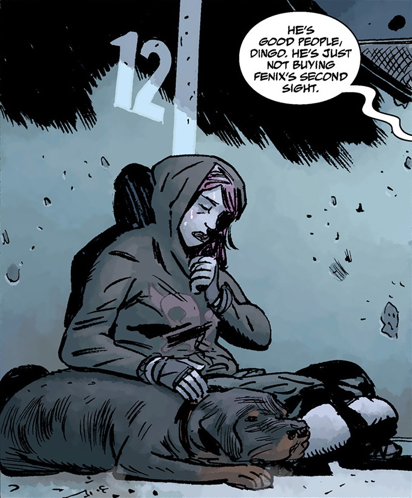
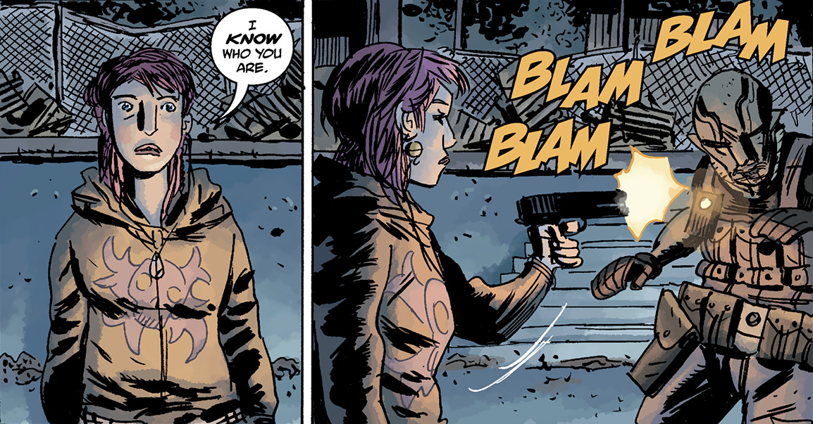
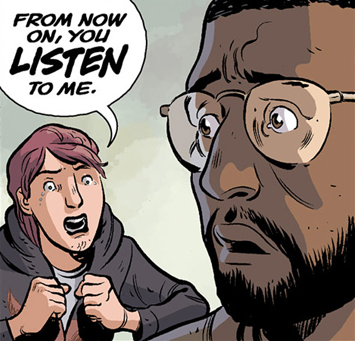
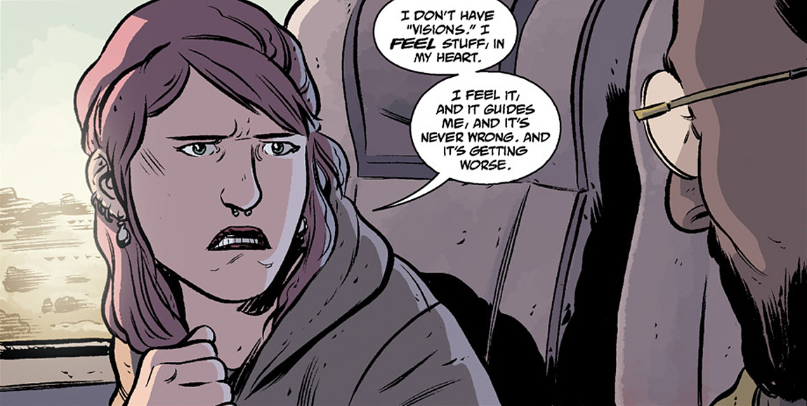

**菲尼克斯·埃斯佩霍（Fenix Espejo）**（发音 *fEh-neeks ehs-pEh-hoh*）是一名十六岁的灵能者，目前无家可归，在全球危机中和许多人一样挣扎求生。由于能够提前感知危险，许多人聚集到她身边寻求指引和保护。当 [B.P.R.D.](/entry/B.P.R.D.) 得知她的存在并前去寻找她时，菲尼克斯开枪击中了[亚伯·塞皮恩](/entry/Abe_Sapien)，险些要了他的命，导致他此后一直无法行动。[安德鲁·德文](/entry/Andrew_Devon)是这一事件的唯一目击者，后来他前去寻找她，要带她一起前往 BPRD 总部。

她是拉丁裔；在西班牙语中，她的名字意为「凤凰」，姓氏意为「镜子」。

## 外貌

菲尼克斯是个少女，有着绿色的眼睛和染成粉色的头发。她身上有好几处穿刺饰品，通常穿着连帽衫和卡其裤，还佩戴各式各样的首饰。由于一直在逃亡路上，她从不换衣服。

## 经历

### [众神](/entry/Gods)

关于菲尼克斯的背景，人们所知甚少。蛙怪瘟疫爆发后，她和其他几个人开始四处迁徙以躲避蛙怪。他们在休斯敦时，菲尼克斯催促他们改变路线，从加尔维斯敦改道北上，并且一直不肯平静下来，直到 他们登上了开往奥斯汀的火车——一座火山喷发后，休斯敦在他们身后陷入火海。一周之后，他们在圣安吉洛时，菲尼克斯再次催促众人动身赶在饥饿的怪物袭击该地区、吞食居民之前离开。她总是知道哪些火车安全、哪里能找到免费的食物和可饮用的水。然而在得克萨斯州时她生了病，灵能感官略微迟钝。丁戈、威利斯和另外几个人去给她找药时，她和豪尔赫在火车站等候，两名警官和一只罗威纳犬在那里发现了他们。警官袭击豪尔赫时，其他人赶了回来，只顾着痛殴警官，菲尼克斯叫他们住手；那只罗威纳犬却跟上了她，后来成了她的伙伴，她给它取名叫布鲁泽。威利斯建议他们在一座废弃的橄榄球场过夜，但菲尼克斯拒绝了，带着众人去了别处。当晚，他们遭到了与袭击圣安吉洛的同类怪物的攻击，若非奉命前来寻找 菲尼克斯的 BPRD 小队把怪物射杀，他们几乎丧命。豪尔赫为了救她被一只怪物杀死，但菲尼克斯活了下来。然而，一见到亚伯，菲尼克斯就抓起豪尔赫的枪；亚伯发现她后，她把他从众人身边引开。尽管亚伯向她保证不会伤害她并做了自我介绍，菲尼克斯还是打断了他，说她知道他是谁，随后开枪将他击倒。德文万分震惊地目睹了整个过程。之后，威利斯回到队伍，为把他们留在危险的地方而道歉，菲尼克斯安慰他说豪尔赫的死不是他的错；BPRD 拘留了丁戈，菲尼克斯告诉大家他们必须前往科罗拉多。

### [恶魔引擎](/entry/The_Devil%27s_Engine)

由于无法抵达科罗拉多，菲尼克斯和她的队伍被困在了新墨西哥州，德文就是在那里找到他们的。在半开玩笑半认真之间，菲尼克斯承认她想联系科罗拉多的政府官员并自首，因为她料想他们有问题要问她。不过她觉得眼下这样反而更容易，因为德文可以为她和布鲁泽支付离开该州的路费。于是众人决定由德文带菲尼克斯去科罗拉多。

然而，由于休斯敦火山喷发产生的烟尘与灰烬遮蔽了天空，德文和菲尼克斯不得不改乘火车而非飞机前往，尽管这名少女对那趟特定的火车感到不安。起初她拒绝上车，但因为布鲁泽已经在火车上，她最终还是上了车。此后她一直焦躁不安、神情紧张，德文对她的态度很不满，质问她是否知道火车会出什么事。菲尼克斯承认她感觉有些不对劲，但由于那只是一种「感觉」，德文并不相信她。

菲尼克斯不肯罢休。她开始尖叫，说他们必须全部下车，否则都会死，甚至动用紧急出口跳下了火车。德文火冒三丈地追了上去，但还没来得及训斥她，脚下的大地就颤抖起来——地震掀翻了火车，把车厢撕成数截，摧毁了铁轨。经历这场磨难后泪流满面的菲尼克斯言辞激烈地告诉德文，下次要听她的。

## 性格

和任何十六岁的少女一样，菲尼克斯有幽默感，不过她的幽默往往比常人更古怪、更愤世嫉俗。[1] 她既无畏又机敏，必要时能当场想出计划或借口。[2] 然而当她感知到危险时，就会因忧虑而焦躁、慌乱，有时听起来会显得冷漠或孩子气。[3] 尽管如此，为了抵达安全之地她会不择手段，有时甚至会做出违背常识的举动。[4]

## 能力与天赋

 菲尼克斯拥有一种类似第六感的能力，使她能够提前察觉危险。据她所说，那是心中的一种感觉，引导着她，而且从未出过错；[5] 不过在她生病期间，这种灵能似乎会变得迟钝。[6] 在潘雅的指导下，菲尼克斯的能力有所增强，能够更有效地运用第六感，B.P.R.D. 进攻津科公司一役便证明了这一点。有趣的是，动物似乎对她很有亲和力，比如那两名警察养的罗威纳犬就跟上了她，如今她亲昵地叫它布鲁泽。[7]

## 人际关系

### [安德鲁·德文](/entry/Andrew_Devon)

虽然菲尼克斯和德文认识的时间不长，但菲尼克斯已经知道德文不是那种会寻仇的人。尽管如此，她并不怎么喜欢他，也不喜欢他不肯听她说话、不肯相信她这一点。

### 布鲁泽

布鲁泽是得克萨斯州两名警察养的罗威纳犬，后来跟上了菲尼克斯，成了她的新伙伴。她非常在乎布鲁泽，以至于尽管她感觉到危险越来越大，还是重新登上了即将开动的火车；她甚至威胁车站的一名工人要他好好照看她的狗。

### [豪尔赫](/entry/Jorge)

菲尼克斯与豪尔赫的关系有多深不得而知，但他亲昵地叫她「小菲」和「宝贝」，非常担心她的安全；她生病时常说他们该带她去看正规医生或住院。他也极为在乎她，在她遇险时甘愿以身涉险，为她献出了生命。

## 语录

### [众神](/entry/Gods)

- 「我*知道*你是谁。」

### [恶魔引擎](/entry/The_Devil%27s_Engine)

- 「哪有这么掉价的绿色贝雷帽出门坐火车的？」
- 「兰博什么时候怕起火山来了？开架战斗机俯冲下来，把我们接走不就行了。」
- 「怎么了，『特种部队』？你紧张什么？拿枪的人可是*你*。」
- 「我没有『幻象』。我是*感觉*到的，用我的心。我感觉到事情，它引导着我，而且从来没出过错。而且这感觉越来越强烈了。」
- 「从现在起，你*得听*我的。」

## 登场

- [B.P.R.D. Hell on Earth: Gods \#1](/entry/Gods)
- [B.P.R.D. Hell on Earth: Gods \#2](/entry/Gods)（仅被提及）
- [B.P.R.D. Hell on Earth: Gods \#3](/entry/Gods)
- [B.P.R.D. Hell on Earth: The Devil's Engine \#1](/entry/The_Devil%27s_Engine)

## 参考资料

<references/>

[1] [B.P.R.D. Hell on Earth: The Devil's Engine \#1](/entry/The_Devil%27s_Engine)

[2] [B.P.R.D. Hell on Earth: Gods \#3](/entry/Gods)

[3] [B.P.R.D. Hell on Earth: Gods \#1](/entry/Gods)

[4]

[5]

[6]

[7]
