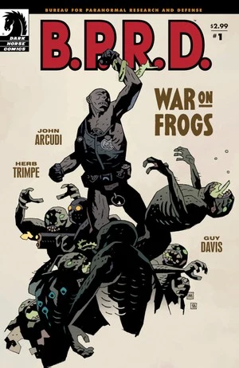
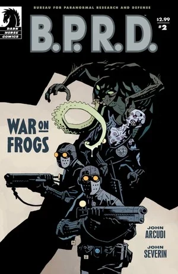
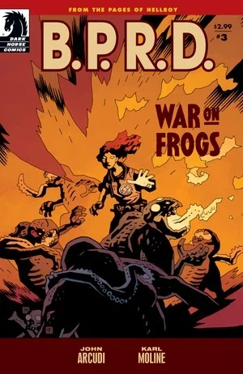
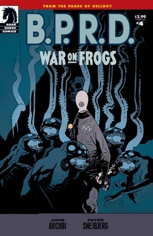
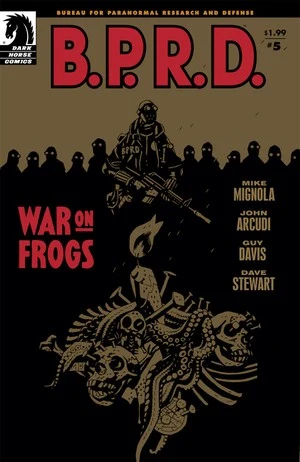

《**蛙人之战**》（*War on Frogs*）是一部四期满载的迷你系列。故事讲述 B.P.R.D. 成员在对抗[蛙怪](/entry/frog_monster)的战争中的经历。每一期都由不同的客座绘者执笔，且各自都是一期完结的独立故事。

## 出版史

这部四期满载的迷你系列于 2008 年 6 月至 2009 年 12 月间出版。2009 年 4 月，该故事与扩充版的 *[复苏](/entry/Revival)*（*Revival*）一同被收录进平装合订本 *[B.P.R.D.: War on Frogs](/entry/Trade_Collections)*。四期故事加上《复苏》被重新编号，排定为一种不同的阅读顺序：

- *War on Frogs* \#1（改题为“第 1 章”）
- *Revival*（改题为“第 2 章”）
- *War on Frogs* \#2（改题为“第 3 章”）
- *War on Frogs* \#4（改题为“第 4 章”）
- *War on Frogs* \#3（改题为“第 5 章”）

2011 年 10 月，短篇故事 *[复苏](/entry/Revival)* 的扩充版由 Dark Horse Digital 重新发行，编号为 *War on Frogs* \#5。

该系列后来以合集形式收录进 *[B.P.R.D.: Plague of Frogs – Volume 2](/entry/Omnibus_Editions)*，同册还包括 *[亡者](/entry/The_Dead)*（*The Dead*）和 *[黑焰](/entry/The_Black_Flame_%28story%29)*（*The Black Flame*）。正如 [Scott Allie](/entry/Scott_Allie) 在序言中所解释的，*War on Frogs* 与 *The Black Flame* 被排进了另一种阅读顺序：

- *The Black Flame* \#1（改题为 *“War on Frogs*：第 1 章”）
- *War on Frogs* \#1（改题为 *“War on Frogs*：第 2 章”）
- *Revival*（改题为 *“War on Frogs*：第 3 章”）
- *War on Frogs* \#2（改题为 *“War on Frogs*：第 4 章”）
- *War on Frogs* \#4（改题为 *“War on Frogs*：第 5 章”）
- *The Black Flame* \#2-6（改题为 *“The Black Flame*：第 1–5 章”）
- *War on Frogs* \#3（改题为 *“The Black Flame*：尾声”）

## 剧情梗概

### 第一部分

第一期由 Herb Trimpe 作画，聚焦于[罗杰](/entry/Roger)。

随着蛙怪邪教蔓延全美，人造人罗杰回到了 B.P.R.D. 与蛙怪生物首次交锋的地点——卡文迪什庄园（Cavendish Hall）的废墟。当年[地狱男爵](/entry/Hellboy_%28character%29)、[亚伯](/entry/Abe_Sapien)和[丽兹](/entry/Liz_Sherman)正是在那里第一次同时遭遇了蛙怪和[拉斯普廷](/entry/Rasputin)。罗杰此行是为了追查卡文迪什家族之谜的最后几块拼图。

此前，[凯特](/entry/Kate_Corrigan)曾提议重返卡文迪什庄园（即 *[毁灭之芽](/entry/Seed_of_Destruction)* 中事件的发生地）寻找有关蛙怪的线索，但亚伯拒绝了这个提议；于是罗杰率领一支 B.P.R.D. 外勤小队前往该地调查。罗杰前往庄园废墟下方的洞穴侦察，在那里发现了卡文迪什兄弟为亡母设立的神龛，其中还安放着她经过保存的尸体。兄弟俩显露真身——他们是某种进化形态的蛙怪。一场漫长的战斗之后，一发流弹击毁了艾玛·卡文迪什（Emma Cavendish）的尸体，怪物们因此分了神，罗杰趁机占据上风。趁兄弟俩对着母亲的尸体悲痛之际，罗杰举枪齐射将他们消灭。清理小组赶到时，罗杰却陷入沉思：当初惊扰这些蛙怪究竟值不值得。最终他命令清理小组就此撤离，不再采取进一步行动。

### 第二部分

第二期由 [John Severin](/entry/John_Severin) 作画，聚焦一队普通的 B.P.R.D. 士兵：他们登上一艘废弃战舰追捕一窝蛙怪——结果反而成了猎物的盘中餐。本期有数名 B.P.R.D. 探员首次也是最后一次登场，他们大概都是从军队征召来的。

2005 年 5 月，一支 B.P.R.D. 士兵小队被派往加利福尼亚海岸，调查一艘废弃战舰上可能存在的蛙怪巢穴。在布拉德利中尉（Lieutenant Bradley）的带领下，Varadi、Demers、Bernie D'Andrea、Whitcomb、Bama 和 Kohler 等探员登上了这艘沉船。他们在船上令人窒息的狭窄走廊中探索时，发现蛙怪可能仍然活着。小队成员接二连三地被蛙怪悄悄除掉，[亚伯·塞皮恩](/entry/Abe_Sapien)只能无助地通过无线电听着这一切。最后，队中仅存的 Demers 冲上甲板，迎面撞上一头蛙怪。手无寸铁的 Demers 抄起一根断裂的铁管武装自己，准备奋战至死。故事的最后几页，一名陆军少校抵达现场，通过无线电与亚伯联络。他透露船上其实只有一头蛙怪，并赞扬 Demers 不惜牺牲自己的生命斩杀了怪物，英勇可嘉。

### 第三部分

第三期由 [Karl Moline](/entry/Karl_Moline) 作画，聚焦于[丽兹·谢尔曼](/entry/Liz_Sherman)和新角色[阿什利·斯托德](/entry/Ashley_Strode)。

时间设定在 2006 年 7 月，阿什利在 [B.P.R.D.](/entry/Bureau_for_Paranormal_Research_and_Defense)食堂里向消沉冷漠的丽兹打招呼。被丽兹无视之后，阿什利和同事们聊起自己多么钦佩丽兹，视她为 B.P.R.D. 中一位坚强的女性榜样，但她也担心，自从[*B.P.R.D.: The Black Flame*](/entry/The_Black_Flame_%28story%29)的事件之后，丽兹的状态就一直不太对劲。

闪回至 2005 年 4 月，丽兹在路易斯安那州的一座污水处理厂捣毁了一个蛙怪巢穴。[达米奥](/entry/Ben_Daimio)对丽兹这种不计后果的任务处理方式表示担忧，丽兹却对他的话不屑一顾。一名 B.P.R.D. 同伴向阿什利·斯托德讲述了丽兹的悲惨过往。

在一组蒙太奇画面中，丽兹在整个 2005 年间率领 B.P.R.D. 外勤小队，先后清剿了艾奥瓦州、华盛顿州、犹他州和俄勒冈州的蛙怪巢穴。

2006 年 2 月，在 B.P.R.D. 总部，阿什利和搭档在走廊里遇到丽兹，阿什利试图自我介绍。但丽兹态度冷淡、心不在焉，甚至没有问她的名字。

在与[凯特](/entry/Kate_Corrigan)和[亚伯](/entry/Abe)的会议上，丽兹提起亚伯不愿参与外勤工作一事。然而凯特批评了丽兹近来执行任务的方式，建议她把精力放在培养探员的能力上，而不是一味追求冷酷的效率。带着这番告诫，丽兹被派去率领一支队伍，前往蒙大拿州汉德尔森（Handelson）查看一个已被废弃的蛙怪巢穴。

B.P.R.D. 小队在现场搜索，丽兹检查地下层，阿什利和搭档搜索楼上。丽兹走出楼时以为现场已经安全。与此同时，阿什利和搭档遭到蛙怪伏击。阿什利被击昏，她的搭档被怪物杀害。就在阿什利即将被杀之际，丽兹及时赶到扭转了局面。阿什利很快恢复过来，帮丽兹消灭了剩下的蛙怪。任务结束时，两人已经以名字相称，友好地道别。

闪回段落结束，本期回到开篇的 B.P.R.D. 食堂场景，阿什利和同事们对丽兹眼下的精神状态百思不解。

在最后几个画格中，我们得以窥见丽兹的视角。那位[神秘术士](/entry/Memnan_Saa)——他曾在[*B.P.R.D.: The Black Flame*](/entry/The_Black_Flame_%28story%29)中向丽兹现身——站在丽兹身后，如影随形，始终笼罩着她。

### 第四部分

第四期也是最后一期，由 Peter Snejbjerg 作画，Bjarne Hansen 上色。故事聚焦于[约翰·克劳斯](/entry/Johann_Kraus)。

灵质之身的约翰·克劳斯率领一队 B.P.R.D. 探员，迎击正在全国蔓延的蛙怪。但这一次，烧掉蛙怪巢穴对约翰来说并不是战斗的终点——因为他得知了调查局这些死敌死后那令人毛骨悚然的归宿。

2006 年 3 月，约翰率领一支外勤小队前往堪萨斯州清剿一个蛙怪巢穴。迅速消灭蛙怪之后，约翰命令[卡特利特探员](/entry/Agent_Catlett)烧掉残骸。然而，除了约翰之外无人看见：它们的鬼魂留了下来。约翰简短地劝这些鬼魂试着往生离去。尽管如此，它们还是跟着小队一路纠缠，直到他们返回 B.P.R.D. 总部。鬼魂们开始让卡特利特探员生病，以此要挟约翰帮助它们。在与[本·达米奥](/entry/Ben_Daimio)讨论了这个问题、并眼见卡特利特病情恶化之后，约翰被说服出手帮助这些蛙怪。他以灵魂形态将它们引向高空，并举行了一场降神会。一道巨大的裂缝撕开，通往另一个存在位面，蛙怪的灵魂得以超度飞升。然而，约翰自己的灵魂也险些被拖入深渊，但他最终挣脱了出来。回到 B.P.R.D. 总部后，有人看到约翰正在诵读圣经。达米奥走上前来，为自己此前轻视约翰所面对的生死之险而道歉。

注：这最后一场戏以及与达米奥的对话，后来在 [The Long Death](/entry/The_Long_Death) 中约翰所做的一个梦里被再次提及。

### 第五部分

*完整条目见[复苏](/entry/Revival)*

[本·达米奥](/entry/Ben_Daimio)追捕伪装成信仰疗法术士的蛙怪。

## 内容

注 1：此处不包括 [The Black Flame](/entry/The_Black_Flame_%28story%29) \#1 的内容——在所有合订版本中，该期都被重新包装为[蛙人之战](/entry/War_on_Frogs)的第一章。
注 2：此处包括[蛙人之战](/entry/War_on_Frogs) \#3 的内容——在所有合订版本中，该期充当 [The Black Flame](/entry/The_Black_Flame_%28story%29) 的尾声。
注 3：第五部分的内容见[复苏](/entry/Revival)。

### 第一部分

#### 角色

- [B.P.R.D.](/entry/Bureau_for_Paranormal_Research_and_Defense)
  - [凯特·考瑞根](/entry/%E5%87%AF%E7%89%B9%C2%B7%E8%80%83%E7%91%9E%E6%A0%B9))
  - [亚伯拉罕·赛皮恩](/entry/Abraham_Sapien)
  - [罗杰](/entry/Roger)
  - Mazzei 探员
  - 其他探员
- [地狱男爵](/entry/Hellboy_%28character%29)（闪回）
- [拉斯普廷](/entry/Rasputin)（闪回）
- [奥格德鲁·赫姆](/entry/Ogdru_Hem)
  - [萨杜-赫姆](/entry/Sadu-Hem)（闪回）
- 卡文迪什家族
  - 艾玛·卡文迪什（尸体与照片）
  - 两兄弟（化作了[蛙怪](/entry/Frog_monster)）

#### 地点

- 美国
  - [B.P.R.D.](/entry/Bureau_for_Paranormal_Research_and_Defense)总部（科罗拉多州）
  - [卡文迪什庄园](/entry/Cavendish_Hall)废墟（纽约州北部塔卢塔湖，Lake Talutah）

### 第二部分

#### 角色

- [B.P.R.D.](/entry/Bureau_for_Paranormal_Research_and_Defense)
  - [亚伯拉罕·赛皮恩](/entry/Abraham_Sapien)
  - 布拉德利中尉
  - Demers、Varadi、Bama、Kohler、Whitcomb 和 D'Andrea 等探员
  - [凯特·考瑞根](/entry/%E5%87%AF%E7%89%B9%C2%B7%E8%80%83%E7%91%9E%E6%A0%B9))
- [地狱男爵](/entry/Hellboy_%28character%29)（闪回）
- [蛙怪](/entry/Frog_monster)
- 军方人员

#### 地点

- 美国
  - [B.P.R.D.](/entry/Bureau_for_Paranormal_Research_and_Defense)总部（科罗拉多州）
  - 废弃船只（加利福尼亚海岸）

### 第三部分

#### 角色

- [B.P.R.D.](/entry/Bureau_for_Paranormal_Research_and_Defense)
  - [伊丽莎白·谢尔曼](/entry/Elizabeth_Sherman)
  - [阿什利·斯托德](/entry/Ashley_Strode)
  - [约翰·克劳斯](/entry/Johann_Kraus)（闪回）
  - [本杰明·达米奥](/entry/Benjamin_Daimio)（闪回）
  - [罗杰](/entry/Roger)（闪回）
  - [凯特·考瑞根](/entry/%E5%87%AF%E7%89%B9%C2%B7%E8%80%83%E7%91%9E%E6%A0%B9))（闪回）
  - [亚伯拉罕·赛皮恩](/entry/Abraham_Sapien)（闪回）
  - 其他探员
- 老妇人（闪回）
- [蛙怪](/entry/Frog_monster)（闪回）
- [姆姆南·萨](/entry/Memnan_Saa)

#### 地点

- 美国
  - [B.P.R.D.](/entry/Bureau_for_Paranormal_Research_and_Defense)总部（科罗拉多州）
  - 各处任务地点：路易斯安那州、艾奥瓦州、华盛顿州、犹他州和俄勒冈州（闪回）
  - 谢尔曼宅邸（堪萨斯城）（闪回）
  - 废弃药房（蒙大拿州汉德尔森）（闪回）

#### 重要物品

- [姆姆南·萨](/entry/Memnan_Saa)的花（闪回）

### 第四部分

#### 角色

- [B.P.R.D.](/entry/Bureau_for_Paranormal_Research_and_Defense)
  - [约翰·克劳斯](/entry/Johann_Kraus)
  - [本杰明·达米奥](/entry/Benjamin_Daimio)（闪回）
  - 其他探员
- [蛙怪](/entry/Frog_monster)

#### 地点

- 美国
  - 堪萨斯州的谷仓
  - [B.P.R.D.](/entry/Bureau_for_Paranormal_Research_and_Defense)总部（科罗拉多州）

## 画廊

 \#1

 \#2

 \#3

 \#4

 \#5
