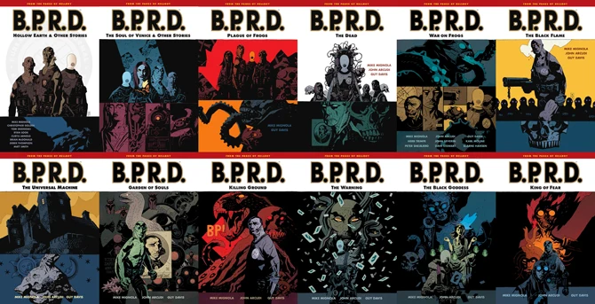

***《蛙族瘟疫》***是 *[B.P.R.D.](/entry/B.P.R.D._%28series%29)* 故事的第一个大系列（story cycle）。

在 *[恐惧之王](/entry/King_of_Fear_%28story%29)* 第 5 期出版后，官方宣布此后的 *B.P.R.D.* 故事将归入 [*BPRD：人间地狱*](/entry/BPRD%3F%E4%BA%BA%E9%97%B4%E5%9C%B0%E7%8B%B1)) 的标题之下。此前所有的 B.P.R.D. 作品则统一归入《蛙族瘟疫》名下，使其成为第一个故事大系列。

此后出版的若干 *B.P.R.D.* 故事并未收录进 [*B.P.R.D.: Plague of Frogs* 全集版](/entry/Omnibus_Editions)。这些故事的时间线设定在《蛙族瘟疫》大系列之前，被收录进平装合订本 *[B.P.R.D.: Being Human](/entry/TPB)*。

## 收录故事

- [*B.P.R.D.* 宣传漫画](/entry/B.P.R.D._%28teaser%29)（2001 年 12 月 – 2002 年 2 月）
- *[空心地球](/entry/Hollow_Earth)* \#1–3（2002 年 1 月 – 6 月）
- *[威尼斯之魂](/entry/The_Soul_of_Venice)*（2003 年 5 月）
- *[黑水之域](/entry/Dark_Waters)*（2003 年 7 月）
- *[午夜列车](/entry/Night_Train)*（2003 年 9 月）
- *[床下有鬼](/entry/There%27s_Something_Under_My_Bed)*（2003 年 11 月）
- *[外勤探员的日常](/entry/Another_Day_at_the_Office)*（2004 年 8 月）
- *[蛙族瘟疫](/entry/Plague_of_Frogs_%28story%29)* \#1–5（2004 年 3 月 – 7 月）
- *[重生](/entry/Born_Again)*（2004 年 3 月）
- *[斯人已逝](/entry/The_Dead)* \#1–5（2004 年 11 月 – 2005 年 3 月）
- *[黑焰使徒](/entry/The_Black_Flame_%28story%29)* \#1–6（2005 年 8 月 – 2006 年 1 月）
- *[万能机械](/entry/The_Universal_Machine)* \#1–5（2006 年 4 月 – 8 月）
- *[灵魂花园](/entry/Garden_of_Souls)* \#1–5（2007 年 3 月 – 7 月）
- *[杀戮地带](/entry/Killing_Ground)* \#1–5（2007 年 8 月 – 12 月）
- *[Revival](/entry/Revival)*（2008 年 3 月）
- *[蛙人之战](/entry/War_on_Frogs)* \#1–4（2008 年 6 月、12 月；2009 年 6 月、12 月）
- *[遥不可及](/entry/Out_of_Reach)*（2008 年 5 月）
- *[厄运之兆](/entry/The_Warning)* \#1–5（2008 年 7 月 – 11 月）
- *[黑暗女神](/entry/The_Black_Goddess)* \#1–5（2009 年 1 月 – 5 月）
- *[恐惧之王](/entry/King_of_Fear_%28story%29)* \#1–5（2010 年 1 月 – 5 月）

尽管下列故事严格来说并不属于《蛙族瘟疫》大系列，它们仍被收录进 [《蛙族瘟疫》全集版](/entry/Omnibus_Editions)：

- *[Abe Sapien versus Science](/entry/Abe_Sapien_versus_Science)*（1999 年 9 月）
- *[Abe Sapien: Drums of the Dead](/entry/Drums_of_the_Dead)*（1998 年 3 月）
- *[Lobster Johnson: The Killer in My Skull](/entry/The_Killer_in_My_Skull)*（1999 年 8 月）。

其中那篇大螯虾·强生的故事，在 2022 年重新包装的全集版中被移除，因为它已被收录进第二部[大螯虾·强生](/entry/Lobster_Johnson_%28series%29)全集。

## 合订本

《蛙族瘟疫》最初与其他 B.P.R.D. 故事一道，被收入未冠以大系列标题的[平装合订本](/entry/TPB)。

*收录《蛙族瘟疫》大系列故事的 12 册 B.P.R.D. 平装合订本。*

《蛙族瘟疫》大系列后来又被重新整理为[全集版](/entry/Omnibus_Editions)。为获得更好的阅读体验，全集对故事顺序做了小幅调整，并扩充了创作草图集。

*《B.P.R.D.: Plague of Frogs》全集版，共四卷。*
