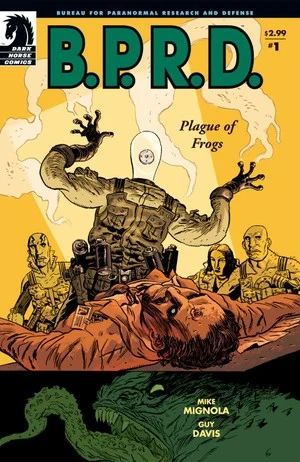
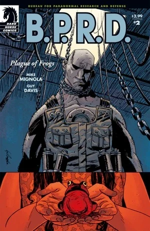
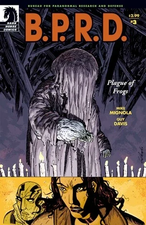
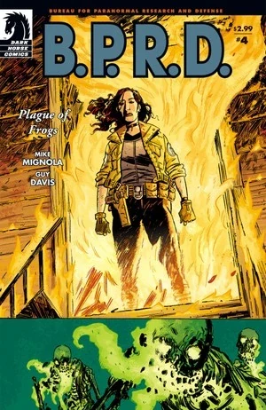
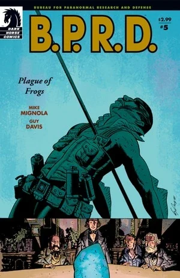

*本条目介绍的是*Plague of Frogs*迷你系列。关于故事循环，见*[蛙族瘟疫（故事循环）](/entry/Plague_of_Frogs_%28story_cycle%29)。

《**蛙族瘟疫**》（Plague of Frogs）是一部五期迷你系列，由 [Mike Mignola](/entry/Mike_Mignola) 编剧、[Guy Davis](/entry/Guy_Davis) 绘制。

## 出版历史

继 2003 年出版的四个单篇 [B.P.R.D.](/entry/B.P.R.D.) 故事（《[威尼斯之魂](/entry/The_Soul_of_Venice)》（The Soul of Venice）、《[暗水](/entry/Dark_Waters)》（Dark Waters）、《[夜车](/entry/Night_Train)》（Night Train）和《[我的床底下有东西](/entry/There%27s_Something_Under_My_Bed)》（There's Something Under My Bed））之后，[Mike Mignola](/entry/Mike_Mignola) 改变了方向，回归[《毁灭之芽》](/entry/Seed_of_Destruction)的主题。[1]

这部五期迷你系列于 2004 年 3 月至 7 月出版。这是 [Guy Davis](/entry/Guy_Davis) 第一次为 [Mike Mignola](/entry/Mike_Mignola) 的剧本作画。故事于 2005 年 2 月收录于平装合订本《[B.P.R.D.: Plague of Frogs](/entry/Trade_Collections)》。

## 剧情简介

### 第一部分

在新泽西州的一处 [B.P.R.D.](/entry/B.P.R.D.) 实验室里，一位真菌学家向前来访问的同行展示他最新的研究成果——一块以异常形态迅速生长的巨大真菌。突然，来访教授从背后开枪射中了这位博士。保安冲了进来，那名男子却呼唤着他的“主人”。枪声大作，整栋建筑陷入黑暗。

[亚伯·塞皮恩](/entry/Abe_Sapien) 坐在海中，看着人们的躯体沉入深渊。他听见《[唤醒恶魔](/entry/Wake_the_Devil)》#5 中死去的神父对他说过的同样话语：“你听见了吗……沉没的钟声正为你敲响。从 Num-Yabisc 黑暗而恐怖的深渊洞穴中，大海正在召唤她的孩子们……回家。”他随着下沉的躯体走向一片亮光，猛然惊醒。

[凯特·考瑞根](/entry/Kate_Corrigan)召集队伍，众人前往新泽西展开调查。监控录像显示，教授开枪击中研究员，随后被两名保安击毙。真菌的容器被枪弹打碎，真菌似乎进入了教授体内，接着大楼的电源被切断。亚伯、[丽兹·舍曼](/entry/Elizabeth_Sherman)、[罗杰](/entry/Roger)和[约翰·克劳斯](/entry/Johann_Kraus)进入大楼。亚伯和丽兹搜查楼下，罗杰和约翰则检查博士的办公室。

亚伯和丽兹一边探查一边交谈。亚伯说他担心罗杰。丽兹回答说，他们了解罗杰的过去，也知道她和约翰身上发生过什么；他们唯一不了解的，是亚伯的过去。

罗杰和约翰找到了博士的尸体，他前额上留下了某种印记。与此同时，一名失踪的保安变成了[青蛙怪物](/entry/Frog_monster)，袭击亚伯和丽兹。另一名保安如今也变成怪物，一并攻来，不过亚伯杀死了它们。楼上，博士站起身来发动攻击，也变成了青蛙怪物。罗杰设法杀死了那只怪物。

### 第二部分

回到康涅狄格州的 B.P.R.D. 总部，探员们检查这些蛙怪。一枚真菌孢子进入了每人的头部，引发了变异。亚伯和罗杰都回忆起以前见过类似的生物：亚伯是在卡文迪什庄园（见《[毁灭之芽](/entry/Seed_of_Destruction)》），罗杰是在洪特城堡（见《[征服之虫](/entry/Conqueror_Worm_%28story%29)》）。[奥唐纳教授](/entry/Professor_James_Henry_O%27Donnell)说那是[萨杜-赫姆](/entry/Sadu-Hem)，并冲[托马斯·曼宁](/entry/Thomas_Manning)大发雷霆。曼宁解释说，每隔六个月就有一支小队检查卡文迪什庄园。十年来那里毫无生命迹象，后来却发现了一小块真菌。他们把样本转移到新泽西的存储设施，任其生长。

由于德比教授的尸体仍然下落不明，他们调查他的生平，寻找任何异常行为。他们发现，他最近开始向总部位于密歇根州蟹角镇的“新奥秘神庙”（The New Temple of Mysteries）捐出大笔金钱。小队飞赴当地进一步调查。抵达时，整座城镇看起来已被废弃。[约翰](/entry/Johann)感觉到一座旧教堂里有动静。教堂内，一名身着长袍的男子正在向会众布道，告诉他们敌人已经降临，但不必害怕。

突然，搭载探员的直升机坠毁。罗杰摔出机外，与队伍失散。他找到一个小女孩，试图帮助她，可她其实也是一只青蛙怪物。怪物发起攻击，罗杰被一条链子吊住脖子，悬在半空。

与此同时，在坠毁的直升机里，昏迷的亚伯·塞皮恩再次听见一个声音呼唤：“你听见了吗……沉没的钟声正为你敲响”，眼前浮现出躯体下沉的景象。

### 第三部分

在坠毁的直升机里，凯特·考瑞根用无线电向总部请求支援，但信号没能发出去，探员们只能自力更生。

在新奥秘神庙内，亚伯、丽兹、约翰和幸存的飞行员受伤倒在地上。站在他们面前的是首领和一个被遮盖的巨大身影。那个被首领称作萨杜-赫姆的遮盖身影伸出手，将飞行员变成青蛙怪物。约翰试图阻止那人，但全体会众——全都是蛙怪——拦住了他，毁掉了他的容器。袍下的身影显露真身，是一个人菌混合的怪物；那怪物用某种方式迫使约翰逃离了房间。

丽兹用她的能力点燃怪物萨杜-赫姆，将其杀死。然而它的精魂渗入地下，赋予墓地里的尸体以生命。发光的骷髅袭击凯特。丽兹前去营救凯特，亚伯则追踪邪教首领。

### 第四部分

丽兹点燃神庙中残余的蛙怪，随即冲出去营救凯特。她将墓地里行走的骷髅烧成灰烬，彻底消灭了萨杜-赫姆。

与此同时，亚伯搜查一座老旧大宅，寻找邪教首领。他找到一些关于一个名叫 Humbert T. Jones 的男孩的剪报，还发现了一座[拉斯普廷](/entry/Rasputin)神龛。邪教首领袭击亚伯，用一根长矛将他刺穿，应验了拉斯普廷的预言（见《[唤醒恶魔](/entry/Wake_the_Devil)》#5）。亚伯开枪击中那人，两人一同从附近的窗户摔了出去。

两人流着血坐在树林里。亚伯意识到，邪教首领其实就是男孩亨伯特，他的青春被[奥古·桀哈](/entry/Ogdru_Jahad)夺走了。他说自己和拉斯普廷一样是被选中的人。他侍奉萨杜-赫姆，让它的孩子们——蛙怪——降临世间。亚伯说 B.P.R.D. 会抓到那些蛙怪，但亨伯特回答说，总会有一些逃脱并聚集起来，唤醒旧神。这继而将导致世界的终结，以及一个新世界的开端。使命既成，亨伯特走进火焰中死去。

亚伯奄奄一息地躺着，约翰来到他身边想带他重返生者的世界，亚伯却悄然离去。丽兹和凯特赶到，约翰只能告诉他们，亚伯走了。

### 第五部分

小队周围的整座城镇都在燃烧，其他 B.P.R.D. 探员冲了进来。

亚伯沉入海中，进入一座巨大的水下神庙。[2] 在里面他看见一个[水灵](/entry/Water_Spirit)。时光在他眼前流逝，那生物形成了一个类似茧的东西。茧如今已经裂开，一名孤身潜水者进入神庙，取走了茧。

亚伯被带到维多利亚时代。一场雷暴中，青蛙从天而降。亚伯穿过一个书架，走进一场秘密集会。四名男子围坐在茧旁，另一人站在他们面前。那人举起茧，开始吟唱。茧碎裂开来，水灵被吸入那人体内。突然，那人——[考尔](/entry/Caul)——能够看见亚伯了，他喝令亚伯退后。亚伯走上前，与考尔融为一体。他们把他放进水中，但最终因 Abraham Lincoln 遇刺而被迫离开考尔。

亚伯醒来，同伴探员们围在他身边。一些探员徒劳地试图捕获所有青蛙怪物。另一些探员找回并救活了[罗杰](/entry/Roger)。

## 故事年表

虽然没有明说，但《Plague of Frogs》的事件发生在 2004 年 7 月之前的某个时候。《Plague of Frogs》#2 中说，这些事件发生在 1994 年《[毁灭之芽](/entry/Seed_of_Destruction)》的十年之后。根据《[Revival](/entry/Revival)》重印版的引子，到那年 7 月，[青蛙怪物](/entry/Frog_monster)已经四处蔓延。

## 内容

### 角色

#### [B.P.R.D.](/entry/Bureau_for_Paranormal_Research_and_Defense)

- [亚伯·塞皮恩](/entry/Abraham_Sapien)
- [约翰·克劳斯](/entry/Johann_Kraus)
- [丽兹·舍曼](/entry/Elizabeth_Sherman)
- [凯特·考瑞根](/entry/%E5%87%AF%E7%89%B9%C2%B7%E8%80%83%E7%91%9E%E6%A0%B9)
- [罗杰](/entry/Roger)
- 存储设施工作人员
  - Platt 博士
  - Howard（保安）
- [托马斯·曼宁](/entry/Thomas_Manning)
- 前成员
  - [地狱男爵](/entry/Hellboy_%28character%29)（被提及）
  - [特雷佛·布鲁姆](/entry/Trevor_Bruttenholm)（被提及）
- [J·H·奥唐纳教授](/entry/J%C2%B7H%C2%B7%E5%A5%A5%E5%94%90%E7%BA%B3%E6%95%99%E6%8E%88)
- Jim

#### [奥格德鲁·赫姆](/entry/Ogdru_Hem)相关

- 新奥秘神庙
  - Irwin Derby
  - 蟹角镇居民（变为[青蛙怪物](/entry/Frog_monster)）
  - Humbert T. Jones
- [奥格德鲁·赫姆](/entry/Ogdru_Hem)
  - [萨杜-赫姆](/entry/Sadu-Hem)
- [青蛙怪物](/entry/Frog_monster)（前身为 B.P.R.D. 存储设施工作人员）
- Cavendish 家族（闪回）
  - Emma Cavendish（尸体）（闪回）
  - 三兄弟（变为[青蛙怪物](/entry/Frog_monster)）（闪回）
- [格里高利·拉斯普廷](/entry/Grigori_Rasputin)（照片与闪回）
- [Sven Olafson](/entry/Sven_Olafson)（被提及）
- [奥古·桀哈](/entry/Ogdru_Jahad)（被提及）
- 活骷髅

#### 其他

- [克洛阿喀娜](/entry/Cloacina)（被提及）
- 成都事件受害者（闪回）
- 特警队员
- 亚伯的幻象／闪回／灵魂时空之旅
  - [水灵](/entry/Water_Spirit)
  - [奥安尼斯学会](/entry/Oannes_Society)
    - Langdon Everett Caul（变异前的[亚伯·塞皮恩](/entry/Abraham_Sapien)）
    - 其他成员

### 地点

- 美国
  - [B.P.R.D.](/entry/Bureau_for_Paranormal_Research_and_Defense)存储设施（新泽西州）
  - [B.P.R.D.](/entry/Bureau_for_Paranormal_Research_and_Defense)总部（康涅狄格州费尔菲尔德）
  - Sherman 宅邸（堪萨斯城）（闪回）
  - St. Trinian's 医院（华盛顿特区）（闪回）
    - [奥安尼斯学会](/entry/Oannes_Society)聚会地（闪回）
  - [卡文迪什庄园](/entry/Cavendish_Hall)（纽约州北部）（闪回）
  - 密歇根州蟹角镇
  - 密歇根／威斯康星州边界
- 罗马尼亚（闪回）
  - Czege 城堡（Fălticeni）下[埃德尔·米施拉塞](/entry/Edel_Mischrasse)的作坊（闪回）
- 德国（闪回）
  - Krauss 宅邸（海德堡）（闪回）
- 大西洋
  - Num-Yabisc 洞穴

### 值得注意的物品

- [奥安尼斯学会](/entry/Oannes_Society)
  - 潜水服（闪回）
  - 潜水艇（闪回）

## 画廊

 \#1

 \#2

 \#3

 \#4

 \#5

## 注释

<references/>

[1] 在《Plague of Frogs》#1 的[Hellmail](/entry/Hellmail)中，[Scott Allie](/entry/Scott_Allie)称这部漫画是“米格诺拉漫画世界中一个全新的方向”，并把故事接回《[毁灭之芽](/entry/Seed_of_Destruction)》的理念。

[2] 虽未明说，但这里几乎可以肯定就是 Num-Yabisc 洞穴。
