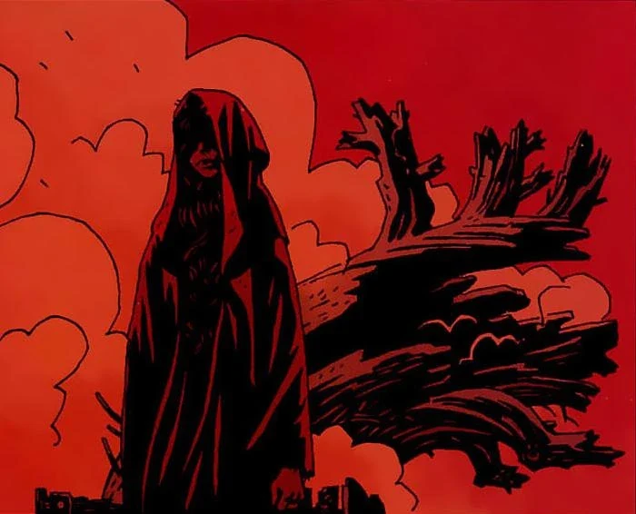
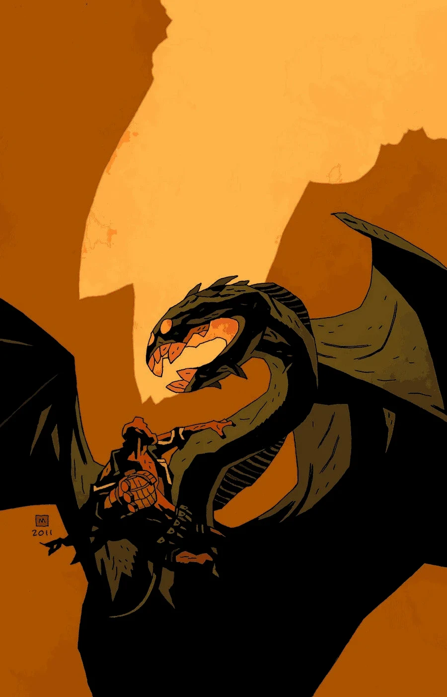
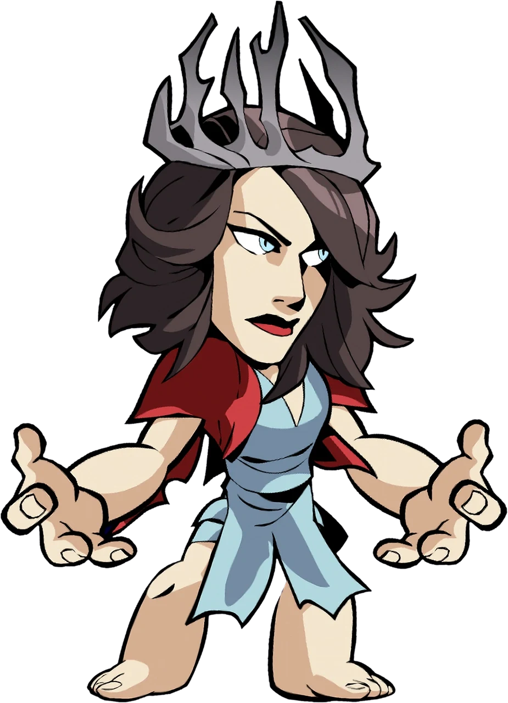

**尼缪（Nimue）**，又称“血皇后”或“湖中仙女”，是不列颠最伟大的女巫。她是“[荒野狩猎](/entry/The_Wild_Hunt)三部曲”——出自《*[地狱男爵](/entry/Hellboy_%28series%29)*》漫画——的主要反派。尼缪是一位强大的女巫，生活在亚瑟王时代。由于力量太强，她被不列颠其他女巫囚禁了1500年，复活之后率领荒野狩猎。

## 历史

尼缪生活在[亚瑟王](/entry/King_Arthur)时代，深受[梅林](/entry/Merlin)宠爱，梅林把自己所有的秘密都告诉了她。她利用这些知识把他永远囚禁在一座坟墓之中。但失去梅林的指引后，尼缪所掌握的魔法知识使她走向疯狂，最终开始崇拜[奥古·桀哈](/entry/Ogdru_Jahad)。她疯狂得太过厉害，其他[女巫](/entry/witches)便杀死了她，把她切成许多块、撒遍大地。然而碎块总会重新聚合，于是女巫们把碎块封进一只木箱，深埋地下。

几个世纪后，在《[黑暗召唤](/entry/Darkness_Calls)》的事件中，[赫卡特](/entry/Hecate)被[伊戈尔·布罗姆黑德](/entry/Igor_Bromhead)囚禁，不列颠的女巫们试图寻找一位新领袖。她们把这份荣耀给予地狱男爵，却被他一口回绝。于是[格鲁阿加赫](/entry/Gruagach)来到她们的集会上，提名尼缪。女巫们虽有顾虑，最终还是同意了，交给格鲁阿加赫一封信，准许他和两名同伴进入封存尼缪箱子的墓穴。看守墓穴的巨人看到信后，别无选择，只能解除封印、取出尼缪的箱子。做完这一切，巨人爬进坑洞，把封盖拖到自己身上——尽管格鲁阿加赫许诺一个光辉的新世界即将到来。巨人说，他宁愿孤独流放，也不愿看到释放尼缪会招来的东西。

 在《[荒野狩猎](/entry/The_Wild_Hunt)》的事件中，箱子仍在格鲁阿加赫手中，但他无法复活尼缪。化作人形的[阿斯塔罗斯](/entry/Astaroth)找上门来，交给他一只圣餐杯，杯中盛着附近一个人类村庄所有居民的鲜血。格鲁阿加赫把血倒入箱中后，血皇后就此升起。

与残存的英格兰女巫算清账之后（大多数女巫为逃避她的怒火、躲避即将降临世界的恐怖而投水自尽），尼缪下令为她集结一支军队。等待军队期间，格鲁阿加赫只求两件事：恢复他的力量，把地狱男爵交给他。她许诺时机一到便会照办。

尼缪迎来了第一位使者，来自日德兰的乌兹维克王。国王的大使献上一顶金冠，许诺他和北方所有国王都会率军队投奔她。尼缪没有接受王冠，而是命大使把金冠锤打成一把刀，用它谋杀自己的国王，再剜出国王的心脏丢进熔炉焚烧，用灰烬锻造一顶铁盔，造型为三只连为一体的渡鸦，分别刻上巴德布、玛查和莫-莉奥甘的名字。尼缪说她用不着王冠，因为她不再是女巫之后，而是战争女神。

后来，当地狱男爵取回[王者之剑](/entry/Excalibur)时，尼缪猜不透[摩根勒菲](/entry/Morgan_Le_Fey)有何图谋，却说这已无关紧要。她继续等待大军到来，格鲁阿加赫则不断恳求她履行恢复其力量的承诺。当他暗示她还不够强大、做不到这一点时，她勃然大怒，把他抛到一边，随后带着追随者消失。

### [风暴](/entry/The_Storm)与[狂怒](/entry/The_Fury)

化作巨龙的尼缪，被奥古·桀哈改造

尼缪杀死[梅布王后](/entry/Queen_Mab)，用她的血赐予一个听命于她的妖精力量去刺杀地狱男爵，随后开始集结军队。另一边，地狱男爵挥动王者之剑，从坟墓中唤起一支不列颠骑士大军与她对抗。尼缪没有意识到的是，[奥古·桀哈](/entry/Ogdru_Jahad)已选中她作为重返世界的容器，真相显露之际，她的身体开始异变。

当地狱男爵赶到、击落她的头盔时，尼缪已被奥古·桀哈彻底附身，在两军厮杀之际变形成一头巨龙般的怪物。[爱丽丝·莫娜汉](/entry/Alice_Monaghan)从梅布王后的灵魂那里得知，这场战斗将标志着世界末日的开端，而地狱男爵的使命是确保朋友们活下来，使人类能够熬过这个时代的终结。

[瓦西丽萨](/entry/Vasilisa)递给地狱男爵一把剑——剑由构成尼缪头盔的一只渡鸦所化，凭借着主人残存的人性自行其事——地狱男爵用它杀死了尼缪。尼缪的灵魂飘出躯体，发觉自己正被英格兰溺亡女巫的鬼魂拖向[地狱](/entry/Hell)。但尼缪拒绝孤独赴死，她掏出地狱男爵的心脏，把他一起拖下了地狱。

## 能力与本领

**[魔法](/entry/Magic)**：尼缪是一位极其强大的女巫；她精通黑魔法与诅咒，拥有许多魔法与恶魔之力。

**巨龙生理：**故事揭示尼缪被奥古·桀哈当作容器、遭其附身，因此变形成一头巨龙般的怪物，企图杀死地狱男爵。

## 在其他媒体中的登场

2019年电影版尼缪，见于《*Brawlhalla*》中的形象。

### Brawlhalla

[尼缪](/entry/Nimue_%28Brawlhalla%29)在 Blue Mammoth Games 的游戏《[Brawlhalla](/entry/Brawlhalla)》中登场，作为[达斯克](/entry/w%3Ac%3Abrawlhalla%3ADusk)的联动皮肤。

### *《地狱男爵》*（2019）

该角色在2019年电影《[地狱男爵：血皇后崛起](/entry/Hellboy_(2019_film)))》中登场，由[米拉·乔沃维奇](/entry/Milla_Jovovich)饰演。
