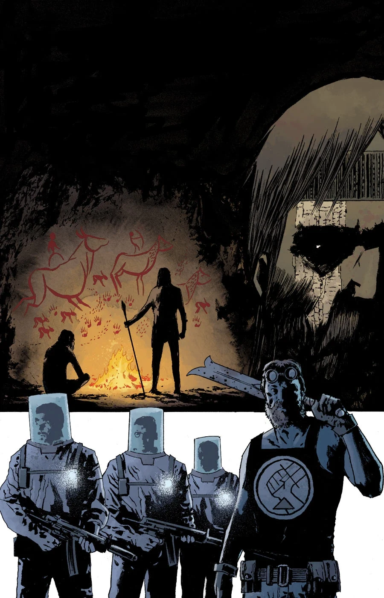
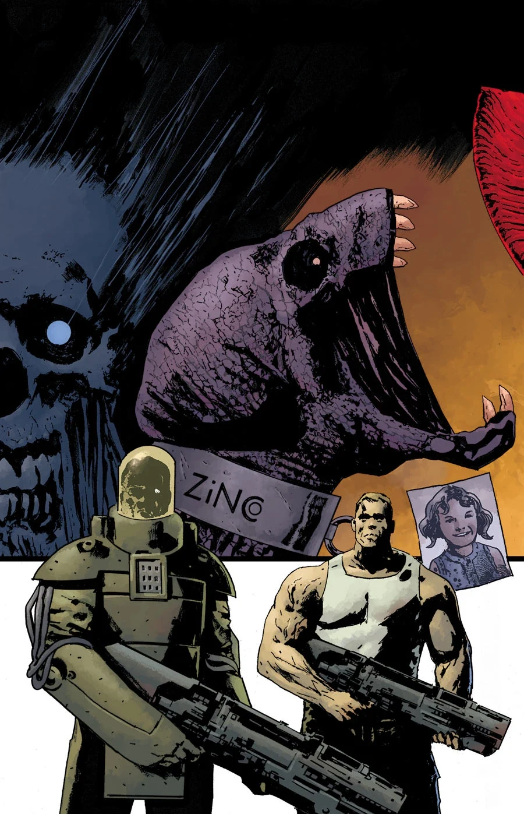
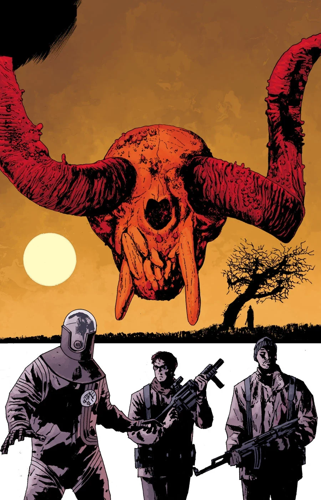
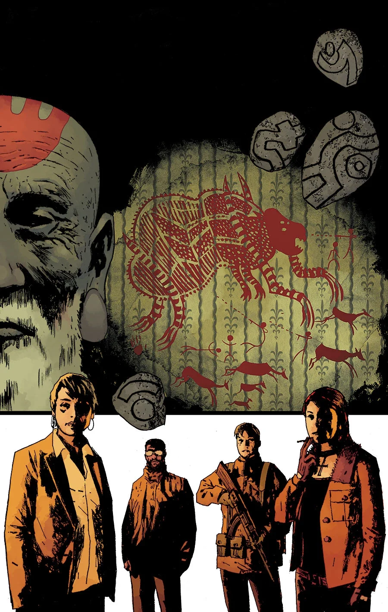
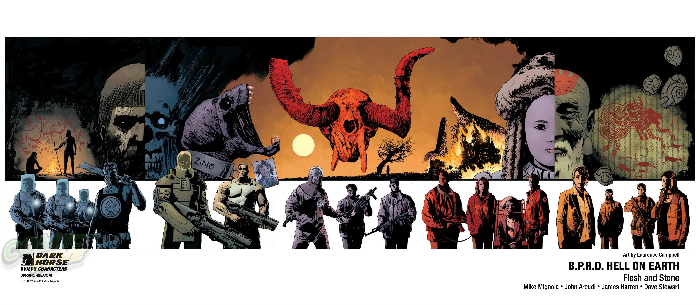

《**血肉磐石**》（Flesh and Stone）是一个五期故事线，由 James Harren 作画，Laurence Campbell 绘制封面。

## 剧情梗概

### 第一部分

[超自然调查防御署](/entry/Bureau_for_Paranormal_Research_and_Defense)（B.P.R.D.）的形势似乎一片大好。凭借与军方的结盟，他们如今拥有了所需的全部军火；纽约一役之后，他们接到一个轻松的任务：清剿一座小镇。但这座小镇与[霍华德](/entry/Ted_Howards)作为[史前战士](/entry/Gall_Dennar)的过去有着诡异的联系，而且镇中的怪物也远超寻常。

### 第二部分

一头怪物在一座山上肆虐，霍华德在那里发现了自己身为史前战将的过往的联系。俄国人正艰难应付他们自己的怪物；而在纽约，[金科公司](/entry/Zinco_Corporation)在[黑焰](/entry/The_Black_Flame_%28character%29)的神秘指挥下行事。

### 第三部分

霍华德探员身为史前战将的过去，为 B.P.R.D. 如何杀死他们一直追捕的那头怪物提供了线索。但霍华德能在整支小队被消灭之前把自己的知识派上用场吗？

### 第四部分

B.P.R.D. 试图杀死那头在雪山山坡上肆虐的怪物，但行动失败了。就在全队拼命逃生之际，有一个人挺身而出，独力对抗怪物……那就是神秘的霍华德探员。这位来自过去的战士能杀死巨兽，还是会被它碾作齑粉？

### 第五部分

霍华德利用自己与过去的联结，从雪山中那头横冲直撞的怪物手下救下了 B.P.R.D.。但他所知晓的秘密，是否足以力挽狂澜？

## 画廊

