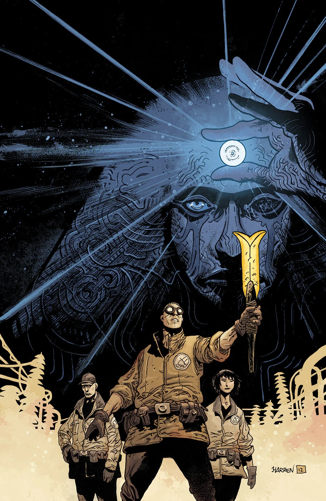
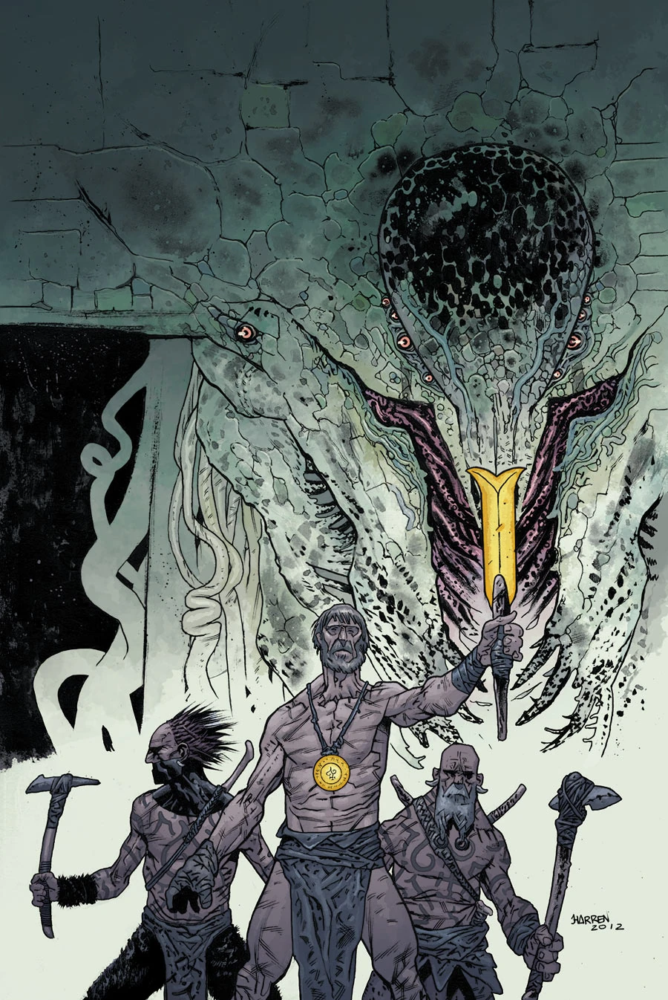
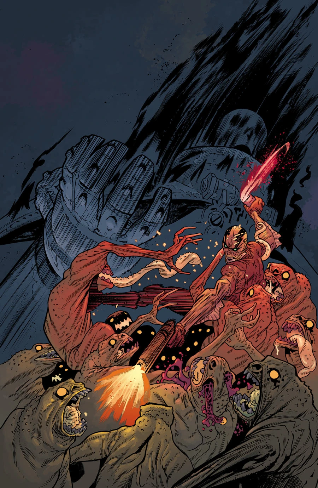

**James Harren（詹姆斯·哈伦）** 是美国漫画画师。他于 2011 年 9 月凭借[《亚伯·塞皮恩：恶魔不戏言》（Abe Sapien: The Devil Does Not Jest）](/entry/The_Devil_Does_Not_Jest)首次登上《地狱男爵》宇宙。

## 内页作画

- [《亚伯·塞皮恩：恶魔不戏言》（Abe Sapien: The Devil Does Not Jest）](/entry/The_Devil_Does_Not_Jest)
- [《B.P.R.D.：人间地狱——漫长的死亡》（B.P.R.D.: Hell on Earth—The Long Death）](/entry/The_Long_Death)
- [《B.P.R.D.：人间地狱——时间深渊》（B.P.R.D.: Hell on Earth—The Abyss of Time）](/entry/The_Abyss_of_Time)
- [《B.P.R.D.：人间地狱——黑焰统治》（B.P.R.D.: Hell on Earth—The Reign of the Black Flame）](/entry/The_Reign_of_the_Black_Flame)
- [《B.P.R.D.：人间地狱——血肉与磐石》（B.P.R.D.: Hell on Earth—Flesh and Stone）](/entry/Flesh_and_Stone)

## 封面作画

## 外部链接

- [**Comic Book DB：** James Harren](http://www.comicbookdb.com/creator.php?ID=25292)
