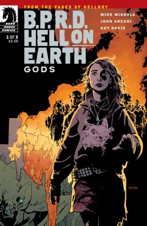
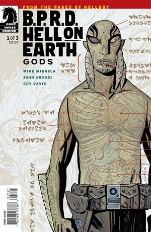
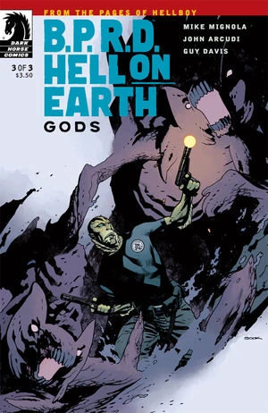

《**诸神**》（Gods）是一部三期限定迷你系列，于 2011 年 1 月至 3 月出版。

## 出版历史

这是[《人间地狱》系列](/entry/BPRD%3A%E4%BA%BA%E9%97%B4%E5%9C%B0%E7%8B%B1)的第二个故事弧，接续《[New World](/entry/New_World_%28B.P.R.D._story_arc%29)》（新世界）。各期出版时封面均由 [Ryan Sook](/entry/Ryan_Sook) 绘制。首期还另有一个由 [Guy Davis](/entry/Guy_Davis) 绘制的变体封面。

本故事与《[Monsters](/entry/Monsters)》（怪物）一同收录于平装合订本《[B.P.R.D.: Hell on Earth—Gods and Monsters](/entry/Trade_Collections)》。

## 剧情概要

### 第一部分

正当得克萨斯坠入地狱之际，一群无家可归的被遗弃者——由一名似乎拥有预知能力的年轻女子带领——躲避着火山喷发、集体歇斯底里和食人怪物。当 B.P.R.D. 注意到这一切时，结局却变得致命。

### 第二部分

怪物横行美国西南部，休斯敦的一座火山在黑夜中燃烧，再加上一群被拥有预言能力的领袖带领的弃民；对一个苦苦支撑的调查防御署而言，这些都成了巨大的威胁。

### 第三部分

长着蝙蝠巨耳的巨兽向调查防御署开战，亚伯终于直面那位神秘的先知，而德文的疑心也得到了证实。

## 画廊

 \#1

 \#1 variant

 \#2

 \#3
