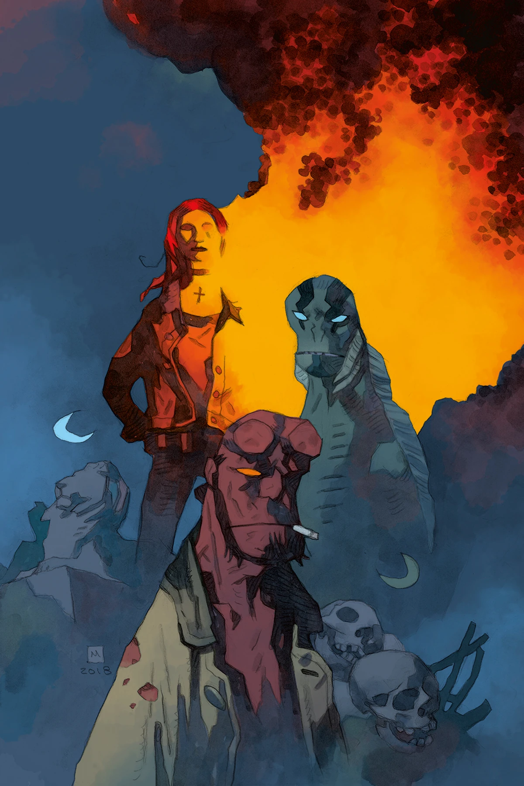
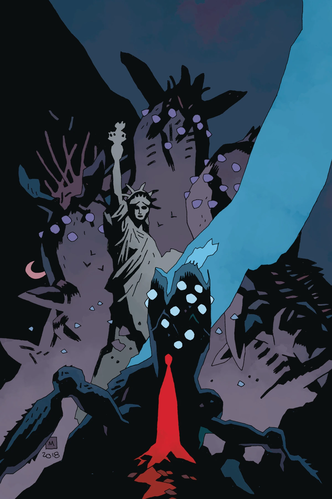
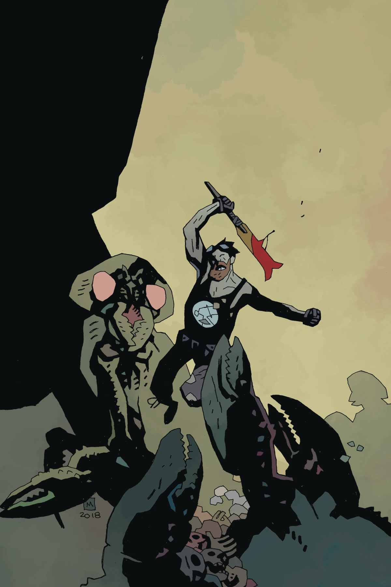
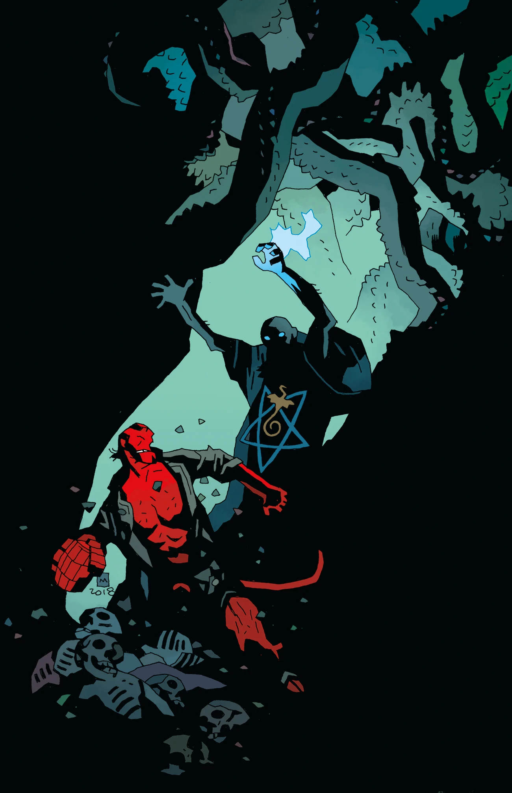
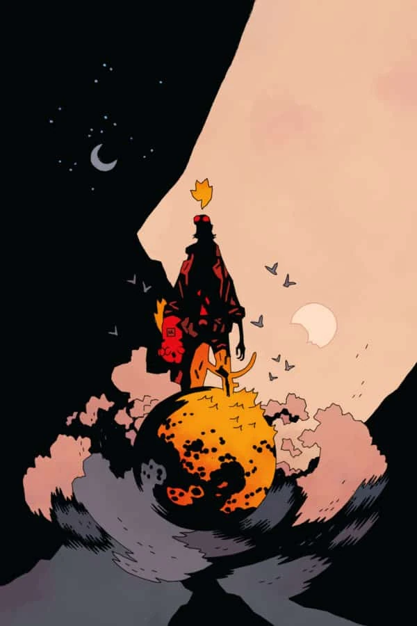

《**诸神的黄昏**》（Ragna Rok）是[《魔鬼旧相识》（The Devil You Know）故事周期](/entry/The_Devil_You_Know_%28story_cycle%29)的第三个、也是最后一个故事弧，同时也是《[B.P.R.D.](/entry/B.P.R.D._%28series%29)》的最终故事。

## 剧情简介

### 第一部分

敌人一个接一个地出现：B.P.R.D. 发现自己面对的事物——以及人物——比他们先前以为的更加险恶；Christopher Mitten 则绘出了 B.P.R.D. 最神秘的敌人之一的起源故事。

### 第二部分

B.P.R.D. 拼命寻找方案，要从一个深藏已久的危机中拯救人类；与此同时，一位老熟人带着新的情报前来拜访地狱男爵。

### 第三部分

地狱男爵、丽兹和亚伯回到纽约，做拯救人类的最后一搏；署里的其余成员则设法护送幸存者前往安全之地。

### 第四部分

拯救人类的最终决战拉开序幕。

### 第五部分

在《B.P.R.D.》漫画走过十五年之后，整个系列迎来爆炸性的结局！

## 画廊

封面作者 [Mike Mignola](/entry/Mike_Mignola)

 \#1

 \#1 variant

 \#2

 \#3

 \#4

 \#5
