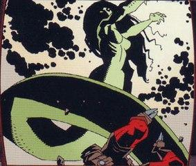
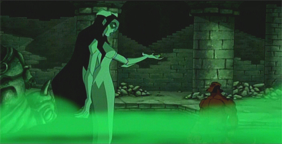

**赫卡特（Hecate）**是[女巫](/entry/Witches)的女神，又称戈耳工之眼、群犬女王以及[迦梨](/entry/Kali)。她声称自己与[地狱男爵](/entry/Hellboy_%28character%29)有所关联，因为两人都与天启的降临有关。她的原型是希腊神话中的魔法女神。

## 历史

在地狱男爵故事线的大部分登场中，赫卡特的出身一直笼罩在神秘之中，直到[爱德华·格雷](/entry/Edward_Grey)在*[黑暗召唤](/entry/Darkness_Calls)*的第二段尾声中追问，她的来历才被披露。在格雷与赫卡特的对话中，赫卡特证实了那些古老的说法：她诞生于阴影之中，由一匹母狼从腹中娩出；也证实了那些古老的故事——她曾居住在厄俄斯山之巅，身边只有猛禽与毒蛇相伴，只饮鲜血，拥有超凡脱俗的美貌。古往今来她有过许多不同的名字，例如赫卡-埃梅姆·拉、内布-奥格罗斯、黑赫卡塔、黑色女神、十字路口女神以及女巫女王。

随后，赫卡特向格雷揭示了她传说中未曾被记载的几个片段，其中大多与她和黄金之民——[极北族人](/entry/Hyperboreans)——共同生活的岁月有关。她住在他们的都城[戈里尼姆](/entry/Gorinium)，混迹于他们之中。按赫卡特的说法，她成功赢得了极北族国王[透特](/entry/Thoth)的欢心，并继而引诱了他。她这样做是为了进入透特拥有的一座秘密花园，园中囚禁着三个超自然的存在：[三个被放逐的天使](/entry/Watchers)。若赫卡特所言可信，透特把这些天使的知识记录在四十二部书里，其中只有两部向他的子民公开，其余四十部由他自己秘藏。赫卡特假扮成他的爱人，企图窃取这些知识，她甚至杀死了三个天使、饮下他们的血，后来又在透特的神殿中将血呕出，"用他（透特）本想秘而不宣的全部知识涂满了那地方的墙壁"。

获得了被放逐天使的全部知识后，赫卡特以一个临时先知的身份走到极北族民众当中，宣讲透特私藏的秘密。透特察觉了赫卡特的背叛，便诅咒她，使她的半边身体变成映照其本性的形态：下半身化为蛇形，皮肤长出鳞片、变得丑陋不堪。诅咒还令阳光对她致命，迫使她余生都只能藏身于阴影之中。

然而这一切都没有让赫卡特特别困扰，因为按她自己的说法，她已经达成了初衷。三个天使的知识已经传遍极北族，脱离了国王的掌控。不幸的是，这些知识也导致了王国的覆灭：民众背弃了曾使他们伟大的东西，堕落为崇拜邪教的野蛮人。可以推断，正是同一事件唤醒了那尊装有[毁灭右手](/entry/Right_Hand_of_Doom)的古老雕像，使它摧毁了极北族仅存的一切，正如*[岛屿](/entry/The_Island)*中那位无名神秘人所记载的那样。

此后，据说赫卡特创造了许多骇人的怪物祸害人类，之后她既成了黑暗女神，又在某个时刻成为女巫女王。世界各地散落着许多献给她的地下神殿，建在阳光照不到的地底。赫卡特向爱德华·格雷爵士讲述的早年经历到此为止。

### *唤醒恶魔*

赫卡特被逐出极北族之后具体从事了哪些活动，已无从考证。此后地狱男爵时间线中最早的情节是：1492 年，希腊渔民把她从湖底打捞上来，之后她的遗体落入[弗拉基米尔·朱雷斯库](/entry/Vladimir_Giurescu)之父手中，此入用各种药剂使她的身体重新变得柔韧。后来，年轻的弗拉基米尔溺水身亡，赫卡特便将他从死亡中复活，以此酬谢他的父亲；在此过程中，她把自己的一部分灵魂赐给弗拉基米尔，把他变成了[吸血鬼](/entry/Vampire_%28creature%29)，使他成为她的"儿子"。弗拉基米尔·朱雷斯库后来参加了拿破仑战争，多次受到致命伤，但都凭借吸血鬼的能力和秘密的奥术仪式痊愈。可以推断，赫卡特在每一场仪式中都扮演了重要角色。

 赫卡特与[地狱男爵](/entry/Hellboy_%28character%29)的初次相遇是在 1990 年代，即[格里高利·拉斯普廷](/entry/Grigori_Rasputin)的门徒们复苏、纳粹末日计划"[吸血鬼风暴](/entry/Vampir_Sturm)"得以延续之后。地狱男爵为寻找朱雷斯库而调查一座欧洲城堡，先与朱雷斯库不死的父亲短暂交手并消灭了他，随后找到了朱雷斯库本人。两人短暂交锋，地狱男爵占了上风，朱雷斯库身负重伤、九死一生地逃脱。朱雷斯库向赫卡特祈祷求助，她迅速回应，在城堡下方的黑暗中治愈了他。

随后，就在地狱男爵把整座城堡安装好炸药之后，赫卡特在城堡内与他正面相遇。赫卡特指责地狱男爵拒绝接受自己作为天启使者的命运，并残杀自己的同类。地狱男爵对她的话毫无兴趣，正要转身离开，赫卡特向他发起攻击。大约在同一时间，拉斯普廷的门徒、朱雷斯库的爱人[伊尔莎·豪普斯坦](/entry/Ilsa_Haupstein)自愿躺入"朱伊处女"（一具曾属于伊丽莎白·巴托里的铁处女），以求成为新的末日使者。

一场恶战之后，地狱男爵把赫卡特强行逼到城堡外的阳光下，消灭了她。由于透特的诅咒，赫卡特无法忍受日光，化为了尘土；不久之后，地狱男爵安置的炸药爆炸，把他震昏过去。

赫卡特虽被消灭，但她的一部分灵魂仍留在已经完全复原的[弗拉基米尔·朱雷斯库](/entry/Vladimir_Giurescu)体内。朱雷斯库找到地狱男爵时，后者（被受朱雷斯库操控的当地村民）绑在一根柱子上，旁边立着豪普斯坦的铁处女。朱雷斯库骑马冲向地狱男爵，自愿让地狱男爵一击毁灭自己，化为一堆骸骨，好让残留在他体内的赫卡特灵魂碎片得以进入铁处女。赫卡特借豪普斯坦的血获得生命，把铁处女塑造成自己的新身体，重生后的她比以往更加强大。她抓住地狱男爵咬了下去，把他抛入黑暗之中，强迫他直面自己的命运，希望他带来世界末日。地狱男爵至死不屈，奋力抵抗，掰断了新长出来的双角，让自己回到了原来世界中他离开的确切位置。赫卡特已不见踪影。

### *征服之虫*

*征服之虫*事件之后，赫卡特下一次现身是在拉斯普廷的鬼魂面前。起初，拉斯普廷以为这具活着的铁处女里装着伊尔莎·豪普斯坦的灵魂，但赫卡特稍一变形便表明并非如此。嘲讽了他一番之后，赫卡特别透露了自己关于未来的幻象，所有幻象都与世界末日时她与地狱男爵并肩而立有关。她相信这些幻象预示两人将共同迎接星球的重生，但她也承认，两人同样可能仅仅是死去，她不确定哪一种结局会成真。拉斯普廷对这些说法不满，反驳说[奥古·桀哈](/entry/Ogdru_Jahad)已选中他来带来世界的重生，这是他神圣的命运。赫卡特怜悯他的无知，指出了显而易见的真相：只有地狱男爵的毁灭右手能带来终结，拉斯普廷对此无能为力。拉斯普廷勃然大怒，尖叫着说自己仍是地狱男爵的主人，随后赫卡特随意挥了挥手臂便消灭了他，只留下他灵魂的一星残渣，被雅加婆婆收走。

### *岛屿*

地狱男爵在遭遇了非洲海巫[博格鲁什](/entry/Bog_Roosh)之后，在海上漂流了两年，之后再次与赫卡特狭路相逢。赫卡特心平气和地走近他，再次给他机会去完成她所认定的命运。她变身为构成她身体的铁处女的巨大形态，向地狱男爵敞开自己，希望他与她结合、带来终结。地狱男爵本性难移地拒绝了，毫不客气地叫她别来烦他。赫卡特仍然深信地狱男爵终会完成预言中之事，便放他离去。后来，地狱男爵遭遇了一位无名神秘人以及赐予他力量的[奥古·桀姆](/entry/Ogdru_Hem)，随后乘一只临时扎成的木筏动身前往英格兰；临行前，他看见赫卡特以巨大的铁处女形态伫立在岸边悬崖上凝望着他。

### *黑暗召唤*

赫卡特最终栽在了[伊戈尔·布罗姆黑德](/entry/Igor_Bromhead)手里，此人是地狱男爵和[B.P.R.D.](/entry/B.P.R.D.)的老对头，曾效命于[乌拉刻](/entry/Ualac)。布罗姆黑德在意大利的一座赫卡特神殿中以血书写咒文、吟诵古老法术，把赫卡特召唤出来，自称是她卑微的仆人。赫卡特不为所动、毫不买账，提起他因乌拉刻施下的部分诅咒而落下的残疾来嘲弄他。布罗姆黑德则以伊尔莎·豪普斯坦的名字配合一道束缚咒作为回应，当场使赫卡特瘫痪，在他面前毫无反抗之力。她难以置信地问他是如何做到的，布罗姆黑德透露，他取得了朱雷斯库的遗骸，让那副骷髅告诉他赫卡特是如何落到如今境地的，以及她如何因依赖豪普斯坦的人类生命精元维持存在而与豪普斯坦相连。如此一来，豪普斯坦的名字便对她有了约束力，因为她同时是不朽者、铁处女和人类，实际上是一位"三重女神"。布罗姆黑德强迫她变成铁处女形态，取出了装着赫卡特灵魂的伊尔莎·豪普斯坦尸体，把它与朱雷斯库的骷髅一同用锁链锁在一间地下室里，再用砖石和水泥把房间封死。尽管布罗姆黑德后来未能利用赫卡特消失后留下的权力真空成为女巫的统治者，但此事引发了一系列事件，拉开了终局的序幕。

事后，失去力量的赫卡特等来了[爱德华·格雷爵士](/entry/Sir_Edward_Grey)，她毫无保留地向他讲述了自己的故事。接着，赫卡特十分直白地告诉格雷，终有一天地狱男爵会呼唤她，世界将迎来末日。但在此之前，地狱男爵会在[对抗一位复苏的女巫女王的战争](/entry/The_Fury)中死去，而把地狱男爵从坟墓中带回来将是格雷的命运。赫卡特还指出，格雷在此过程中会犯下可怕的行径，而地狱男爵最终将既是他的救赎也是他的毁灭，说罢便与他道别。

在[诸神黄昏](/entry/Ragna_Rok_%28event%29)落幕之际，奥古·桀哈与奥古·桀姆被消灭、地狱男爵重获毁灭右手之后，赫卡特在残破的地球上最后一次出现在他面前。地狱男爵本以为还要一战，但赫卡特问他是否已经厌倦了战斗，并把他的注意力引向[丽兹·舍曼](/entry/Liz_Sherman)——她一直出神地在大地上游荡，试图控制自己的火焰。地狱男爵本不愿丽兹落得如此结局，但最终被赫卡特说服，去完成注定要发生的事。他呼唤丽兹释放火焰，把世界烧净，随后赫卡特再次迎接他，将他吞没在自己的铁处女形态之中，他终于迎来了自己的终结。通过两人的融合，她洒下他的血，从而把生命带回世界，供下一代人类栖居。

## 能力与本领

在被伊戈尔·布罗姆黑德囚禁之前，赫卡特无疑是地狱男爵宇宙中最强大的女巫，力量甚至超过声名狼藉的雅加婆婆。世界各地有许多邪教奉她为女神，其中大多以巫术为中心；她也被称为女巫女王。她的生命史早于现代人类，说明她是不朽的。

颇具讽刺意味的是，与地狱男爵和 B.P.R.D. 遭遇过的大多数其他邪恶魔法力量不同，赫卡特很少以常规方式使用魔法；事实上，在她与地狱男爵的战斗中可以看到，正面冲突时她更偏爱蛮力而非魔法。战斗时，赫卡特展现出惊人的力量与速度，可能与地狱男爵相当甚至更强，蛇形的下半身也运用得同样自如。赫卡特唯一的弱点是：由于透特施下的诅咒，她对阳光极度敏感。

赫卡特还拥有一定程度的预知能力。她在这方面的能力可谓独步天下，甚至能看到世界的末日，但仍非完美无缺，某些关键之处始终模糊不清。她还多次展现出通过动物（主要是蛇）说话的能力，不过并不总能确定她借以说话的蛇究竟是真蛇，还是她用魔法造出的化身。她偶尔会把自己的一部分力量乃至灵魂赐给人类，使他们变得不再是寻常人类。爱德华·格雷声称，她在漫长岁月里"生下"了许多怪物；前面提到的赐予力量的能力或许可以解释这一点。

赫卡特掌握的一种更隐蔽的能力似乎是瞬间移动。故事中她多次出人意料地出现在相距数百英里的地方，有时是回应请求或命令她现身的咒文。她如何做到这一点从未被展现，这让她力量的真正极限更添神秘。

被阳光消灭后，赫卡特在伊尔莎·豪普斯坦的铁处女中重生，这一变化以强化的铁躯大幅增强了她的力量。赫卡特也可以恢复原形，并在不同程度上化为铁处女形态，随心所欲地混搭两种形态的特征。她甚至能变成铁处女并让其长到巨物般的尺寸，同时仍保持行动和说话的能力。反过来说，由于她的灵魂寄居于伊尔莎的尸身中，赫卡特也可以变得完全像人形。这具新身体似乎还在一定程度上消除了她对阳光的弱点。然而，赫卡特后来得知，由于与伊尔莎·豪普斯坦之间的形而上羁绊，她多了一个新的弱点：伊尔莎的名字可以被用来以魔法束缚和控制这位女神。

即使被移出铁处女之身，赫卡特仍保有说话、通过蛇语以及预知的能力。

## 其他媒体

 在*[地狱男爵：铁血惊魂](/entry/Hellboy%3A_Blood_and_Iron)*中，赫卡特由克里·萨默配音，作为主要反派登场，最初被看到正在观看地狱男爵与一头机械弥诺陶搏斗。闪回情节揭示，赫卡特曾与[厄尔热贝特·翁德鲁什科](/entry/Erzsebet_Ondrushko)立约，在她于 1939 年被年轻的[特雷佛·布鲁姆](/entry/Trevor_Bruttenholm)教授杀死之前赐予她吸血鬼的生命。但在两名[色萨利女子](/entry/Women_of_Thessaly)（演职员表中记作鸟身妖婆）和狼人[卢佩斯科神父](/entry/Father_Lupescu)的协助下，厄尔热贝特在现代被复活。任务中地狱男爵与其他人失散时，赫卡特现身，企图让他接受自己作为天启之兽的命运。地狱男爵拒不听从、击退她的群蛇，赫卡特便用一具类似铁处女的石棺获得实体形态亲自与他搏斗，每挨一击身形便增大一分。尽管厄尔热贝特彻底死亡后赫卡特动了真格，但地狱男爵最终把她拖到阳光下击败了女神。这使赫卡特的实体形态变回石棺，赫卡特从中化为一条巨蛇现身，游回了阴影之中。

## 画廊

[pt-br:Hecate](/entry/pt-br%3AHecate)
