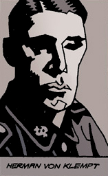
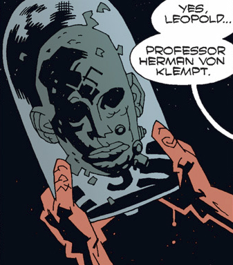
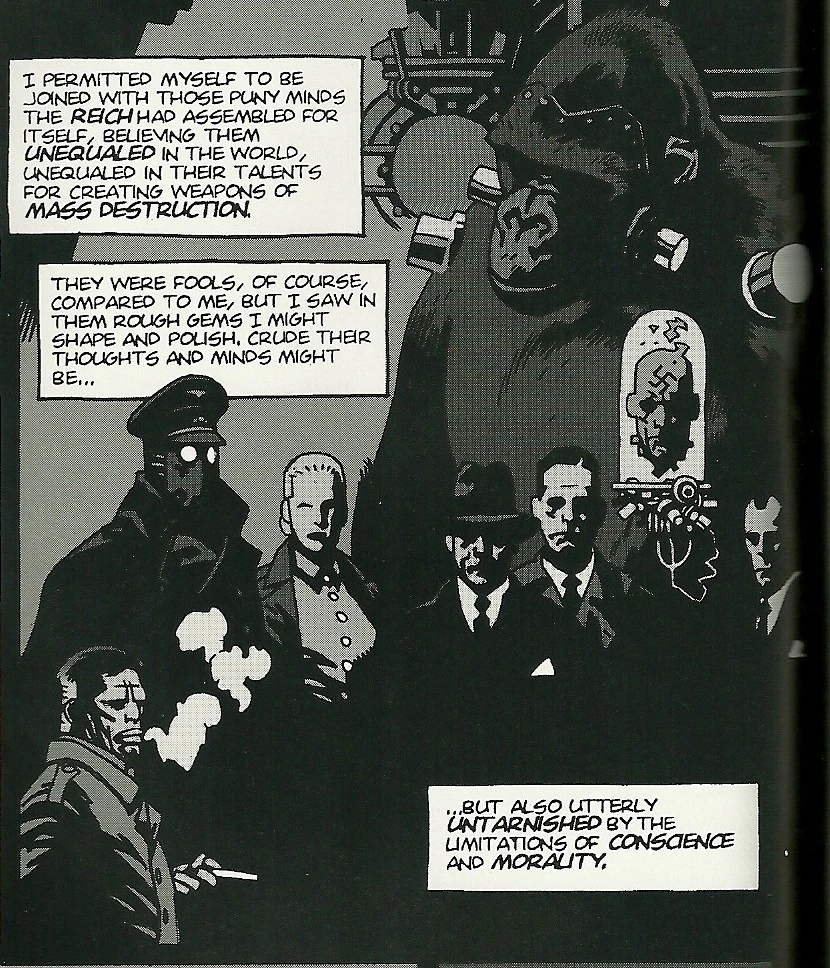
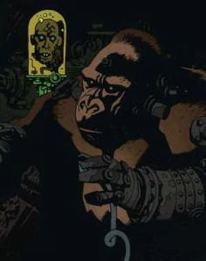
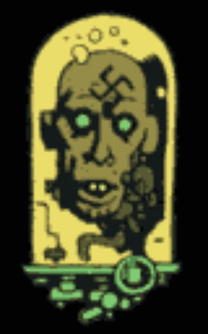

**赫尔曼·冯·卡朗普特（Herman von Klempt）**（又称**冯·卡朗普特**）是一名纳粹“疯狂科学家”，策划过无数控制或毁灭世界的阴谋。尽管身体已毁，冯·卡朗普特却以一颗罐中之脑（头颅）的形态存活下来，工作时常有机械猿猴相助。

他是《[地狱男爵：邪恶科学](/entry/Hellboy%3A_The_Science_of_Evil)》电子游戏的主要反派，由尤尔根·普洛奇诺配音。

## 历史

赫尔曼·冯·卡朗普特1885年生于德国法兰克福。十岁上下时，冯·卡朗普特便对控制论产生了浓厚兴趣：他杀死家里的猫，试图把钟表零件装进猫的身体来“改进”它的构造。他的行为让家人深感恐惧，所以当他去柏林读医学院时，家人都乐得摆脱他。在柏林，冯·卡朗普特执迷不悟的做派在同学中出了名，他与同袍[卡尔·鲁普雷希特·克罗嫩](/entry/Karl_Ruprect_Kroenen)过从甚密。尽管两人看似理念相近，冯·卡朗普特却只把克罗嫩当作一项资源：克罗嫩的财富和社会关系为他提供了经济后盾，否则他永远做不成那些研究。

1935年，冯·卡朗普特与克罗嫩一起受海因里希·希姆莱之邀加入[黑日学会](/entry/Sonnenrad_Society)。加入黑日学会后不久，冯·卡朗普特便利用该组织的资源开发自己的项目，比如[战猿](/entry/Kriegaffe)计划。1936年，冯·卡朗普特在一场实验室爆炸中险些丧命，身体大部分被毁。克罗嫩救了他一命，设法把冯·卡朗普特的头颅保存在一只玻璃钟罩里存活下来。

1937年，[格里高利·拉斯普廷](/entry/Grigori_Rasputin)招募黑日学会的数名成员——包括克罗嫩——作为[诸神黄昏计划](/entry/Project_Ragna_Rok)的门徒。冯·卡朗普特态度强硬、满心厌恶地拒绝加入拉斯普廷，他认为拉斯普廷是个骗子，其理念毫无意义。

### 亨特城堡

 1939年，冯·卡朗普特参与了纳粹太空计划，旨在与外太空的非物质存在建立联系。这些存在许诺：如果把一具人类躯壳送入太空充当宿主，它返回地球时将强大到足以消灭纳粹的敌人。纳粹准备从他们位于奥地利亨特城堡的基地，把[恩斯特·厄明](/entry/Ernst_Oeming)博士的遗骸送入太空——厄明是一位德国物理学家，常被称作“纳粹的爱因斯坦”，当年早些时候被汽车炸弹暗杀。

1939年3月20日夜，即厄明遗体预定发射之日，美国英雄[大螯虾](/entry/The_Lobster)率领一队美军攻打亨特城堡。惊慌之下，纳粹没等城堡屋顶的舱门打开便发射了厄明的飞船。火箭虽然冲出城堡、进入太空，爆炸却瞬间烧死了城堡内除冯·卡朗普特之外的所有人。

### 1946年

纳粹德国向盟军投降后，冯·卡朗普特退守柏林地下的一处秘密基地。他带着[吸血鬼风暴计划](/entry/Project_Vampir_Sturm)的吸血鬼，企图用一场吸血鬼瘟疫毁灭美国。1946年，[特雷佛·布鲁姆](/entry/Trevor_Bruttenholm)和 B.P.R.D. 发现了他的巢穴。冯·卡朗普特赶在布鲁姆阻止他之前，迅速向美国发射了一枚满载吸血鬼的火箭。在他人协助下，布鲁姆摧毁了火箭，吸血鬼和冯·卡朗普特一同化为灰烬。尽管布鲁姆以为冯·卡朗普特已被消灭，约六年后他却再度浮出水面。

### 巴西实验

某个时期，冯·卡朗普特在巴西特罗索一座旧葡萄牙监狱的地下建了一座秘密实验室。在[1952年](/entry/1952)地狱男爵为 B.P.R.D. 执行的第一次任务中，冯·卡朗普特组建了一支半机械人亡灵大军，企图复活第三帝国。多亏地狱男爵、一小队 B.P.R.D. 探员，以及一具被[奥古·赫姆精灵](/entry/Zara-Hem)变异的复活尸体，他的阴谋才告终结。冯·卡朗普特的头颅被他的一只猿猴实验体一把抓走，使他逃脱了追捕。

1959年，冯·卡朗普特再次在巴西现身，这次是在马卡帕附近的丛林里。地狱男爵调查当地农家少女失踪案时找到了他（见[世界上最伟大的超自然调查员（CBG）](/entry/World%27s_Greatest_Paranormal_Investigator_%28CBG%29)）。在随后的搏斗中，地狱男爵击败了冯·卡朗普特和他的[战猿](/entry/Kriegaffe)——冯·卡朗普特管它叫“布鲁图斯”。此后几十年里，冯·卡朗普特销声匿迹。

### 唤醒恶魔

 冯·卡朗普特的老友兼同袍[卡尔·鲁普雷希特·克罗嫩](/entry/Karl_Ruprect_Kroenen)，曾与诸神黄昏计划的另外两名成员[伊尔莎·豪普斯坦](/entry/Ilsa_Haupstein)和[利奥波德·克茨](/entry/Leopold_Kurtz)一起进入假死状态。被唤醒后，克罗嫩派[罗德里克·津科](/entry/Roderick_Zinco)——[津科公司](/entry/Zinco_Corporation)的人——取回冯·卡朗普特的头颅。复活这位疯狂科学家后，克罗嫩把格里高利·拉斯普廷和天启大军的事告诉了冯·卡朗普特。冯·卡朗普特随即试图说服克罗嫩放弃拉斯普廷的计划，不要毁灭世界，而要用天启大军征服世界。克茨无意中听到冯·卡朗普特的阴谋，抄起扳手狠狠袭击这位疯狂科学家脱离身体的头颅。为保护冯·卡朗普特，克罗嫩用手术刀刺死了克茨。随后克罗嫩又翻脸指责冯·卡朗普特，说一切都是他的错。就在这时，拉斯普廷突然出现，对克罗嫩和津科复活冯·卡朗普特、杀死克茨勃然大怒。拉斯普廷施法使津科双目失明。失明的津科在狂怒中意外引发大火，摧毁了基地。

### 征服之虫

冯·卡朗普特侥幸从城堡的爆炸中逃生，退守德国一座墓地下方的秘密实验室。在那里，他着手研制10号战猿及其他各种项目，却突然被绝望攫住：他的人生仿佛只剩下无尽的失败，失去了目标。在这软弱的一刻，拉斯普廷的鬼魂联系了他。冯·卡朗普特误以为对方是死亡天使，拉斯普廷向这位纳粹科学家展示了放出他们植入厄明体内的蠕虫将带来的毁灭：世界被占据之后，[奥古·赫姆](/entry/Ogdru_Hem)将被放出牢笼，他们继而释放[奥古·桀哈](/entry/Ogdru_Jahad)，后者将把世界化为灰烬。冯·卡朗普特终于获得了目标——目睹世界的毁灭——于是六十年后重返亨特城堡。

冯·卡朗普特成功把厄明的太空舱引回地球。一头名为“[征服之虫](/entry/Conqueror_Worm)”的巨型怪物从舱中喷涌而出。蠕虫喷出有毒气体，把冯·卡朗普特的人类爪牙变成蛙人，随即为填饱无底的肚子立刻把他们吞食。多亏[地狱男爵](/entry/Hellboy_%28character%29)和[罗杰](/entry/Roger)在大螯虾鬼魂的协助下迅速出手，才挡住了蠕虫的进军。罗杰把冯·卡朗普特从悬崖上拽了下去；疯狂科学家的玻璃罐摔得粉碎，他的生命就此终结。

### 人间地狱

冯·卡朗普特的头颅不知何故被津科公司的[兰迪斯·波普](/entry/Landis_Pope)找回，摆在波普办公室的纳粹纪念品收藏中。[黑焰](/entry/Black_Flame)与[丽兹·舍曼](/entry/Liz_Sherman)激战之后，克罗嫩从曼哈顿的废墟中找回并带走了冯·卡朗普特的头颅。

### 你所认识的恶魔

冯·卡朗普特再次复活，有人看见他和瓦尔瓦拉坐在一起聊天，嘲笑克罗嫩——后者似乎已疲惫不堪、斗志全无。

他最终被拉斯普廷所杀：这位神秘法师作为奥古·桀哈的容器重返地球时，结果了他。

## 在其他媒体中

### *邪恶科学*

赫尔曼·冯·卡朗普特和他的几只战猿在《[地狱男爵：邪恶科学](/entry/Hellboy%3A_The_Science_of_Evil)》电子游戏中登场。

在日本，赫尔曼朝悬崖走去，地狱男爵发现了卡朗普特，却遭到赫尔曼的一只战猿袭击。他们的战斗延续到一座古庙中，最终赫尔曼被自己爪牙失手抛出的一根圆木击中，坠下悬崖；在东欧，他回到巨型城堡，完成实验工作，放出一个巨型半机械突变体去杀地狱男爵。卡朗普特的控制室起火，他被严重烧伤，露出机器人的真面目；卡朗普特真正的头颅出现在一只悬浮的罐中。地狱男爵夺过罐子，把它塞进突变体背部的能量核心，导致它爆炸，把地狱男爵从城堡弹入大海。

## 能力与本领

- **天才级智力**：专攻控制论、基因工程和神秘学技术。
- **科技操控**：冯·卡朗普特能够控制他各式各样的机器人与半机械人造物。
- **长寿/伪永生**：以罐中头颅的形态存活，并通过科技手段多次复活。

## 武器

- **机械躯体**：他经常占据一具机械身体，包括蛛形机械腿或完整的半机械人形态，以便与外界互动。
- **先进的纳粹科技**：可使用各种机器、火箭和实验装置。

## 画廊

## 趣闻

- 2005年 Mezco Toyz 发售的10号战猿可动人仔附带赫尔曼·冯·卡朗普特的头颅。一款冯·卡朗普特头颅的变体（额头带有纳粹卐字标记）则随一款限量版地狱男爵人偶发售。[1](http://mezco.net/products.asp?pline=hbc2005)
