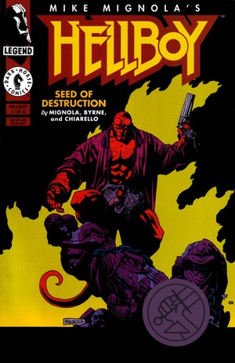
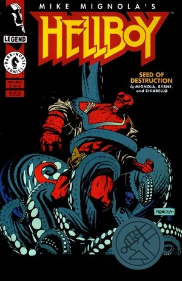
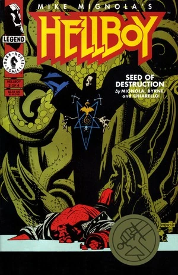
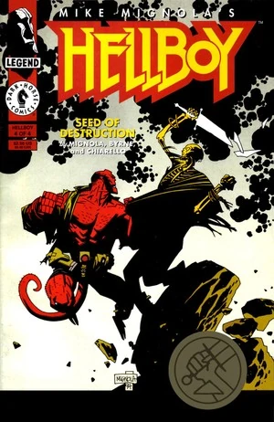
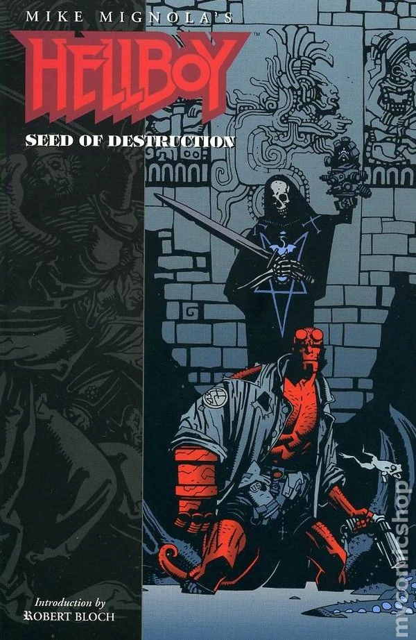
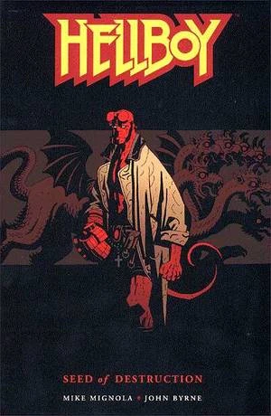
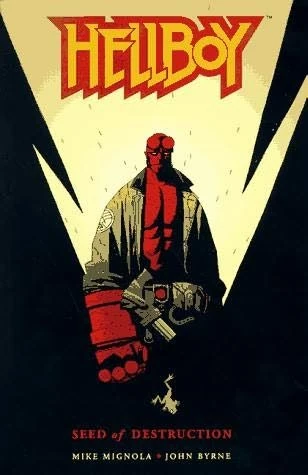
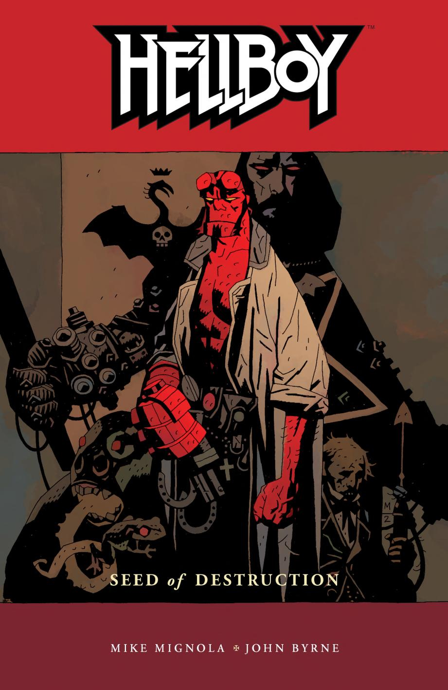
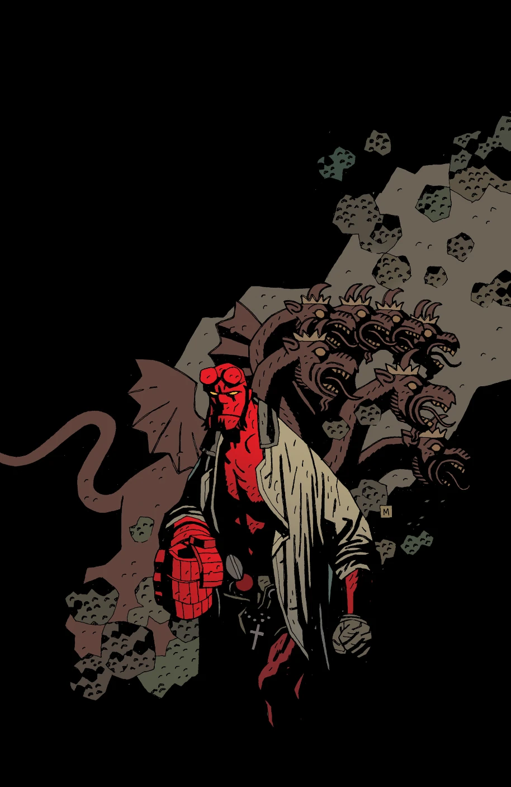
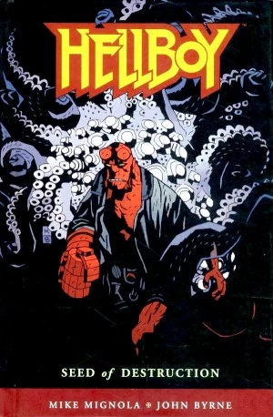

**Mike Mignola（迈克·米格诺拉）** 是美国漫画编剧兼画师，最广为人知的成就是创作了 [《地狱男爵》（*Hellboy*）](/entry/Hellboy_%28series%29)及其一系列相关作品。

## 编剧

除少数例外，Mike Mignola 几乎参与了地狱男爵宇宙（Hellboy Universe）每一部故事的编剧工作：

- [《鱼人亚伯：亡者之鼓》（*Abe Sapien: Drums of the Dead*）](/entry/Drums_of_the_Dead)
- [《B.P.R.D.：暗水》（*B.P.R.D.: Dark Waters*）](/entry/Dark_Waters)
- [《B.P.R.D.：夜车》（*B.P.R.D.: Night Train*）](/entry/Night_Train)
- [《B.P.R.D.：我的床下有东西》（*B.P.R.D.: There's Something Under My Bed*）](/entry/There%27s_Something_Under_My_Bed)
- [《鱼人亚伯：风暴前的宁静》（*Abe Sapien: The Calm Before the Storm*）](/entry/The_Calm_Before_the_Storm)
- [《鱼人亚伯：潜意识》（*Abe Sapien: Subconscious*）](/entry/Subconscious)
- [《寻鬼者：昂兰之谜》（*Witchfinder: The Mysteries of Unland*）](/entry/The_Mysteries_of_Unland)
- *[《情绪波动》（Mood Swings）](/entry/Mood_Swings)*
- *[《绯红莲花》（Crimson Lotus）](/entry/Crimson_Lotus_%28story%29)*

## 内页作画

- [《地狱男爵》宣传漫画 \#1](/entry/World%27s_Greatest_Paranormal_Investigator_%28SDCC%29)
- [《地狱男爵》宣传漫画 \#2](/entry/World%27s_Greatest_Paranormal_Investigator_%28CBG%29)
- [《地狱男爵：毁灭之芽》（*Hellboy: Seed of Destruction*）](/entry/Seed_of_Destruction)
- [《地狱男爵：圣奥古斯丁之狼》（*Hellboy: The Wolves of Saint August*）](/entry/The_Wolves_of_Saint_August)
- [《"你好，我叫地狱男爵"》宣传漫画（*"Hi, My Name's Hellboy"* promtional comic）](/entry/Hi%2C_My_Name%27s_Hellboy)
- [《地狱男爵：尸体》（*Hellboy: The Corpse*）](/entry/The_Corpse)
- [《地狱男爵：铁鞋》（*Hellboy: The Iron Shoes*）](/entry/The_Iron_Shoes)
- [《地狱男爵：唤醒恶魔》（*Hellboy: Wake the Devil*）](/entry/Wake_the_Devil)
- [《地狱男爵：近乎巨像》（*Hellboy: Almost Colossus*）](/entry/Almost_Colossus)
- [《地狱男爵：地下圣诞节》（*Hellboy: A Christmas Underground*）](/entry/A_Christmas_Underground)
- [《地狱男爵：头颅》（*Hellboy: Heads*）](/entry/Heads)
- [《地狱男爵：雅加婆婆》（*Hellboy: The Baba Yaga*）](/entry/The_Baba_Yaga)
- [《地狱男爵：毁灭之右手》（*Hellboy: The Right Hand of Doom*）](/entry/The_Right_Hand_of_Doom)
- [《地狱男爵：瓦尔科拉克》（*Hellboy: The Vârcolac*）](/entry/The_V%C3%A2rcolac)
- [《地狱男爵：再见托德先生》（*Hellboy: Goodbye Mister Tod*）](/entry/Goodbye_Mister_Tod)
- [《地狱男爵：煎饼》（*Hellboy: Pancakes*）](/entry/Pancakes)
- [《地狱男爵：邪恶之盒》（*Hellboy: Box Full of Evil*）](/entry/Box_Full_of_Evil)
- *[《鱼人亚伯对抗科学》（Abe Sapien versus Science）](/entry/Abe_Sapien_versus_Science)*（仅勾线）
- [《地狱男爵：野兽的本性》（*Hellboy: The Nature of the Beast*）](/entry/The_Nature_of_the_Beast)
- [《地狱男爵：沃尔德王》（*Hellboy: King Vold*）](/entry/King_Vold)
- [《地狱男爵：征服之虫》（*Hellboy: Conqueror Worm*）](/entry/Conqueror_Worm_%28story%29)
- [《地狱男爵：第三个愿望》（*Hellboy: The Third Wish*）](/entry/The_Third_Wish)
- [《地狱男爵：卡普博士的实验》（*Hellboy: Dr. Carp's Experiment*）](/entry/Dr._Carp%27s_Experiment)
- [《地狱男爵：庞南加兰》（*Hellboy: The Penanggalan*）](/entry/The_Penanggalan)
- [《地狱男爵：巨魔女巫》（*Hellboy: The Troll-witch*）](/entry/The_Troll_Witch)
- [《地狱男爵：食尸鬼》（*Hellboy: The Ghoul*）](/entry/The_Ghoul)
- [《地狱男爵：神秘海域》（*Hellboy: The Island*）](/entry/The_Island)
- [《地狱男爵：马科玛》（*Hellboy: Makoma*）](/entry/Makoma_%28story%29)
- [《地狱男爵：九头蛇与狮子》（*Hellboy: The Hydra and the Lion*）](/entry/The_Hydra_and_the_Lion)
- [《地狱男爵：摩洛克神殿》（*Hellboy: In the Chapel of Moloch*）](/entry/In_the_Chapel_of_Moloch)
- [《地狱男爵：惠蒂尔的遗产》（*Hellboy: The Whittier Legacy*）](/entry/The_Whittier_Legacy)
- *[《地狱男爵大战阿兹特克木乃伊》（Hellboy versus the Aztec Mummy）](/entry/Hellboy_versus_the_Aztec_Mummy)*
- [《地狱男爵在地狱》（*Hellboy in Hell*）](/entry/Hellboy_in_Hell_%28series%29)
- [《地狱男爵在地狱：沃尔斯克的驱魔人》（*Hellboy in Hell: The Exorcist of Vorsk*）](/entry/The_Exorcist_of_Vorsk)
- [《Edward Grey 爵士：阿刻戎》（*Sir Edward Grey: Acheron*）](/entry/Acheron_%28story%29)

### 精选内页作画

- [《地狱男爵：马科玛》（*Hellboy: Makoma*）](/entry/Makoma_%28story%29)，十页框架故事
- [《B.P.R.D.：万象机器》（*B.P.R.D.: The Universal Machine*）](/entry/The_Universal_Machine)，最后五页
- [《地狱男爵：黑暗召唤》（*Hellboy: Darkness Calls*）](/entry/Darkness_Calls)，七页的第二段尾声
- [《B.P.R.D.：恐惧之王》（*B.P.R.D.: King of Fear*）](/entry/King_of_Fear_%28story%29)，第 4 章中的两页
- [《地狱男爵：山雨欲来与怒火燎原》（*Hellboy: The Storm and the Fury*）](/entry/Trade_Paperback_Collections)，三页尾声
- [《B.P.R.D.：你所熟知的恶魔——潘德摩宁》（*B.P.R.D.: The Devil You Know—Pandemonium*）](/entry/Pandemonium_%28story_arc%29)，前三页
- [《B.P.R.D.：你所熟知的恶魔——拉格纳洛克》（*B.P.R.D.: The Devil You Know—Ragna Rok*）](/entry/Ragna_Rok_%28story_arc%29)，最后十三页

## 封面画作

**注意：** *本板块仍在建设中*

### 《地狱男爵：毁灭之芽》（*Hellboy: Seed of Destruction*）

|《地狱男爵：毁灭之芽》（*Hellboy: Seed of Destruction*）#1

|《地狱男爵：毁灭之芽》（*Hellboy: Seed of Destruction*）#2

|《地狱男爵：毁灭之芽》（*Hellboy: Seed of Destruction*）#3

|《地狱男爵：毁灭之芽》（*Hellboy: Seed of Destruction*）#4

|《地狱男爵——第 1 卷：毁灭之芽》（*Hellboy – Volume 1: Seed of Destruction*）（1994 年，初版）

|《地狱男爵——第 1 卷：毁灭之芽》（*Hellboy – Volume 1: Seed of Destruction*）（2003 年，第三版）

|《地狱男爵——第 1 卷：毁灭之芽》（*Hellboy – Volume 1: Seed of Destruction*）（2004 年）

|《地狱男爵——第 1 卷：毁灭之芽》（*Hellboy – Volume 1: Seed of Destruction*）（4¾"x7½" 版本，2006 年）

|《地狱男爵——第 1 卷：毁灭之芽》（*Hellboy – Volume 1: Seed of Destruction*）（2008 年精装版）

### 《地狱男爵：圣奥古斯丁之狼》《尸体》与《铁鞋》（*Hellboy: The Wolves of Saint August*、*The Corpse*、*The Iron Shoes*）

### 《地狱男爵：唤醒恶魔》（*Hellboy: Wake the Devil*）

### 《地狱男爵：近乎巨像》《锁链棺》《毁灭之右手》《邪恶之盒》与《野兽的本性》（*Hellboy: Almost Colossus*、*The Chained Coffin*、*The Right Hand of Doom*、*Box Full of Evil*、*The Nature of the Beast*）

### 《地狱男爵与 B.P.R.D.》（*Hellboy and the B.P.R.D.*）

### 《地狱男爵》图书馆版（*Hellboy* Library Editions）

### 《地狱男爵》合订大全版（*Hellboy* Omnibus Editions）

### [《不死者柯歇伊》（Koshchei the Deathless）](/entry/Koshchei_the_Deathless_%28story%29)

## 外部链接

- [**维基百科：Mike Mignola**](https://en.wikipedia.org/wiki/Mike_Mignola)
- [**Comic Book DB：Mike Mignola**](http://comicbookdb.com/creator.php?ID=171)
- [The Art of Mike Mignola](http://artofmikemignola.com/)
- [**Twitter：Mike Mignola**](https://www.twitter.com/artofmmignola)
