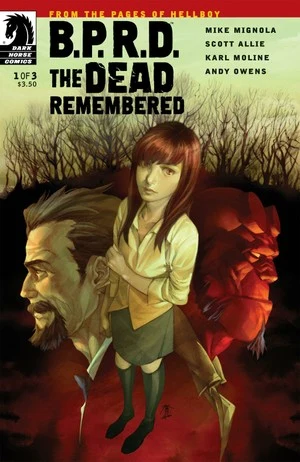
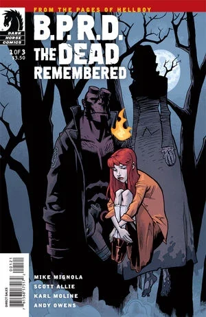
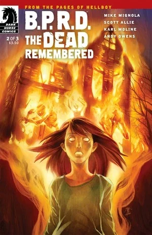
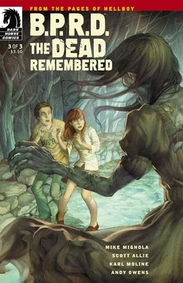

《**逝者不忘**》（The Dead Remembered）是一个回溯至 1976 年的故事，也是[丽兹·舍曼](/entry/Elizabeth_Sherman)的第一次「任务」，[特雷佛·布鲁姆](/entry/Trevor_Bruttenholm)亦在其中登场。

## 出版历史

这部三期限定迷你系列于 2011 年 4 月至 6 月出版。2011 年 11 月，该故事收录于平装合订本《[B.P.R.D.: Being Human](/entry/Trade_Collections)》。这是第一部由长期担任《Hellboy》与《B.P.R.D.》编辑的 Scott Allie 担任编剧的迷你系列。

## 剧情概要

### 第一部分

在意外将家人活活烧死三年后，14 岁的火焰操控者丽兹·舍曼随布鲁姆教授一同前往调查新英格兰的一座小镇——那里曾发生过一场惨烈的猎巫运动，而一个鬼魂正在一位神父的宅子里作祟。

### 第二部分

当布鲁姆在神父家中驱走一个鬼魂时，丽兹探查了宅子周围的树林——那里曾发生过一场惨烈的猎巫运动，还有一名女人被谋杀！

丽兹害死家人的那场事故，终于以完整细节揭晓！

### 第三部分

丽兹·舍曼重温了一名三百年前遭受酷刑的被指控女子的命运，但她必须克制住自己的火焰之力，否则整座新英格兰小镇都将被迫重温丽兹把自己家人烧死的那一天。

## 与其他故事的关联

故事中出现了丽兹第一次重大事故的闪回——她在那场事故中意外害死了自己的家人；这一事件最早在《[Seed of Destruction](/entry/Seed_of_Destruction)》（毁灭之种）的第二期中被提及。

在《[The Whittier Legacy](/entry/The_Whittier_Legacy)》（惠蒂尔遗产）中我们得知，来自罗得岛州普罗维登斯（该州与马萨诸塞州接壤）的惠蒂尔家族曾参与秘术仪式。故事中的鬼魂安妮很可能就出自同一家族：她的娘家姓正是惠蒂尔，而且她也是在被指控施行巫术之后，从英格兰迁居到美国的新英格兰地区。

Yafides 神父提到了寻巫人 [Henry Hood](/entry/Henry_Hood)，后者首次登场于《[Darkness Calls](/entry/Darkness_Calls)》（黑暗召唤）；其中有一页再现了 [Duncan Fegredo](/entry/Duncan_Fegredo) 在那个故事中所绘的一格画面，描绘 Hood 绞死一群女人的场景。

## 内容

### 角色

Anne Caldwell（娘家姓 Whittier）、马萨诸塞居民

- [超自然调查防御署](/entry/Bureau_for_Paranormal_Research_and_Defense)（B.P.R.D.）
  - [特雷佛·布鲁姆](/entry/Trevor_Bruttenholm)
  - [地狱男爵](/entry/Hellboy_%28character%29)
  - [丽兹·舍曼](/entry/Elizabeth_Sherman)
  - Jenny
- Yafides 神父
- Sotiropoulos 一家
  - Ted Sotiropoulos
  - Ted Sotiropoulos Sr.
  - Michael Sotiropoulos
- [Henry Hood](/entry/Henry_Hood)（闪回）
- Thomas Caldwell（闪回）
- 舍曼家族成员（闪回）

### 地点

- 美国
  - Caldwell 宅邸（马萨诸塞湾殖民地）（闪回）
  - [超自然调查防御署](/entry/Bureau_for_Paranormal_Research_and_Defense)（B.P.R.D.）总部（康涅狄格州 Farfield）
  - Peerlo 空军基地（新墨西哥州）（照片）
  - 无名小镇（马萨诸塞州）
    - Yafides 宅邸
    - Hayes 旅馆
    - 餐厅
  - 舍曼宅邸（堪萨斯州堪萨斯城）（闪回）
- 英格兰（闪回）

## 画廊

除另有说明外，所有封面均由 [Jo Chen](/entry/Jo_Chen) 绘制。

 \#1

 \#1 variant cover by Karl Moline

 \#2

 \#3

## 花絮

- 丽兹与特雷佛乘车前往 Yafides 神父家途中，车里播放的歌曲是 [Paul Simon 的《Loves Me Like A Rock》](https://www.youtube.com/watch?v=CjFzw8AxSBA)。这首歌发行于 1973 年，而在故事设定中，这也正是丽兹意外害死家人的那一年。
