**Duncan Fegredo**（邓肯·费格瑞铎）是英国漫画画师。2007 年至 2011 年间，他担任*[《地狱男爵》（Hellboy）](/entry/Hellboy_%28series%29)*的连载画师。

## 内页画师

Duncan Fegredo 接替 [Mike Mignola](/entry/Mike_Mignola) 担任《地狱男爵》连载画师，从[《黑暗召唤》（Darkness Calls）](/entry/Darkness_Calls)开始，由此加入地狱男爵宇宙。在完成[《狂怒》（The Fury）](/entry/The_Fury)后，他卸任连载画师，但仍是地狱男爵宇宙团队的一员。

- [《地狱男爵：黑暗召唤》（Hellboy: Darkness Calls）](/entry/Darkness_Calls)
- [《地狱男爵：鼹鼠》（Hellboy: The Mole）](/entry/The_Mole)
- [《地狱男爵：狂猎》（Hellboy: The Wild Hunt）](/entry/The_Wild_Hunt)
- [《地狱男爵：风暴》（Hellboy: The Storm）](/entry/The_Storm)
- [《地狱男爵：狂怒》（Hellboy: The Fury）](/entry/The_Fury)
- [《B.P.R.D.：人间地狱——无名之墓》（B.P.R.D.: Hell on Earth—An Unmarked Grave）](/entry/An_Unmarked_Grave)
- [《地狱男爵：午夜马戏团》（Hellboy: The Midnight Circus）](/entry/The_Midnight_Circus)
- [《地狱男爵：瓦尔古之兽》（Hellboy: The Beast of Vargu）](/entry/The_Beast_of_Vargu)
- [《地狱男爵：罗姆人的隐秘之神》（Hellboy: The Secret God of the Roma）](/entry/The_Secret_God_of_the_Roma)

## 封面画师

### 各期

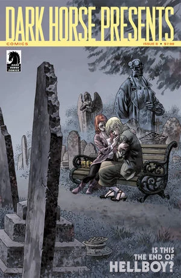

|*Dark Horse Presents* #8（为[《无名之墓》（An Unmarked Grave）](/entry/An_Unmarked_Grave)所作）

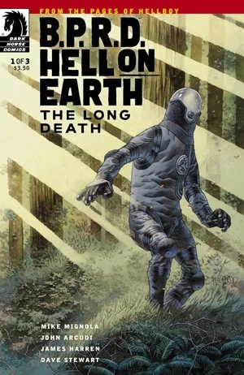

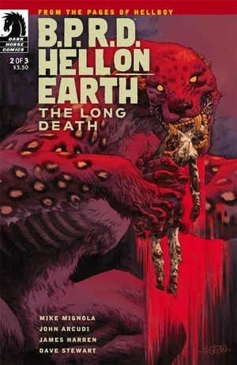

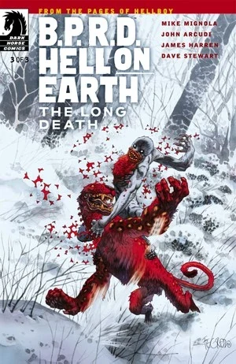

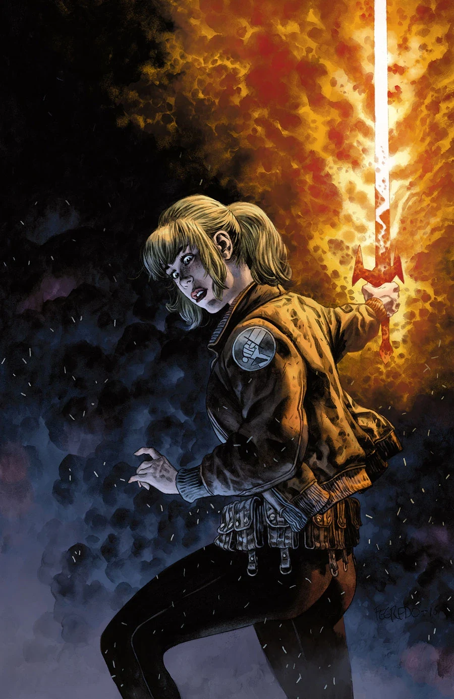

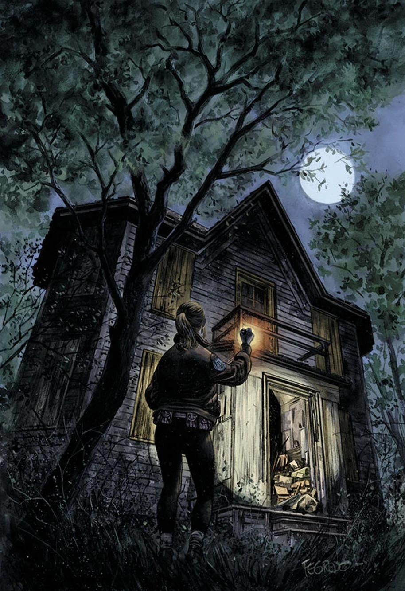

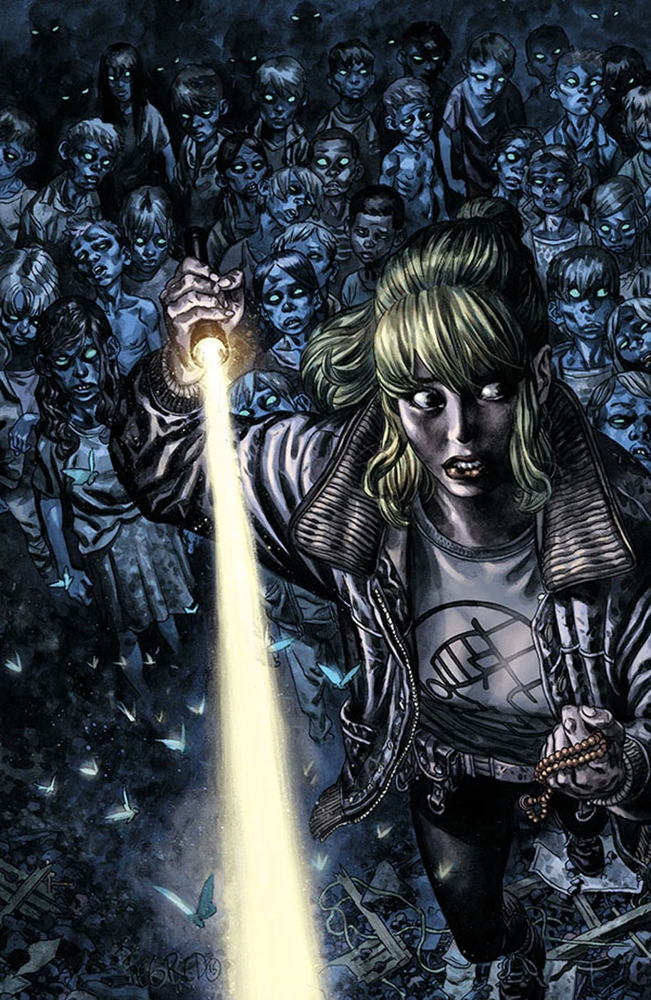

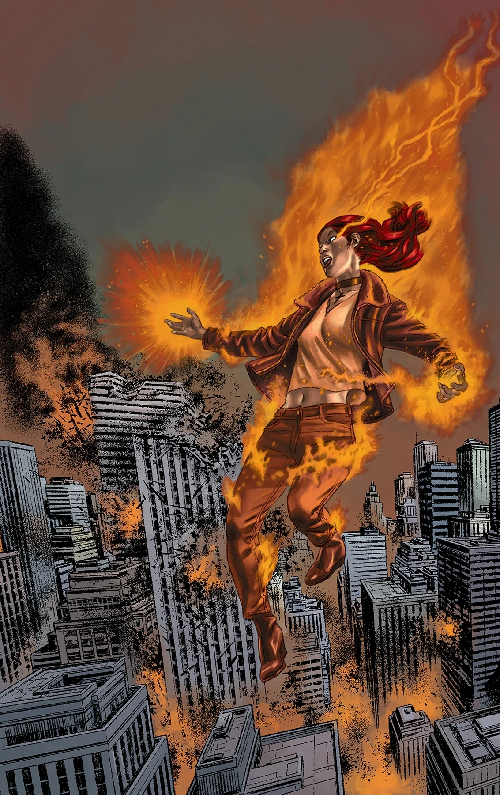

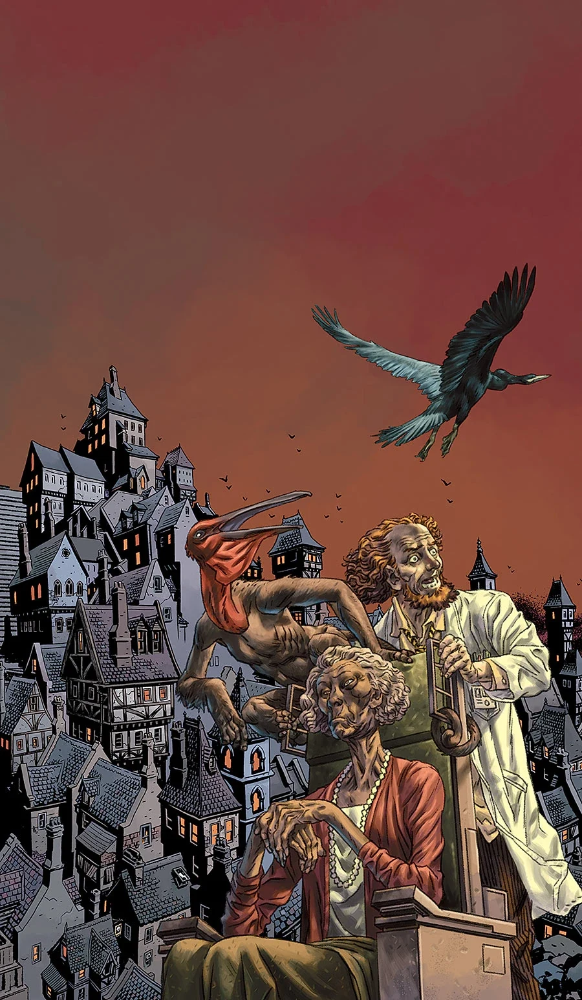

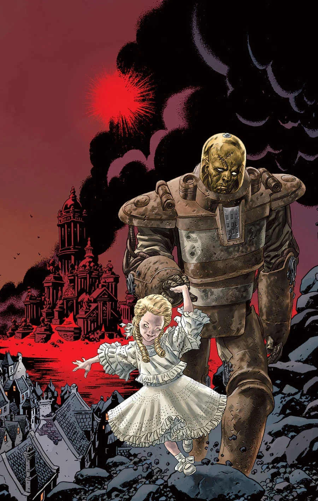

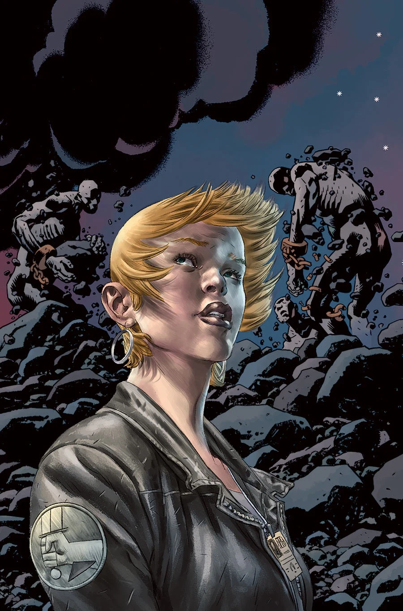

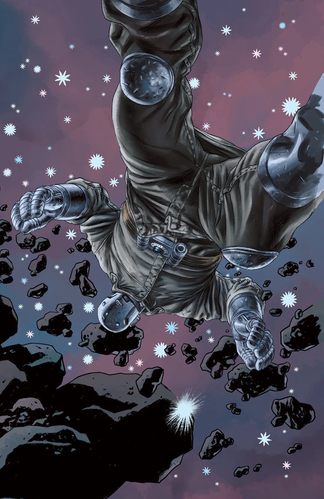

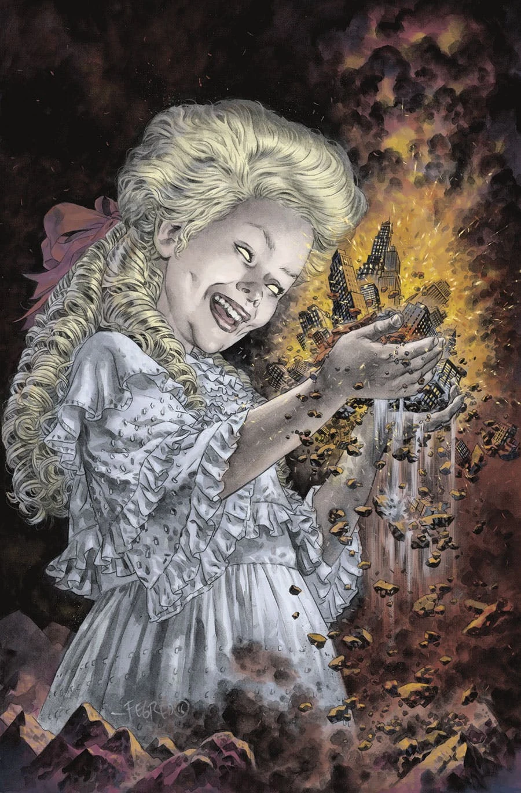

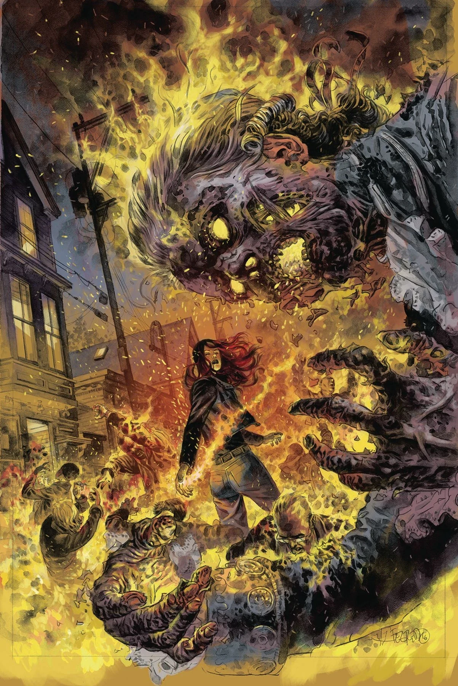

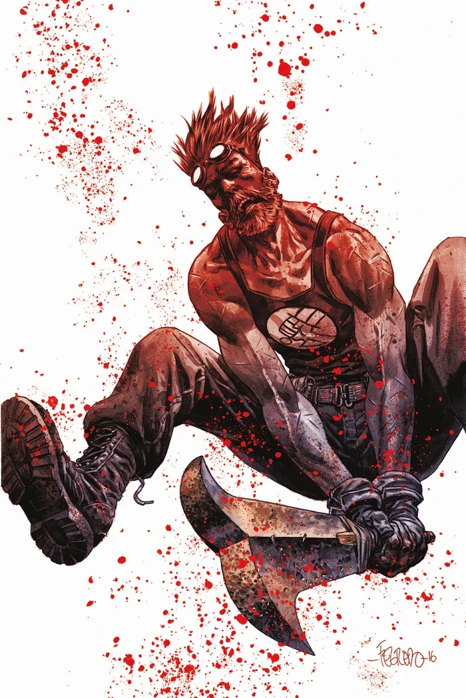

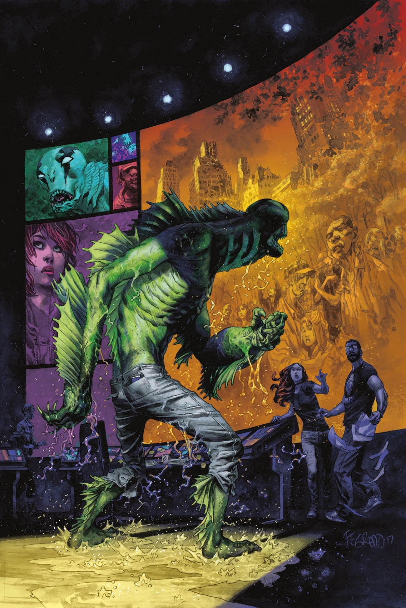

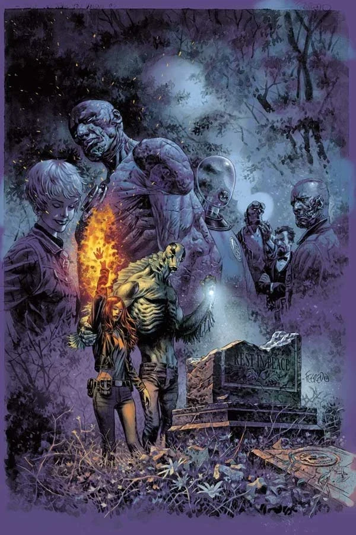

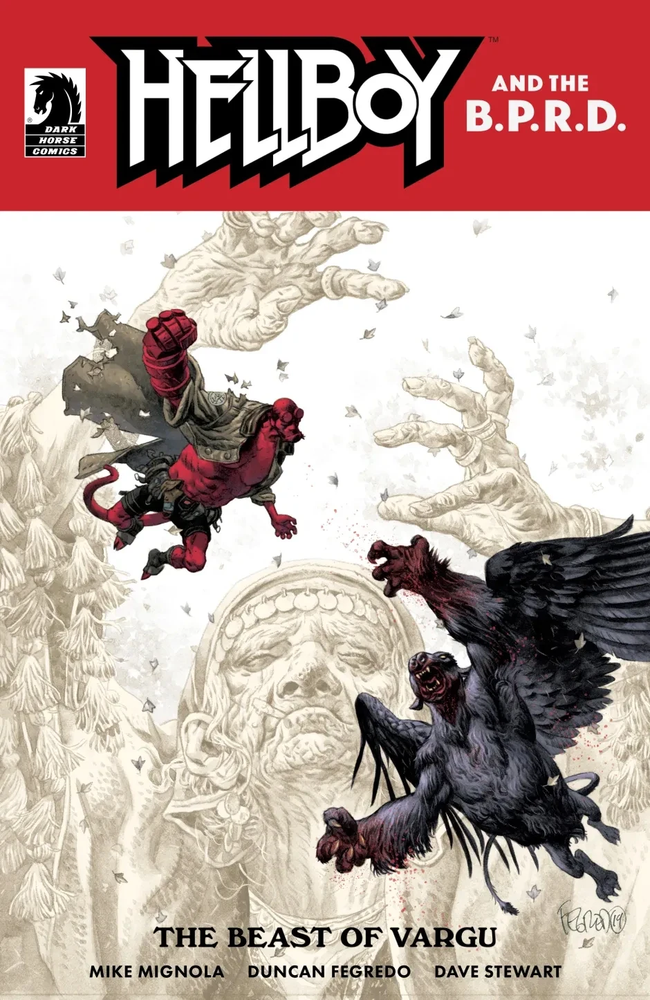

|《地狱男爵：瓦尔古之兽》（Hellboy: The Beast of Vargu）

### 小说

## 外部链接

- [**Wikipedia：** Duncan Fegredo](https://en.wikipedia.org/wiki/Duncan_Fegredo)
- [**Comic Book DB：** Cameron Stewart](http://comicbookdb.com/creator.php?ID=1237)
- [官方网站](http://www.duncanfegredo.co.uk/)
