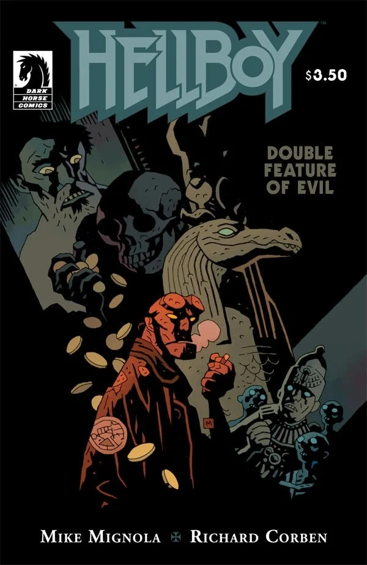

《**邪典双专场**》（Double Feature of Evil）是一本单刊，收录了两个短篇故事。第一个故事中他前往一栋鬼屋。第二个故事中他前往一座博物馆。

## 出版历史

《邪典双专场》于 2010 年 11 月以单期形式出版。它有两个封面同时发行，一个由 [Richard Corben](/entry/Richard_Corben) 绘制，另一个由 [Mike Mignola](/entry/Mike_Mignola) 绘制的变体封面。

## 剧情简介

### 框架故事

在一家破旧的老电影院里，一群僵尸正坐着看一场恐怖电影连映专场。他们正在看的电影就是这两个[《地狱男爵》](/entry/Hellboy_%28series%29)故事。

### 《沙利文的奖赏》

1960 年，地狱男爵前往堪萨斯州去见沙利文先生。沙利文解释说，他原本是个酒鬼，直到一个陌生人出现，给了他一栋房子的地契。他搬到那里后得知，只要把一个人放进某个房间，房子就会杀死那个人并付给他黄金。那男人设计骗了地狱男爵，把他锁进了那个房间。在房间里，地狱男爵看到了房子建造者的灵魂，它向他发起攻击。房子外面，沙利文因为带来了地狱男爵而得到报酬——一大堆黄金砸下来，把他压死了。地狱男爵逃了出来，摧毁了建造者的残骸。房子崩塌了。

### 《塞贝克之屋》

在一座大学博物馆里，一个自称法老的男人设法让木乃伊复活了。地狱男爵轻松地制服了木乃伊，那男人逃走了。他进入了在博物馆中复原重建的一座[塞贝克](/entry/Sebek)神庙。那男人向[荷鲁斯](/entry/Horus)祈祷。这激怒了塞贝克，鳄鱼神的雕像活了过来，吃掉了那男人。

## 画廊

|by Mike Mignola
