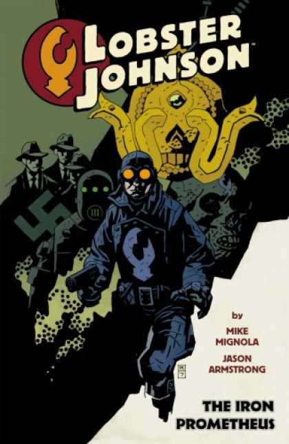
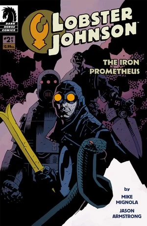
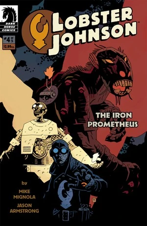

《**钢铁普罗米修斯**》（The Iron Prometheus）是一部五期限定连载，由 [Mike Mignola](/entry/Mike_Mignola) 编剧、[Jason Armstrong](/entry/Jason_Armstrong) 绘制。它于2007年由黑马漫画（Dark Horse Comics）发行。

## 角色

- [龙虾人](/entry/The_Lobster)
- 龙虾人的团队
  - [莱斯特](/entry/Lester)
  - [哈里·麦克泰尔](/entry/Harry_McTell)
  - [鲍勃](/entry/Robert_Isherwood)
  - [比尔](/entry/Bill)
- [梅姆南·萨](/entry/Memnan_Saa)
- [吉姆·萨克斯](/entry/Jim_Sacks)
- [瓦克斯曼博士](/entry/Niels_Waxman)
- [基里亚科斯·加拉拉加斯教授](/entry/Kyriakos_Gallaragas)
- [海伦娜·加拉拉加斯](/entry/Helena_Gallaragas)
- [丘特战士](/entry/Chutt)

## 剧情

### 第一部

1937年，当美国徘徊在第二次世界大战的边缘时，龙虾人和他的盟友们必须争分夺秒，一路杀过食人族、雪猿，以及一名神秘反派的种种阴谋——此人一心想要实现一个致命的预言。

### 第二部

龙虾人和吉姆更深入地探究加拉拉加斯教授神秘失踪背后的邪恶势力，发现了一个比他们所能想象的还要荒诞的阴谋，其中涉及纳粹、西藏邪教徒，以及一个一旦实现便可能意味着世界末日的预言。

### 第三部

龙虾人并未被在蛇怪口中的失败所吓倒，他重新投入行动——但他能及时找到自己的盟友吗？吉姆——仍穿着他那套偷来的战甲——已落入一名神秘反派的魔爪，此人将不惜一切代价，要驾驭驱动吉姆战甲的宇宙维利尔（Vril）能量。

### 第四部

在盟友们死去之后，龙虾人必须一路杀过一座由神秘学与科学的畸形怪物组成的变异兽栏，以阻止他那神秘对手的险恶阴谋。

### 第五部

龙虾人回归，迎来《钢铁普罗米修斯》扣人心弦的结局——他在泽西海岸与一名可怕的犯罪主谋及纳粹作战，试图阻止一个神秘的预言。

## 画廊

 \#1

 \#2

 \#3

 \#4

 \#5
