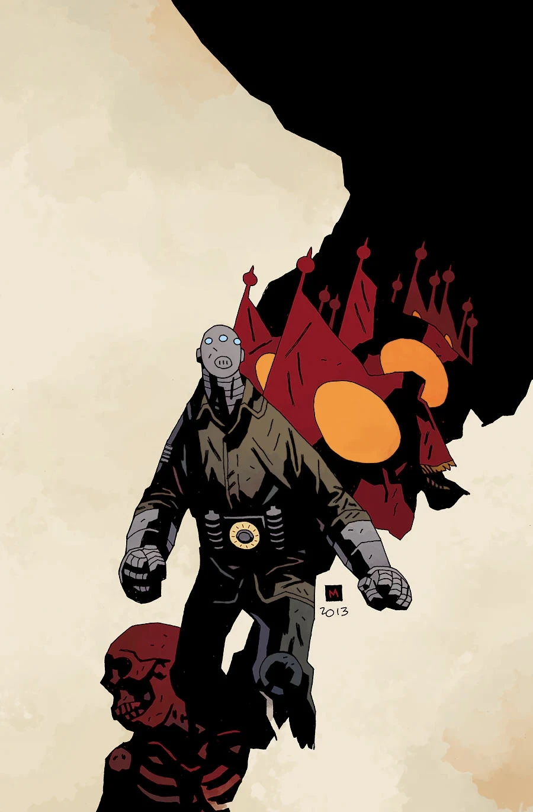

《**闪电战**》（Lightning War）是一部三期迷你系列，于2013年出版，画作由 Laurence Campbell 创作。它是 *[Sledgehammer 44](/entry/Sledgehammer_44_%28story%29)* 的续作。

## 剧情简介

### 第一部

在被称为"飞翼"的机密先进飞机遭纳粹劫持后，Sledgehammer 被派去执行一项特别回收任务，与致命的[黑焰](/entry/The_Black_Flame_%28character%29)正面对决！

### 第二部

被称为 Sledgehammer 的铁甲战士是唯一能领导一场营救行动的人——一名被绑架的美国人即将向纳粹及其超级士兵——黑焰——泄露关于飞翼战机的最高机密情报！

### 第三部

黑焰与被称为 Sledgehammer 的铁甲战士之间的战斗不断升温，围绕一架尖端美国战机的搏斗在天空中爆发！

## 画廊

## 注释

第一部的剧情简介提到了实验性飞行器"飞翼"。这架飞行器在 *[B.P.R.D.：死者](/entry/The_Dead)* 中被提及。故事中的剪报簿里有一张黑焰站在机翼上的照片。照片标注为"在'飞翼'实验飞行期间拍摄。1944年9月20日"
