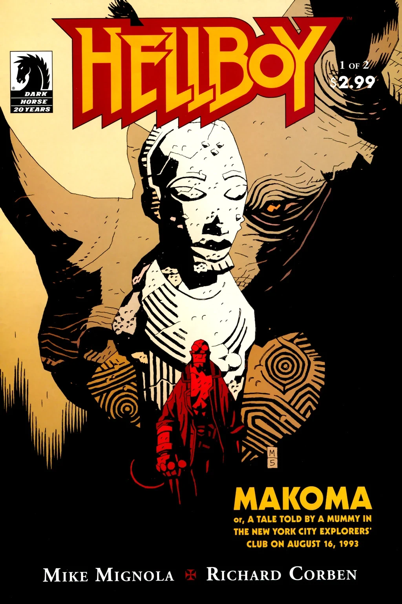
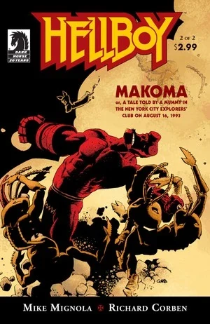

《**马科玛**》（Makoma，又名《1993年8月16日一具木乃伊在纽约市探险家俱乐部讲述的故事》，A Tale Told by a Mummy in the New York City Explorers' Club on August 16, 1993）讲述了一位传奇非洲国王的故事，由一具木乃伊讲给[地狱男爵](/entry/Hellboy)听。与此同时，马科玛的故事与地狱男爵自己的人生相互映照。

## 出版历史

《马科玛》最初于2006年2月至3月作为两期迷你系列出版。该故事后来于2007年10月收录于[《地狱男爵——第7卷：巨怪女巫及其他故事》](/entry/Trade_Collections)。

《马科玛》是第一部由[米格诺拉](/entry/Mike_Mignola)以外的人绘制美术的地狱男爵故事。

## 剧情简介

《马科玛》的框架故事设定在1993年。[地狱男爵](/entry/Hellboy)前往探险家俱乐部，一具从一座古城中取出的木乃伊（那座城市在一场沙暴后彻底消失了）开口对他说话。在这个框架之内，是传奇国王马科玛的故事。大部分时候马科玛被画得仿佛就是地狱男爵，不过在最后一场戏中，马科玛本人——一位非洲国王——才被描绘出来。

框架部分由[迈克·米格诺拉](/entry/Mike_Mignola)绘制，马科玛的故事由[理查德·科本](/entry/Richard_Corben)绘制。

### 第一部

《马科玛》的故事发生在1993年8月16日的纽约探险家俱乐部。[地狱男爵](/entry/Hellboy)与阿里·T·科曼教授交谈，后者谈及他最近在非洲的考古发掘。科曼因一场沙暴被迫放弃发掘现场，但带回了一批古物，其中包括一具木乃伊。地狱男爵提到自己只去过非洲一次。[1]俱乐部的人议论说，他1947年曾与[特雷弗·布鲁滕霍尔姆](/entry/Trevor_Bruttenholm)一同前往非洲，而最近布鲁滕霍尔姆的考察队被认定已经失踪。[2]地狱男爵闪过一段记忆，想起自己童年在非洲度过的时光，那时一头巨大的犀牛念出了他的名字。

木乃伊开始对地狱男爵说话，召唤他前往那座失落的城市与诸王的陵墓。地狱男爵在废墟中游荡，木乃伊开始给他讲马科玛的故事，他听着听着打起了瞌睡。

马科玛生来便会说话，他给自己取名为"最伟大且无所畏惧者"，他被扔进一个鳄鱼成群的深潭，第二天却完全长大成人地浮出水面，手持一把铁锤，周围是被杀死的鳄鱼。长老们向马科玛讲述这片土地上的种种祸患，他于是踏上了旅程。马科玛遇到一位老妇人，老妇人给了他一个袋子，用来装他敌人的骨头。老妇人嘱他一直背着袋子，直到在世界尽头与她再次相遇。马科玛的旅程中，他与巨人们狭路相逢，巨人们一听到他的名字便与他搏斗。每一个巨人都被击败，缩得极小，小到马科玛能把他们放进袋子里。接着马科玛找到一个火魔，击败了这个存在。恶魔引诱马科玛杀死他、夺取他的力量，"成为[他]注定要成为的东西"。但马科玛反而用树枝做了一个笼子，把火魔关在里面。

### 第二部

马科玛走近一个坐在城镇前的男人，城镇里的人们唱着歌，男人请他放下负担留下来。但马科玛看出这座城镇实际上满是处于梦境般死亡状态的尸体，于是决定返回。那人本打算让马科玛做他的奴隶，拒绝放他离开，便召来一群蚁人攻击这位战士。许多天之后，那人提出只要马科玛把装着巨人的袋子留下，就放他走。但马科玛设计让那人接过了树枝笼子，结果那人放出了火魔，火魔把他和他的城镇烧成灰烬。

马科玛继续旅行了多年，直到回到他旅程之初遇到的那位老妇人身边。马科玛在老妇人的小屋中睡去。在梦中，伟大酋长们的灵魂以狮子的形态、非洲之灵以巨犀的形态前来拜访他。他醒来时面前摆着一席盛宴，马科玛把食物吃得一干二净，之后才得知自己吃下的是那些巨人。马科玛朝袋中看去，看到一个男孩站在一堆骨头上，老妇人揭示说这个男孩此前被火魔附了身，是马科玛使他重获新生。马科玛重新踏上旅程，随后迎战一条七头巨龙，他与怪物势均力敌，最终双双战死。马科玛死后，世界从他的袋子中被重新创造出来，那个男孩最后一个走出来。

叙述回到城市废墟中的木乃伊。他告诉地狱男爵，他就是那个男孩，他建造这座城市，作为马科玛的纪念碑与陵墓。讲完故事后，木乃伊碎成了尘土。由于这件事，地狱男爵被探险家俱乐部列为不受欢迎的人。

## 与其他故事的关联

整个故事与地狱男爵自己的人生、或他人生的一种可能性相平行，因为他在故事中扮演了马科玛的角色。[3]最明显的元素是七头巨龙（原故事中是五头），它代表[奥格德鲁·贾哈德](/entry/Ogdru_Jahad)。这个故事暗示了整个地狱男爵故事的一种可能结局：奥格德鲁·贾哈德被释放，地狱男爵与它们战斗，在战斗中杀死它们，世界不久之后自行复原。这既类似地狱男爵系列的结局，也类似BPRD系列的结局，两者都涉及地狱男爵与巨龙的一个化身战斗。

马科玛击败巨人并把他们缩小，可能代表地狱男爵与格罗姆的战斗。

[地狱男爵](/entry/Hellboy)在《[三个愿望](/entry/The_Third_Wish)》中前往非洲。在那里他睡着并有狮子前来拜访，这些可能就是《马科玛》第2期中出现的伟大酋长们的灵魂。

## 内容

### 角色

#### 现代

- [B.P.R.D.](/entry/Bureau_for_Paranormal_Research_and_Defense)
  - [地狱男爵](/entry/Hellboy_%28character%29)
  - [特雷弗·布鲁滕霍尔姆](/entry/Trevor_Bruttenholm)（照片）
- 纽约探险家俱乐部
  - 阿里·T·科曼
  - 其他成员
- 非洲之灵（闪回）
- [青蛙怪物](/entry/Frog_monster)（叙述中被提及）

#### 马科玛闪回/幻象

- 木乃伊（"男孩"）
- 马科玛（在幻象中由地狱男爵代表）
- [女巫](/entry/Witches)
  - 女巫
- 巨人们
  - Chi-Eswa-Mapiri
  - Chi-Dubula-Taka
  - Chi-Gwisa-Miti
  - 河流巨人
- 火[恶魔](/entry/Demon)
- "恶人"
- 蚁人
- 非洲的众灵
- 巨龙（可能是[奥格德鲁·贾哈德](/entry/Ogdru_Jahad)）
- 其他非洲人

### 地点

- 美国
  - 纽约探险家俱乐部（纽约州纽约市）
- 非洲（闪回与幻象）
  - 坦桑尼亚（闪回）
  - 死者之城（幻象）

### 值得注意的物品

- 马科玛的铁锤（在幻象中由[末日右手](/entry/Right_Hand_of_Doom)代表）
- 马科玛的布袋
- 马科玛的树枝袋

## 趣闻

- 地狱男爵声称自己只在1947年去过非洲一次，但在正史小说[《地狱男爵：失落的军团》](/entry/Hellboy__The_Lost_Army)（故事发生在1986年）中，他前往了埃及。

## 画廊

\#1 封面，迈克·米格诺拉绘

\#2 封面，理查德·科本绘

## 注释

[1] 地狱男爵前往非洲一事先前在《[征服者蠕虫](/entry/Conqueror_Worm_%28story%29)》第4期中被提及

[2] 先前在《[毁灭之种](/entry/Seed_of_Destruction)》第1期中被提及

[3] 米格诺拉在[《地狱男爵——第7卷：巨怪女巫及其他故事》](/entry/Trade_Collections)中该故事的引言里指出了这些平行对应
