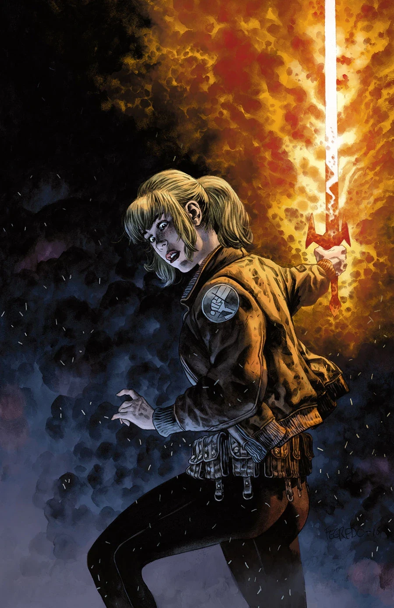
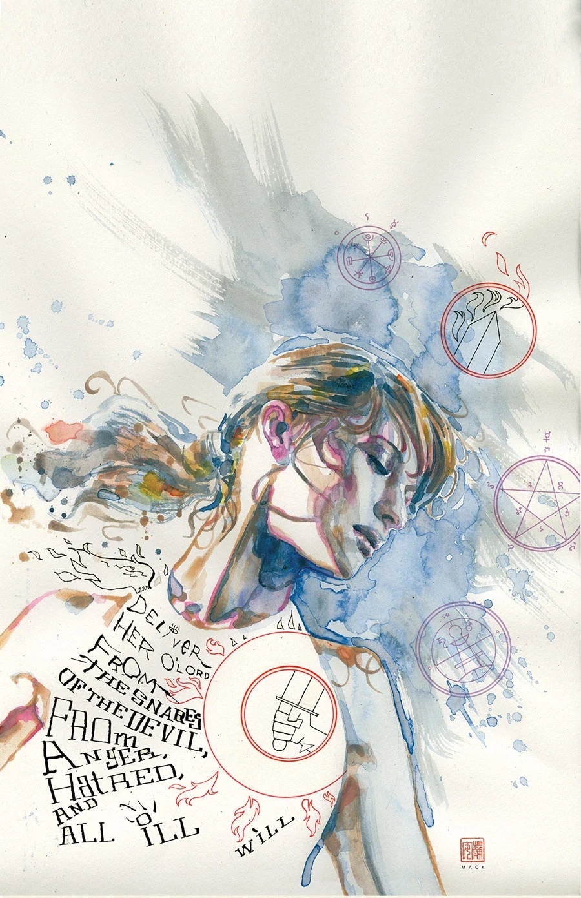
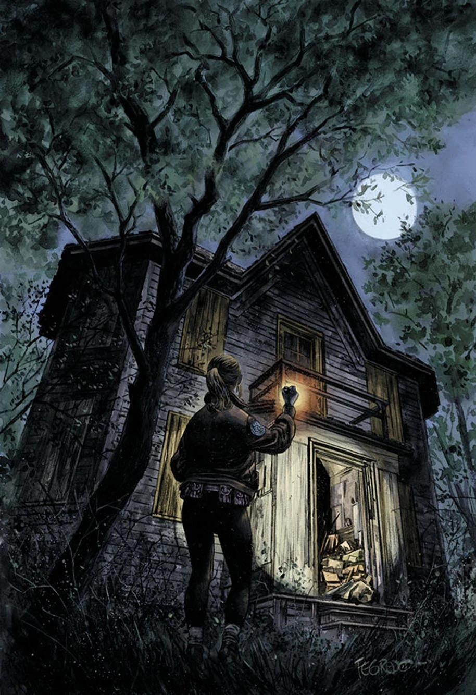
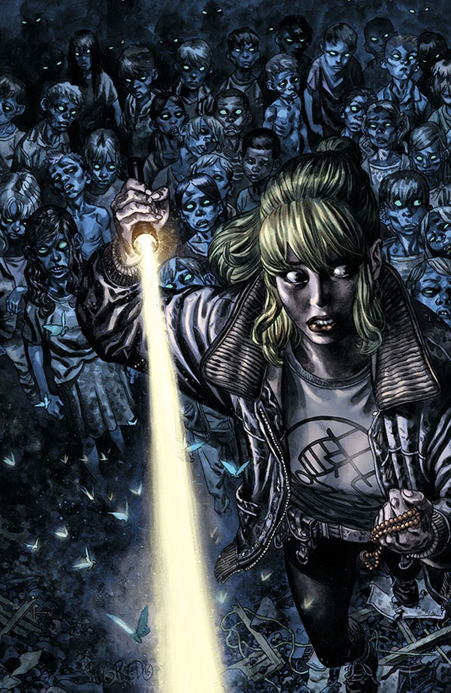

《**驱魔人**》（The Exorcist）是 [Cameron Stewart](/entry/Cameron_Stewart) 创作的两篇[阿什利·斯托德](/entry/Ashley_Strode)故事中的第二篇。

## 出版历史

这篇三期故事最初计划由 Cameron Stewart 亲自编剧并作画，于 2016 年 2 月开始推出。然而故事推迟到 2016 年 4 月，创作团队也发生了变动。根据 Cameron Stewart 的大纲，《驱魔人》的剧本由 [Chris Roberson](/entry/Chris_Roberson) 撰写；[Mike Norton](/entry/Mike_Norton) 接手作画，[Dave Stokes](/entry/Dave_Stokes) 在缩略草图方面提供了一些协助。

Stewart 表示，由于《Fight Club 2》和《Batgirl》的工作承诺，他无法独自完成这篇故事。他还说这很可能是他最后一篇阿什利·斯托德故事，因为他打算专注于自己的个人项目。[1]

## 剧情简介

### 第一部分

Cameron Stewart（《Fight Club 2》、《Batgirl》）回到了他在《[BPRD 人间地狱：驱魔](/entry/Exorcism)》中塑造的角色。上一次见到阿什利·斯托德时，世界正开始在她周围崩坏，她只学会了驱魔最基础的皮毛。如今地狱之门已经关闭，文明在天启面前停摆，阿什利正用自己所知的一切拖延末日的到来。一座小镇上摇摇欲坠的房子藏着诡异的秘密，让阿什利恨不得自己还和[丽兹](/entry/Elizabeth_Sherman)、[凯特](/entry/%E5%87%AF%E7%89%B9%C2%B7%E8%80%83%E7%91%9E%E6%A0%B9)待在一起——因为要应付这件事，恐怕需要整个[B.P.R.D.](/entry/B.P.R.D.)出动。

### 第二部分

儿童失踪案与恶魔崇拜的传言把 BPRD 驱魔人阿什利·斯托德引到一座近乎荒废的乡村小镇，而这里并非所有人都准备好驱逐镇上的恶魔。

### 第三部分

在把一个恶魔符号的源头追溯到一座乡村小镇的废弃房屋后，阿什利必须在更多孩子失踪之前直面镇上的恶魔。

## 画廊

David Mack 变体封面

<references />

[1] <http://www.comicbookresources.com/article/roberson-norton-team-with-stewart-for-ghostly-bprd-story>
