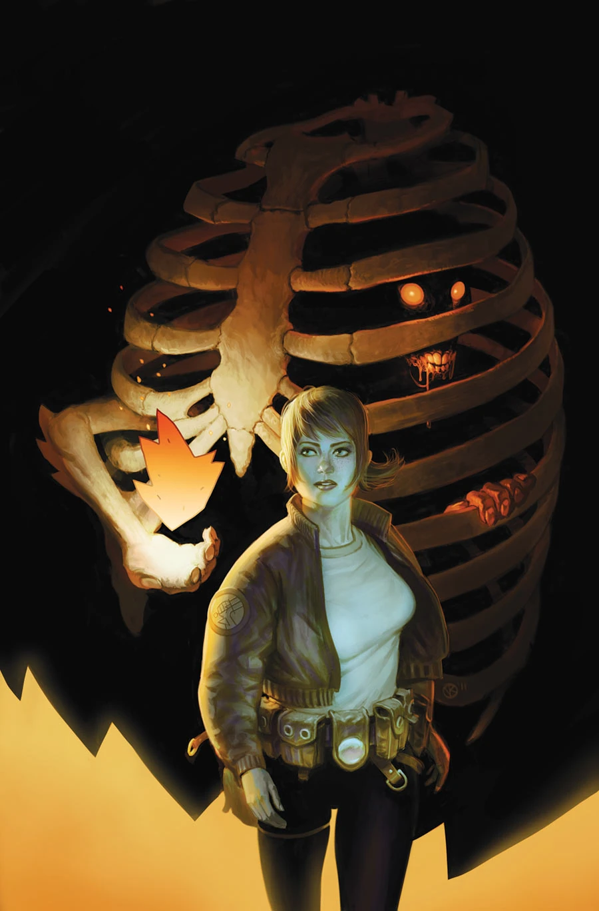
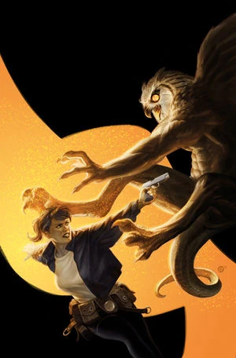

《**驱魔记**》（Exorcism）是 [Cameron Stewart](/entry/Cameron_Stewart) 围绕[阿什利·斯托德探员](/entry/Ashley_Strode)创作的两个故事中的第一篇。

## 出版历史

*B.P.R.D.: Hell on Earth—Exorcism* 是一部两期限定迷你系列，于 2012 年 6 月至 7 月出版。剧情围绕[斯托德探员](/entry/Ashley_Strode)展开，讲述她在印第安纳州一座乡间小镇调查一连串驱魔事件的经过。

本篇是[《BPRD:人间地狱》故事环](/entry/BPRD%3F%E4%BA%BA%E9%97%B4%E5%9C%B0%E7%8B%B1))的一部分，但属于支线故事，情节并不接续《[漫长的死亡](/entry/The_Long_Death)》。各期封面由 [Viktor Kalvachev](/entry/Viktor_Kalvachev) 绘制。

## 剧情简介

### 第一部

外勤探员[阿什利·斯托德](/entry/Ashley_Strode)被派往一座墨西哥村庄：一名恶魔命令她释放自己的一个同类，否则就要夺走一个幼童的灵魂。

### 第二部

外勤探员[阿什利·斯托德](/entry/Ashley_Strode)试图将一名恶魔从一位百岁驱魔人身上驱逐出去，她采用了一种致命的仪式，会将二人一同送入灵魂的地狱。

## 画廊

 \#1

 \#2
