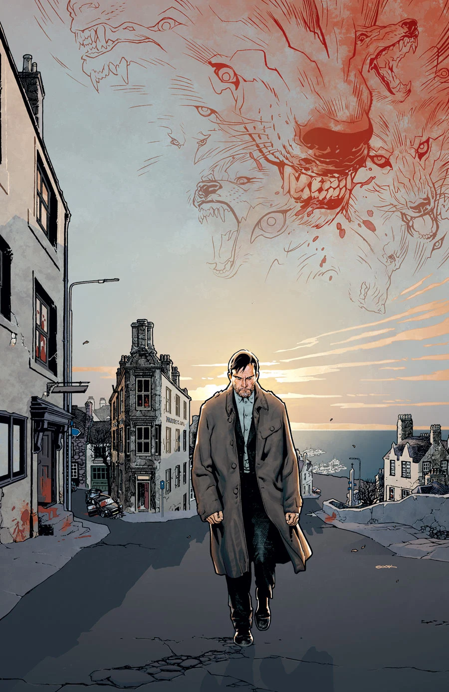
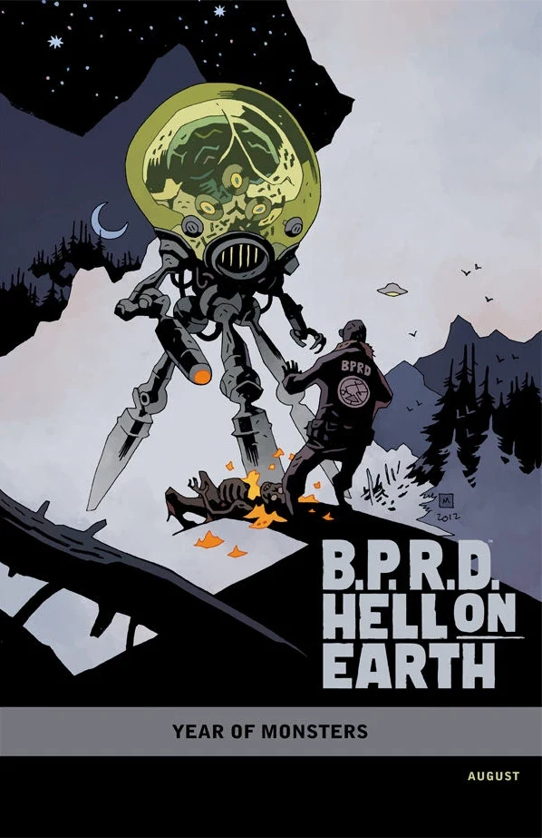
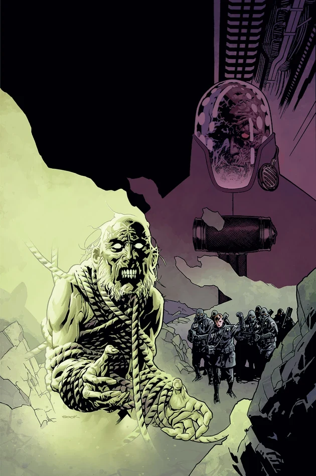
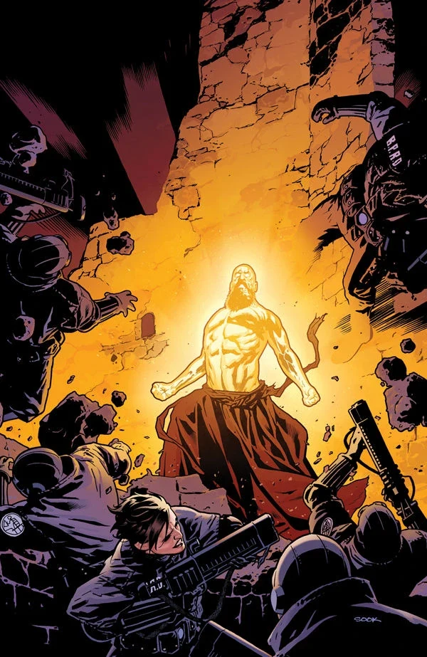
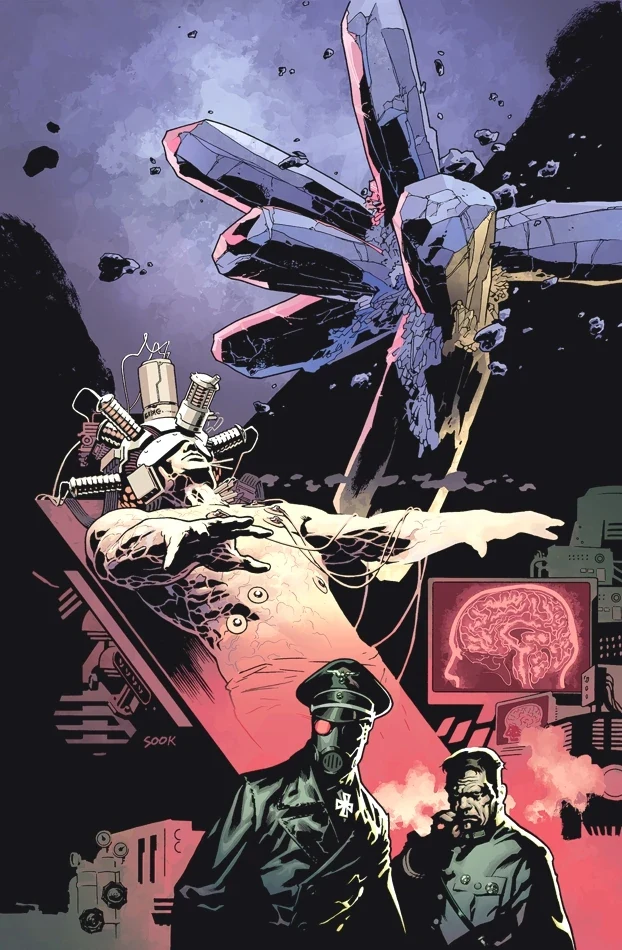
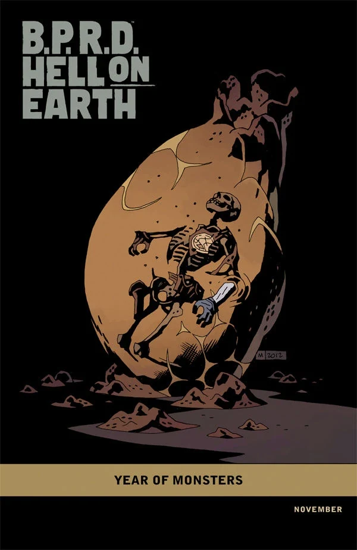
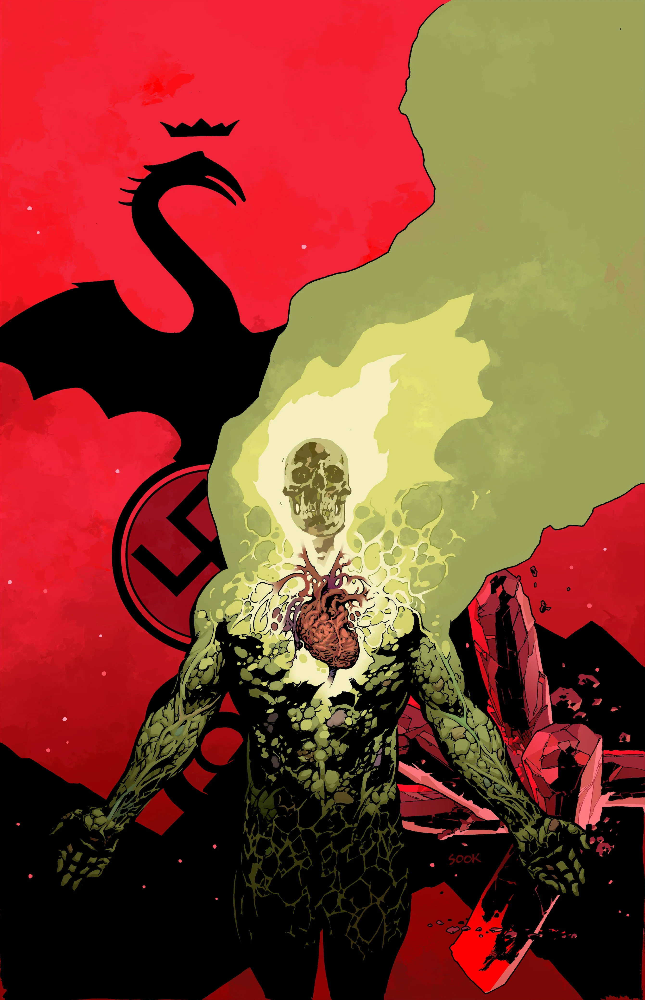
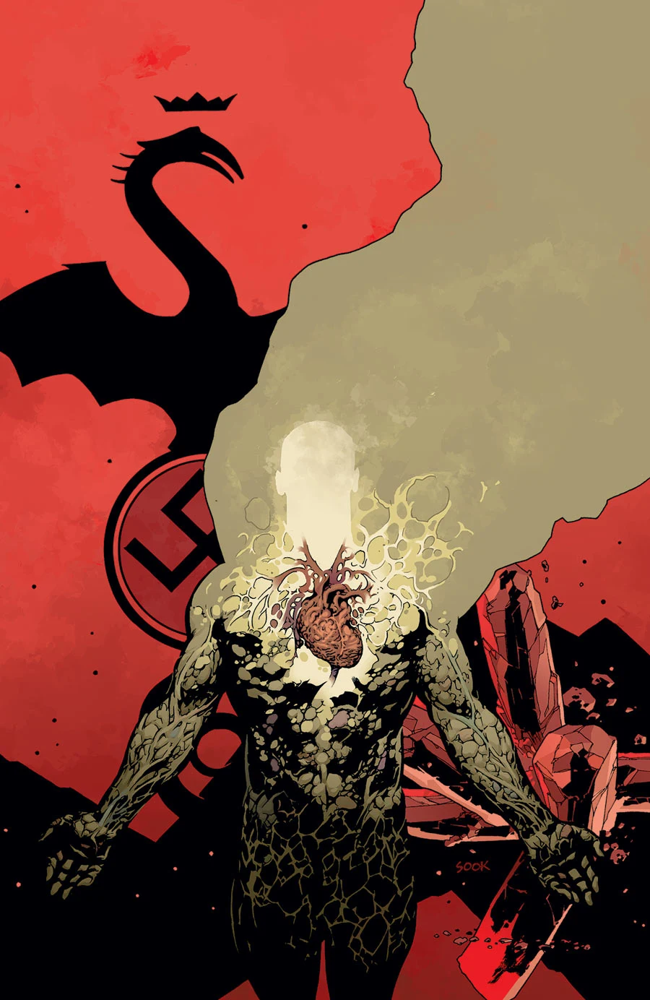

《**魔主再临**》（The Return of the Master）是一部五期迷你系列，于 2012 年 8 月至 12 月出版。其中第三期是《*[B.P.R.D.](/entry/B.P.R.D._%28series%29)*》的第 100 期。

## 剧情简介

### 第一部分

在苏格兰高地，一名从《*[B.P.R.D.：人间地狱——俄罗斯](/entry/Russia)*》那场血腥屠杀中逃脱的变节科学家，纠集起一个矢志毁灭世界的超自然邪教。B.P.R.D. 能否及时追查到这个团体？还是说，在这个本已摇摇欲坠、濒临末日的世界里，恶魔将被释放出来？

### 第二部分

一支 B.P.R.D. 精英小队深入苏格兰高地追捕疯狂的俄罗斯科学家，却遭到一只凶暴骇人的幽灵伏击。与此同时，金科公司与调查局会面，计划对约翰进行特殊实验。

### 第三部分

一支 B.P.R.D. 特遣队攻入疯狂俄罗斯科学家及其邪教追随者的据点，却发现自己被困在一座充斥着可怖黑魔法的致命要塞之中。

### 第四部分

疯狂的俄罗斯科学家及其邪教追随者削弱了 B.P.R.D. 的力量，混乱骤然爆发。与此同时，调查局总部的金科实验迎来了一个危险而意外的结局。

### 第五部分

巨大的毁灭席卷全球，恐怖的怪物从地底喷涌而出，人间地狱就此达到顶峰。

## 画廊

除特别注明外，全部封面均由 Ryan Sook 绘制。

「[怪兽之年](/entry/Year_of_Monsters)」变体封面
[Mike Mignola](/entry/Mike_Mignola) 绘

 \#2

 \#3

 \#4

 \#4
「[怪兽之年](/entry/Year_of_Monsters)」变体封面
[Mike Mignola](/entry/Mike_Mignola) 绘

 \#5

### 第 \#5 期备选封面

 在征订宣传阶段，第 \#5 期的封面经过修改，以便对第 \#4 期的重大揭露保密。第 \#4 期出版后不久，真正的封面才被公开。
