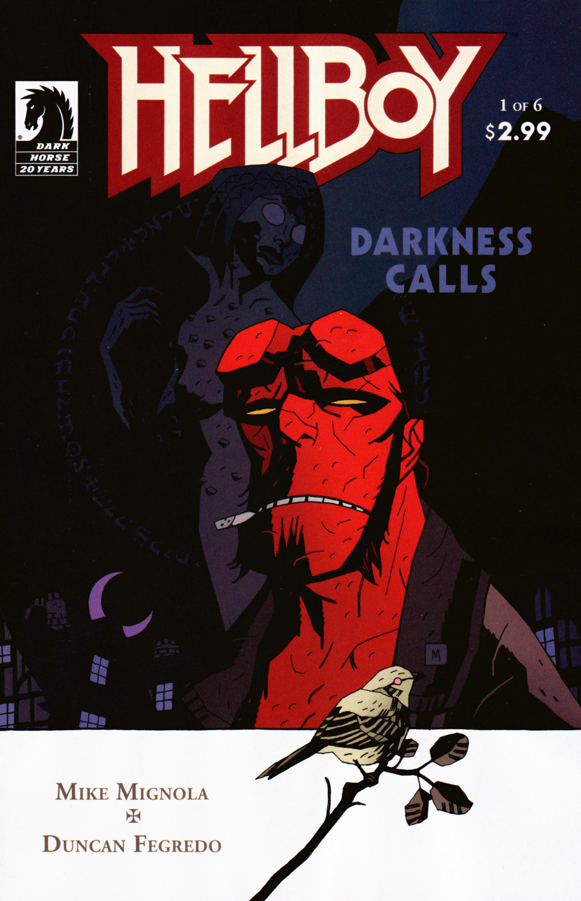
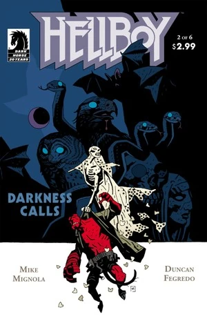
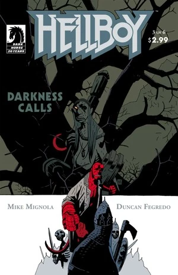
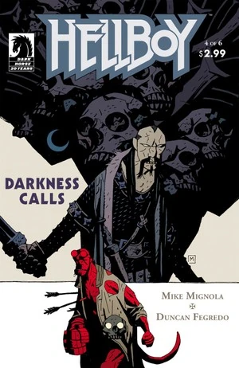
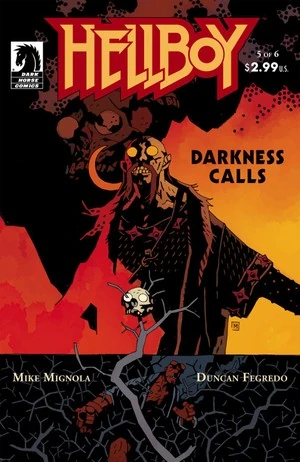

在《**黑暗召唤**》（Darkness Calls）中，[赫卡忒](/entry/Hecate)被囚禁，女巫们寻找一位新的统治者，她们希望[地狱男爵](/entry/Hellboy_%28character%29)成为她们的国王。地狱男爵拒绝了，并被困在一个由[芭芭·雅嘎](/entry/Baba_Yaga_%28character%29)控制的俄罗斯神话世界中。他被迫先面对她的仆从，然后才能逃脱。与此同时，女巫们继续寻找新的统治者，为即将到来的一切埋下伏笔。

## 出版历史

《黑暗召唤》于 2007 年 5 月至 11 月间作为六期限定迷你系列出版。第 \#1 期和第 \#2 期都在 5 月出版，不过第 \#1 期的封面日期是 4 月。该系列本应按月发行，但第 \#6 期延期，于 11 月 7 日才发行。[1]

该故事于 2008 年 5 月连同两个新尾声一起收录进《[地狱男爵：第 8 卷 黑暗召唤](/entry/Trade_Collections)》。第一个尾声由 [Duncan Fegredo](/entry/Duncan_Fegredo) 绘制，第二个由 [Mike Mignola](/entry/Mike_Mignola) 绘制。

最初《黑暗召唤》打算由 [Lee Bermejo](https://en.wikipedia.org/wiki/Lee_Bermejo) 绘制。虽然第一期已经画好，[2] 但最终决定不使用 Bermejo 来画这个故事。有若干画面被公布，包括 [Hellmail](/entry/Hellmail) 中刊登在 [*The Island* \#1](/entry/The_Island) 的一页上色稿。

## 剧情简介

### 第一部

在意大利的一座地下墓室里，[伊戈尔·布罗姆黑德](/entry/Igor_Bromhead)围着一大缸血吟唱，召唤女神[赫卡忒](/entry/Hecate)。赫卡忒现身，布罗姆黑德随即用她的秘密名字——[伊尔莎·豪普斯坦因](/entry/Ilsa_Haupstein)——诅咒并束缚她。赫卡忒震惊于他竟然知道这个名字。布罗姆黑德透露，她被自己的情人[弗拉基米尔·久列斯库](/entry/Vladimir_Giurescu)出卖了，后者的骸骨就躺在这座墓室里。

在英格兰，三个女巫站在一圈立石之中。其中一个女巫刚从久列斯库城堡回来，她在那里取回了[地狱男爵](/entry/Hellboy)的两只断角（如《[唤醒恶魔](/entry/Wake_the_Devil)》中所见）。她们把其中一只角雕刻成地狱男爵的形象，并用它来召唤他。

同样在英格兰，过去一个月里地狱男爵一直住在老朋友[哈里·米德尔顿](/entry/Harry_Middleton)家。地狱男爵决定出去散个短步。他走进一片树林时，一群猫跟随着他。

三个人——两个男人和一个女人——走近地狱男爵。他们告诉地狱男爵，就在这个地方，1640 年代的猎巫人[亨利·胡德](/entry/Henry_Hood)绞死了三个女人。胡德没有好下场：他的眼睛被铜钱烧穿，被活埋在一座没有标记的坟墓里。

故事闪回到绞死那三个女人的场景。一个女人用最后一口气诅咒胡德，说他今生来世都不得安宁。

三个旅人来到那三个女人的坟前，把一种药剂倒在坟上，使女巫们复活。他们告诉地狱男爵，将有一场前所未有的女巫集会，而这一切都是为了地狱男爵。

### 第二部

英格兰的女巫们继续她们的仪式，以束缚[地狱男爵](/entry/Hellboy)并复活三个被绞死的女巫。

被绞死的女巫们从坟墓中升起。[亨利·胡德](/entry/Henry_Hood)的鬼魂出现并攻击女巫们。地狱男爵告诉胡德他们是同一阵营的，但胡德拒绝与一个恶魔为伍，并攻击了他。复活的女巫重复了她对胡德的诅咒，随后女巫们带着地狱男爵一起飞走了。

各种各样的女巫在空中加入她们，全都前往利兹的安息日集会。地狱男爵叫她们放他走，但她们回答说她们是为他而聚集的。地狱男爵开枪击中了驮着他的女巫，从一座老教堂的屋顶摔到了地上。

地狱男爵醒来时被女巫们包围。她们告诉他，[伊戈尔·布罗姆黑德](/entry/Igor_Bromhead)囚禁了[赫卡忒](/entry/Hecate)。他试图让自己成为国王并召下月亮，但凡人无法容纳那种力量。赫卡忒不在了，女巫们请求地狱男爵做统治她们的国王。地狱男爵拒绝了。女巫们接受了这一点，并请求彼此之间保持和平。地狱男爵说他可以允许她们在夜里集会，但天亮之后他仍会继续与她们战斗。地狱男爵离开时，女巫们吓得蜷缩起来。

仆人[科库](/entry/Koku)——他效忠于[芭芭·雅嘎](/entry/Baba_Yaga_%28character%29)——出现，提出要把地狱男爵永远带走。女巫们同意了，地狱男爵走出教堂，踏入一个白雪覆盖的世界。芭芭·雅嘎说她要复仇，与此同时一群死去的战士向地狱男爵逼近。

### 第三部

在英格兰，女巫们思量着谁该成为她们同类的下一任女王。[格鲁阿加赫](/entry/Gruagach)出现并告诉她们，她们知道谁该做她们的女王。女巫们害怕他的主意，但他回答说，她是她们不至于消亡的唯一希望。

地狱男爵发现自己身处"三十九重土地之外、第三十重王国"——一片由芭芭·雅嘎控制的土地。在她的命令下，一支骷髅大军攻击地狱男爵。地狱男爵敌不过大军，向树林边缘跑去。一群巨狼从他身边跑过，扑向那支军队。一只白狼示意地狱男爵跟着它深入树林。狼把他带到一个老人的篝火旁。老人说，为了气芭芭·雅嘎，他允许地狱男爵在他的树林里待一晚。这个自称列希的男人对地狱男爵感到厌倦，便走开了，变身成一头长角的巨大生物。离开时他呼唤世界之父佩伦，助他对抗芭芭·雅嘎。

太阳升起时地狱男爵醒来，跑出树林，却只看到骷髅大军已成一片废墟。

芭芭·雅嘎飞越她的世界，来到[不死者科谢伊](/entry/Koshchei_%28character%29)的城堡。她叫他去杀地狱男爵，作为回报，她会赐予他唯一渴望的东西：死亡。

地狱男爵走进一座房子，与里面的多莫沃伊——一个俄罗斯家宅精灵——交谈。多莫沃伊告诉他科谢伊正在追杀他。多莫沃伊还告诉他，芭芭·雅嘎把科谢伊的灵魂藏了起来，使他无法被杀死。

芭芭·雅嘎接近风暴之神佩伦。她告诉他，在她的俄罗斯，她将是唯一的神，她的骷髅战士杀死了他。

### 第四部

[格鲁阿加赫](/entry/Gruagach)与另外两个仙灵一起，下行进入一座英格兰教堂下面的洞穴。在地下深处，他唤醒一个巨人，并给他看一封来自不列颠女巫们的信。巨人不太情愿，但还是听从信的指示，走进一个深坑去释放他的囚犯。

地狱男爵坐在房子里，科谢伊破门而入。两人随即在整座房子里打斗。地狱男爵设法夺过科谢伊的剑并砍下他的头，但科谢伊捡起自己的头重新安回肩膀上。一个小女孩走进房子，在一道闪光中逼退科谢伊。地狱男爵趁机用剑把他钉在地上。地狱男爵和女孩逃走了。

女孩解释说她叫[瓦西丽莎](/entry/Vasilisa)，她母亲曾给她一个玩偶，帮她干杂活。这激怒了她的继母，继母打发她去向芭芭·雅嘎借火。在玩偶的帮助下，瓦西丽莎活了下来，并得到了一个装满火的骷髅。借着骷髅的光，瓦西丽莎指给地狱男爵看悬崖高处一扇能让他逃出去的门。

就在这时，科谢伊一箭射穿女孩，又向地狱男爵连射数箭。地狱男爵把垂死的女孩抱在怀里。她告诉他现在他可以回家了；还说当她已是个老妇人时，她的玩偶送给她两件礼物：一块手帕和一把梳子。此刻临死之际，瓦西丽莎把这两样东西交给地狱男爵。地狱男爵低头看女孩原来所在的地方，只看到一个胸口被箭射穿的小玩偶。

科谢伊策马赶来，继续攻击地狱男爵。

### 第五部

科谢伊告诉地狱男爵他是不会死的，并请求地狱男爵让他痛快利落地被杀掉。地狱男爵把瓦西丽莎的梳子朝科谢伊扔去。科谢伊把梳子打掉，梳子长成一片树林，把他困住。远处观望的芭芭·雅嘎对这一事态发展十分恼火，但说地狱男爵现在是她的了。

回到英格兰，格鲁阿加赫看着巨人取回装着"她"身体的箱子——那身体被女巫们切成了碎块。任务完成后，巨人爬回自己的地洞，说他不想与即将发生的事有任何牵连。格鲁阿加赫离开教堂，看到一只小鸟，他告诉小鸟，它的女主人应该选好自己站在哪一边，因为他的新女王就要来了。[达格达](/entry/Dagda)国王在远处望着，说仙灵们活不过即将到来的劫难。

芭芭·雅嘎命人把藏在一只山羊体内的科谢伊的灵魂带到她面前。她把自己的力量吹入其中，使科谢伊浑身发出红色的力量之光，并命令他杀死地狱男爵。科谢伊别无选择只能攻击地狱男爵，但他请求芭芭·雅嘎释放他。她说他归她掌控，并把更多力量注入他体内，把科谢伊变成一个强大的巨人。

### 第六部

芭芭·雅嘎把更多力量注入科谢伊体内。科谢伊继续与地狱男爵战斗。趁科谢伊一时虚弱，地狱男爵试图冲向通往现实世界的出口，但芭芭·雅嘎仍在给科谢伊输送更多力量。芭芭·雅嘎想再给他更多力量，却发现自己的力量已经耗尽。她摘下脖子上那颗装着拉斯普廷残余灵魂的橡果，但科库一把抓过橡果扔进火里。科谢伊发动最后一击，把剑掷入地狱男爵的后背。中剑的地狱男爵掉落了瓦西丽莎的手帕。手帕落到地上，化作一片洪水，把科谢伊冲走。芭芭·雅嘎在失败中瘫倒，地狱男爵则走进了通往英格兰那座教堂的大门。

地狱男爵回头望去，看到瓦西丽莎的鬼魂，然后走出教堂。亨利·胡德站在教堂附近的墓地里等着。他叫地狱男爵"了结它"，随后化为尘土。地狱男爵低头看向胡德的剑，看到上面刻着伊戈尔·布罗姆黑德的名字。

地狱男爵前往意大利找到布罗姆黑德，后者已变成怪物般肿胀的样子。布罗姆黑德说他吞下了月亮，却无法容纳它的力量。他请求地狱男爵杀了他；临死之际，他看到地狱男爵率领地狱大军的幻象。

回到英格兰，格鲁阿加赫拖着箱子经过达格达国王身边。达格达告诉他这箱子只会给世间带来邪恶，但格鲁阿加赫不听他的警告。争执激烈之时，格鲁阿加赫身边的一个仙灵刺死了达格达。意识到自己所作所为后，那个仙灵自杀了。聚集的仙灵们陷入死寂。格鲁阿加赫抓住这个时机，说人们会哀悼达格达，但现在是迎立"鲜血女王"的时候了。

### 尾声一

[凯特·科里根](/entry/Kate_Corrigan)、[亚伯·赛皮恩](/entry/Abe_Sapien)和[莉兹·谢尔曼](/entry/Liz_Sherman)收到一封地狱男爵的来信。莉兹说，地狱男爵不知道最近 [B.P.R.D.](/entry/Bureau_for_Paranormal_Research_and_Defense) 发生的许多事，包括[本·戴米奥](/entry/Ben_Daimio)、[蛙怪](/entry/Frog_monster)以及[罗杰](/entry/Roger)的遭遇。凯特说地狱男爵已经离开六年了。信上说地狱男爵住在哈里·米德尔顿家。亚伯说这很奇怪，因为哈里 1984 年就死了。凯特说她不喜欢这个消息。

### 尾声二

[爱德华·格雷](/entry/Edward_Grey)爵士身着长袍、戴着面具，走进赫卡忒的陵墓。格雷请赫卡忒讲述她自己版本的故事。起初赫卡忒看上去像个美丽的女人。她前往[戈里尼乌姆](/entry/Gorinium)——[亥伯波瑞亚](/entry/Hyperborea)的都城。[透特](/entry/Thoth)国王从三位天使那里学到了宇宙的秘密，却向他的人民隐瞒。赫卡忒杀死了天使，把她们的所有秘密告诉了人民。格雷评论说人类把这些知识用于邪恶，但赫卡忒说她是让人民自己做选择。透特国王发现后诅咒了她，把她一半的身体变成蛇，并强迫她生活在黑暗中。

赫卡忒说她会等待，直到地狱男爵呼唤她。在即将到来的战争中，地狱男爵将会迷失。她告诉格雷，他会找到地狱男爵，而地狱男爵将既拯救他又毁灭他。她说格雷在最终死去之前将饱受折磨，而且他会为了成就善而行恶。赫卡忒祝格雷安好，与他道别。

## 故事年表

虽然没有明说，但这个故事发生在 2006 年的某个时候。在尾声一中，凯特·科里根说地狱男爵已经离开六年。地狱男爵是在《[征服者蠕虫](/entry/Conqueror_Worm_%28story%29)》事件之后于 2001 年离开的。

## 内容

注：关于收录在平装合集和精选合订本中的序幕内容，请见 [The Mole](/entry/The_Mole)。

### 角色

#### 一般角色

- [伊戈尔·布罗姆黑德](/entry/Igor_Bromhead)
- [地狱男爵](/entry/Hellboy_%28character%29)
- [哈里·米德尔顿](/entry/Harry_Middleton)
- [特雷弗·布鲁滕霍尔姆](/entry/Trevor_Bruttenholm)（被提及）
- [亨利·胡德](/entry/Henry_Hood)
- [托尔](/entry/Thor)（被提及）

#### [女巫](/entry/Witches)及其盟友

- [赫卡忒](/entry/Hecate)
  - [伊尔莎·豪普斯坦因](/entry/Ilsa_Haupstein)（被提及）
- [弗拉基米尔·久列斯库](/entry/Vladimir_Giurescu)
- 色萨利的女人们
- 猫、蛙和乌鸦魔宠
- 玛丽、玛格丽特和阿米莉亚
- [拉斯普廷](/entry/Rasputin)（被提及）
- [恶魔](/entry/Demon)（闪回）
  - [阿扎尔](/entry/Azzael)（闪回）
- [莎拉·休斯](/entry/Sarah_Hughes)（被提及，以对[地狱男爵](/entry/Hellboy_%28character%29)说"你母亲"的方式）
- [尼缪](/entry/Nimue)
- 其他女巫及其魔宠

#### [达因·西堤仙灵](/entry/Daoine_Sidhe)

- [格鲁阿加赫](/entry/Gruagach)
- 守卫巨人
- [达格达](/entry/Dagda)
- 未命名的抽烟斗哥布林
- [梅布女王](/entry/Queen_Mab)
- 其他达因·西堤仙灵

#### [世界之树](/entry/Yggdrasil)

- [芭芭·雅嘎](/entry/Baba_Yaga_%28character%29)
- [科库](/entry/Koku)
- 俄罗斯式的死神形象[3]
- [拉塔托斯克](/entry/Ratatosk)

#### 第三十重王国

- 骷髅大军
- [列希](/entry/Leshii)和他的狼群
- [科谢伊](/entry/Koshchei_%28character%29)
- [多莫沃伊](/entry/Domovoi)
- [佩伦](/entry/Perun)
- [瓦西丽莎](/entry/Vasilisa)

#### 尾声一

- [B.P.R.D.](/entry/Bureau_for_Paranormal_Research_and_Defense)
  - [亚伯拉罕·赛皮恩](/entry/Abraham_Sapien)
  - [伊丽莎白·谢尔曼](/entry/Elizabeth_Sherman)
  - [凯瑟琳·科里根](/entry/%E5%87%AF%E7%89%B9%C2%B7%E8%80%83%E7%91%9E%E6%A0%B9))
  - [本杰明·戴米奥](/entry/Benjamin_Daimio)（被提及）
  - [罗杰](/entry/Roger)（被提及）
  - 其他人员
- [蛙怪](/entry/Frog_monster)（被提及）

#### 尾声二

- [爱德华·格雷](/entry/Edward_Grey)
- [守望者](/entry/Watchers)（闪回）
- [亥伯波瑞亚人](/entry/Hyperboreans)（闪回）
  - [透特](/entry/Thoth)（闪回）

### 地点

- 意大利
  - [伊戈尔·布罗姆黑德的](/entry/Igor_Bromhead)巢穴（卢卡附近）
- 英格兰
  - 色萨利女人的巨石阵
  - [哈里·米德尔顿的](/entry/Harry_Middleton)房子
  - 玛丽、玛格丽特和阿米莉亚的无标记坟墓
  - [女巫](/entry/Witches)教堂
  - [尼缪的](/entry/Nimue)安息之地
- 罗马尼亚（闪回）
  - [久列斯库](/entry/Vladimir_Giurescu)城堡（闪回）
- [世界之树](/entry/Yggdrasil)
- 第三十重王国
  - [列希的](/entry/Leshii)树林
  - [科谢伊的](/entry/Koshchei_%28character%29)城堡
  - [多莫沃伊的](/entry/Domovoi)房子
- 美国
  - [B.P.R.D.](/entry/Bureau_for_Paranormal_Research_and_Defense)总部（科罗拉多）
- [亥伯波瑞亚](/entry/Hyperboreans)（闪回）
  - [透特的](/entry/Thoth)神庙（[戈里尼乌姆](/entry/Gorinium)）（闪回）

### 值得注意的物品

- [地狱男爵的](/entry/Hellboy_%28character%29)角被雕刻成他自己的小像
- [瓦西丽莎的](/entry/Vasilisa)手杖、玩偶、梳子和手帕
- [芭芭·雅嘎的](/entry/Baba_Yaga_%28character%29)鸡足小屋

## 花絮

- 青蛙魔宠唱的歌是船夫号子 ["Mister Stormalong"](https://www.youtube.com/watch?v=uS3JlQJAts4)（有时简称 "Stormalong"）

## 画廊

所有封面均由 [Mike Mignola](/entry/Mike_Mignola) 绘制。

 \#1

 \#2

 \#3

 \#4

 \#5

 \#6

## 构图草稿

2012 年，Duncan Fegredo 开始发布《黑暗召唤》的构图草稿（layouts）。这些草稿连同他的笔记已归档在 Storify 网站上。

:\*[About Art Tools](http://storify.com/DuncanFegredo/duncan-fegredo-process-0)

:\*[Issue 1](http://storify.com/DuncanFegredo/duncan-fegredo-process)

:\*[Issue 2](http://storify.com/DuncanFegredo/duncan-fegredo-process-2)

:\*[Issue 3](http://storify.com/DuncanFegredo/duncan-fegredo-process-3)

:\*[Issue 4](http://storify.com/DuncanFegredo/duncan-fegredo-process-4)

:\*[Issue 5](http://storify.com/DuncanFegredo/duncan-fegredo-process-5)

:\*[Issue 6](http://storify.com/DuncanFegredo/duncan-fegredo-process-6-7)

## 注释

[pt-br:Darkness Calls](/entry/pt-br%3ADarkness_Calls)

[1] 在第 \#6 期的 '[Hellmail](/entry/Hellmail)' 中，[Mike Mignola](/entry/Mike_Mignola) 为该期的延期道歉。

[2] "他 \[Lee Bermejo\] 在第二年 \[2005\] 完成了第一期，但我们最终与 Lee 分道扬镳，并请来了 Duncan Fegredo。" 出自 [There's a Storm A-Brewin!](http://www.darkhorse.com/Zones/Hellboy/596) 2010 年 5 月 5 日

[3] *据 Duncan Fegredo 所述（Hellboy Book Club 第 21 集 - Hellboy: Darkness Calls，1:48:05）*
