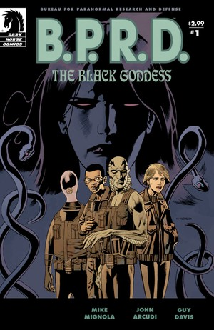
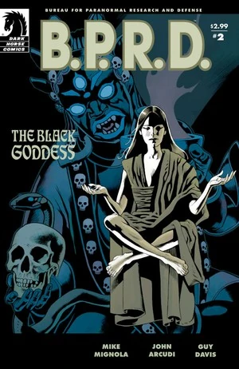
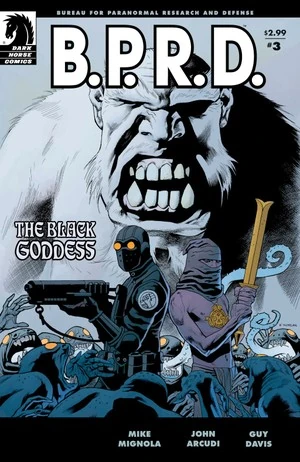
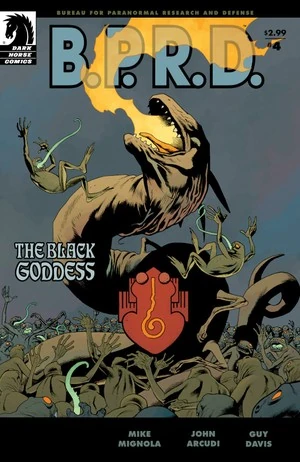
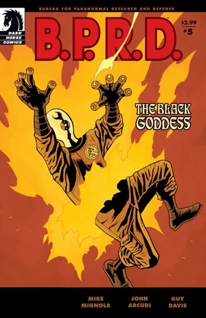

《**黑暗女神**》（The Black Goddess）是一部五期限定迷你系列，是[焦土三部曲](/entry/Scorched_Earth_Trilogy)的第二部。

## 出版历史

这部五期限定迷你系列于 2009 年 1 月至 5 月出版。故事于 2009 年 10 月被收录进平装合订本 *[B.P.R.D.: The Black Goddess](/entry/Trade_Collections)*。

## 剧情简介

### 第一部

二十世纪初，一位痴迷神秘学的英国博物馆馆长东行寻求力量与永生，此后便杳无音信。

1937 年，戴面具的义警大螯虾面对一个妄图实现末日预言、操弄魔法的狂人。阴谋虽被挫败、世界得以拯救，那个反派本人却消失得无影无踪……

七十年后，B.P.R.D. 探员丽兹·舍曼开始频频看到一位神秘绅士的幻象，他警告灾难即将来临。防御署追踪到他时，他再次消失——并绑架了丽兹。

如今，丽兹的朋友们争分夺秒地寻找她，而他们的宿敌们则正纠集起来，准备发动最后一场灾难性的进攻。

### 第二部

在大螯虾最后一位幸存盟友的帮助下，B.P.R.D. 已把姆姆南·萨追踪到他囚禁丽兹的山间避难所。但即便是超自然调查防御署，也对眼前这场末日之战毫无准备。

### 第三部

约翰面临着生死搏斗，亚伯和凯特则得知了维多利亚时代神秘学者 Martin Gilfryd 如何化身为姆姆南·萨的往事——他就是预言中那位将「驯服火种以繁育巨龙」的极北族之王。

### 第四部

姆姆南·萨的圣所之外，两支怪物大军为世界的命运展开厮杀；圣所之内，B.P.R.D. 只能眼睁睁看着萨的阴谋在他们四周继续展开，一步步走向以丽兹为核心的末日高潮。

### 第五部

被困在疯狂先知与末日大战之间，亚伯、凯特和约翰必须掂量自己灵魂的代价：他们究竟该忠于谁——一位朋友的生命，是否比整个世界的命运更重要。

## 内容

### 角色

#### [B.P.R.D.](/entry/Bureau_for_Paranormal_Research_and_Defense)

- [约翰·克劳斯](/entry/Johann_Kraus)
- [安德鲁·德文](/entry/Andrew_Devon)
- [亚伯拉罕·塞皮恩](/entry/Abraham_Sapien)
- [凯特·考瑞根](/entry/%E5%87%AF%E7%89%B9%C2%B7%E8%80%83%E7%91%9E%E6%A0%B9))
- [潘雅](/entry/Panya_%28character%29)
  - Olly
  - 变异动物
- 多丽丝（潘雅的看护人）
- [丽兹·舍曼](/entry/Elizabeth_Sherman)
- 其他探员与工作人员

#### [哈里](/entry/Harold_McTell)讲述的往事

- [大螯虾的团队](/entry/%3ACategory%3ALobster%27s_crew)
  - [哈罗德·麦克泰尔](/entry/Harold_McTell)
  - [大螯虾](/entry/The_Lobster)
  - [Robert Isherwood](/entry/Robert_Isherwood)（闪回）
  - [比尔](/entry/Bill)（闪回）
  - [莱斯特](/entry/Lester)（闪回）
- [Rudolf Bergen（钢鹰）](/entry/Rudolf_Bergen)（闪回）
- 大螯虾的非洲主题反派（闪回）
- [Helena Gallaragas](/entry/Helena_Gallaragas)（闪回）

#### 其他

- [姆姆南·萨 / Martin Gilfryd](/entry/Martin_Gilfryd)
- Thadrethes 僧侣
  - 狼人雪怪
- 美军士兵
  - 将军
- [纳粹](/entry/%3ACategory%3ANazi)
  - [拉斯普廷](/entry/Rasputin)（幻象）
  - [阿道夫·希特勒](/entry/Adolf_Hitler)（幻象）
  - 士兵与科学家（闪回）
- [蛙怪](/entry/Frog_monster)
- [兰迪斯·波普](/entry/Landis_Pope)（[黑焰](/entry/The_Black_Flame_%28character%29)）（幻象）
- [左手仆从](/entry/Servants_of_the_Left_Hand)
- 阿加尔塔僧侣（闪回）
- [Vril](/entry/Vril)之龙
- [守望者](/entry/Watchers)（闪回）
- [极北族人](/entry/Hyperboreans)（闪回）
  - [赫卡特](/entry/Hecate)（闪回）
  - [透特](/entry/Thoth)（闪回）
  - 其他人（闪回）
- T'shethuan 萨满（闪回）
  - [雄钦](/entry/Shonchin)（闪回）
  - 其他人（闪回）
- Nimung-Gula（闪回）
- [奥格德鲁·赫姆](/entry/Ogdru_Hem)（幻象）

### 地点

- 美国
  - [大螯虾](/entry/The_Lobster)的总部（纽约州纽约市）
  - [哈罗德·麦克泰尔](/entry/Harold_McTell)居住的养老院
  - [姆姆南·萨](/entry/Memnan_Saa)的仓库（新泽西州）（闪回）
  - [B.P.R.D.](/entry/Bureau_for_Paranormal_Research_and_Defense) 总部（科罗拉多州）
- 英格兰（闪回）
  - Bedlam（伦敦）（闪回）
  - 伦敦街头/码头（闪回）
- 俄罗斯
  - Thadrethes
  - 阿加尔塔（闪回）
- 奥地利（闪回）
  - 亨特城堡（闪回）
- 中国（闪回）
  - 颐和园（北京）（闪回）

### 重要器物

- 玉蛙
- [厄明](/entry/Ernst_Oeming)太空舱（闪回）
- [姆姆南·萨](/entry/Memnan_Saa)的护身符
- [极北族人](/entry/Hyperboreans)战争机器
- [尖刺圆筒](/entry/Spiked_Cylinder)（[极北族人](/entry/Hyperboreans)神器）（闪回）
- [重锤装甲](/entry/Vril_Energy_Suit)（普罗米修斯型）（闪回）

## 花絮

- 片中那位美国将军的外形以演员 [Ernest Borgnine](https://en.wikipedia.org/wiki/Ernest_Borgnine) 为原型。

## 画廊

封面由 [Kevin Nowlan](/entry/Kevin_Nowlan) 绘制。

 \#1

 \#2

 \#3

 \#4

 \#5
