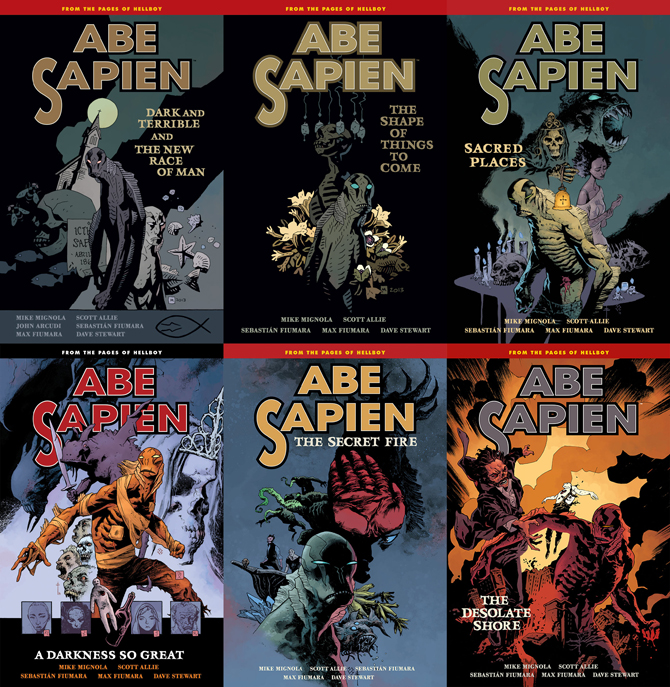
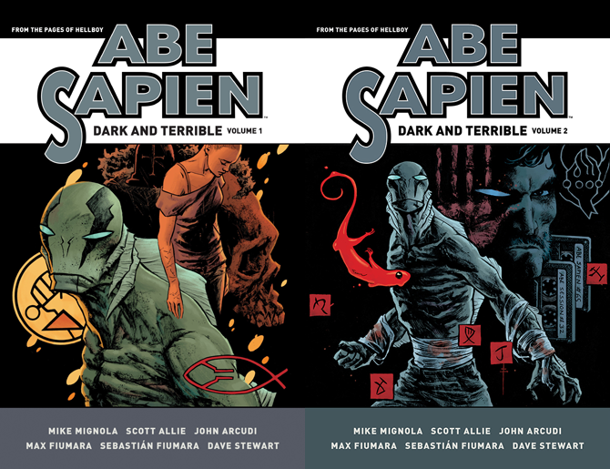

*《黑暗恐怖之处》（Dark and Terrible）* 是一个 [亚伯·赛皮恩](/entry/Abe_Sapien_%28series%29) 故事循环，与 *[B.P.R.D. 人间地狱](/entry/BPRD%3F%E4%BA%BA%E9%97%B4%E5%9C%B0%E7%8B%B1))* 的事件并行展开。这是一部连载系列，由 [迈克·米格诺拉](/entry/Mike_Mignola) 和 [斯科特·艾利](/entry/Scott_Allie) 编剧，[马克斯·菲乌马拉](/entry/Max_Fiumara) 和 [塞巴斯蒂安·菲乌马拉](/entry/Sebasti%C3%A1n_Fiumara) 承担绘画工作。连载中偶尔会出现回忆故事，但这些不属于 *Dark and Terrible* 的一部分。

## 已出版故事

- *[《黑暗恐怖之处》（Dark and Terrible）](/entry/Dark_and_Terrible_%28story%29)* #1–3（2013 年 4 月 – 6 月）
- *[《人类新种族》（The New Race of Man）](/entry/The_New_Race_of_Man)* #1–2（2013 年 7 月 – 8 月）
- *[《未来之事的形状》（The Shape of Things to Come）](/entry/The_Shape_of_Things_to_Come)* #1–2（2013 年 10 月 – 11 月）
- *[《战至最后一人》（To the Last Man）](/entry/To_the_Last_Man)* #1–3（2014 年 1 月 – 3 月）
- *[《花园（一）》（The Garden (I)）](/entry/The_Garden_%28I%29)*（2014 年 5 月）
- *[《治疗者》（The Healer）](/entry/The_Healer)*（2014 年 6 月）
- *[《幻象、梦境与钓鱼》（Visions, Dreams, and Fishin'）](/entry/Visions%2C_Dreams%2C_and_Fishin%27)*（2014 年 7 月）
- *[《圣地》（Sacred Places）](/entry/Sacred_Places)* #1–2（2014 年 9 月 – 10 月）
- *[《如此巨大的黑暗》（A Darkness so Great）](/entry/A_Darkness_so_Great)* #1–5（2014 年 12 月 – 2015 年 4 月）
- *[《苏旺尼上空之影》（The Shadow Over Suwanee）](/entry/The_Shadow_Over_Suwanee)* #1–3（2015 年 7 月 – 9 月）
- *[《花园（二）》（The Garden (II)）](/entry/The_Garden_%28II%29)*（2015 年 11 月 – 12 月）
- *[《黑色学派》（The Black School）](/entry/The_Black_School)*（2016 年 2 月）
- *[《退化》（Regressions）](/entry/Regressions)*（2016 年 4 月 – 5 月）
- *[《黑暗恐怖之处：深渊》（Dark and Terrible Deep）](/entry/Dark_and_Terrible_Deep)*（2016 年 6 月）
- *[《花园（三）》（The Garden (III)）](/entry/The_Garden_%28III%29)*（2016 年 7 月）
- *[《荒凉海岸》（The Desolate Shore）](/entry/The_Desolate_Shore)*（2016 年 8 月）

## 合订本

*Dark and Terrible* 收录在常规的 [*亚伯·赛皮恩* 平装合订本](/entry/TPB)系列第 3 卷至第 8 卷中。

收录 *Dark and Terrible* 循环各故事的全部六本 <em>亚伯·赛皮恩</em> 平装合订本。

*Dark and Terrible* 循环将从 2017 年 11 月起收录进[合集版（omnibus editions）](/entry/Omnibus_Editions)。这些合集配有扩充版速写本。

<em>亚伯·赛皮恩：黑暗恐怖之处</em> 合集版的两卷。
