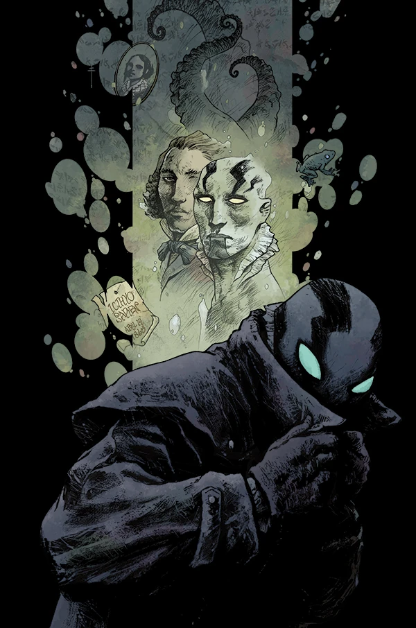
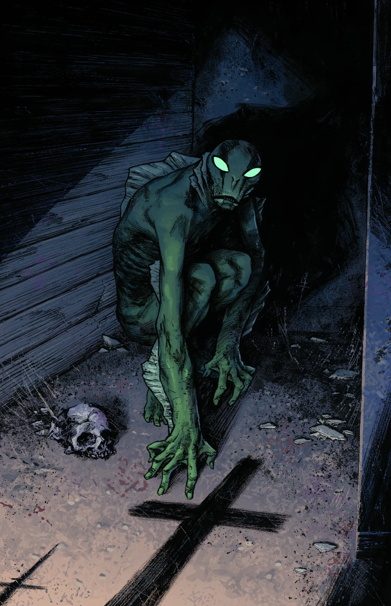
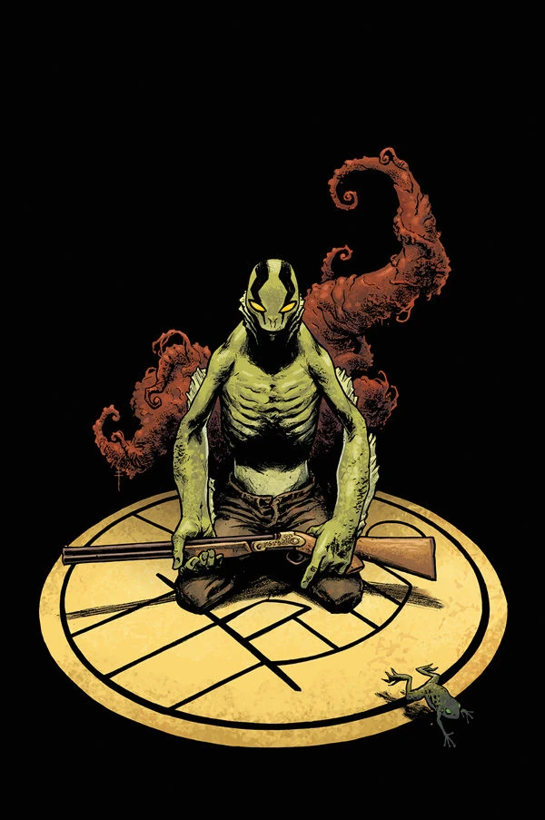

《**黑暗恐怖之处**》（Dark and Terrible）是连载系列《亚伯·塞皮恩》（Abe Sapien）的第一个故事弧，也是[《黑暗恐怖之处》（Dark and Terrible）故事周期](/entry/Dark_and_Terrible_%28story_cycle%29)的开端。故事紧接 *[《B.P.R.D.：人间地狱——地狱寒日》（B.P.R.D.: Hell on Earth—A Cold Day in Hell）](/entry/A_Cold_Day_in_Hell)* 的事件展开，亚伯正躲避着 B.P.R.D. 的追捕。

## 出版历史

《黑暗恐怖之处》是一个三期满完的故事弧，于 2013 年 4 月出版，作画由 [Sebastián Fiumara](/entry/Sebasti%C3%A1n_Fiumara) 担任。

「Dark and Terrible」原本是 [Mike Mignola](/entry/Mike_Mignola) 在 1996 年创作的一部搁浅的地狱男爵与亚伯·塞皮恩故事的名字。[1] 那个故事的一些元素最终成为《[蛙族瘟疫](/entry/Plague_of_Frogs_%28story%29)》的一部分。这个旧故事与如今的新版本之间不太可能有什么关联，因为自那时起，亚伯·塞皮恩的背景故事已经发生了巨大变化。

## 剧情简介

### 第一部分

在逃离[超自然调查防御署](/entry/Bureau_for_Paranormal_Research_and_Defense)追捕的途中，发生变异的[亚伯·塞皮恩](/entry/Abraham_Sapien)穿行于满目疮痍的美国——怪物的尸体散落四野，城市尽成废墟。

### 第二部分

世界在他周围崩塌，亚伯·塞皮恩一路搏杀，对抗恐怖的奥格德鲁·赫姆与人性沦丧的怪物，追寻着自己在世界末日中所扮演角色的真相。

### 第三部分

一座被肆虐的怪物与外界隔绝的小镇必须做出抉择：他们中间那个奇怪的鱼人，究竟预示着救赎，还是末日的降临。

## 画廊

 \#1 variant

 \#2

 and Terrible 1 for $

## 注释

<references />

[1] [The Art of Hellboy](/entry/The_Art_of_Hellboy)
