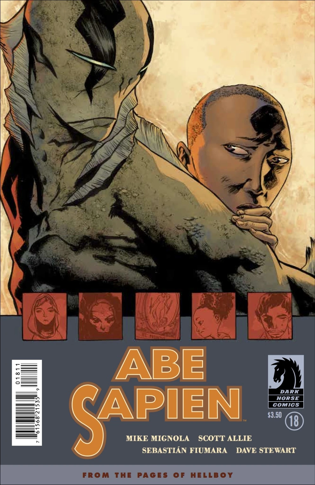
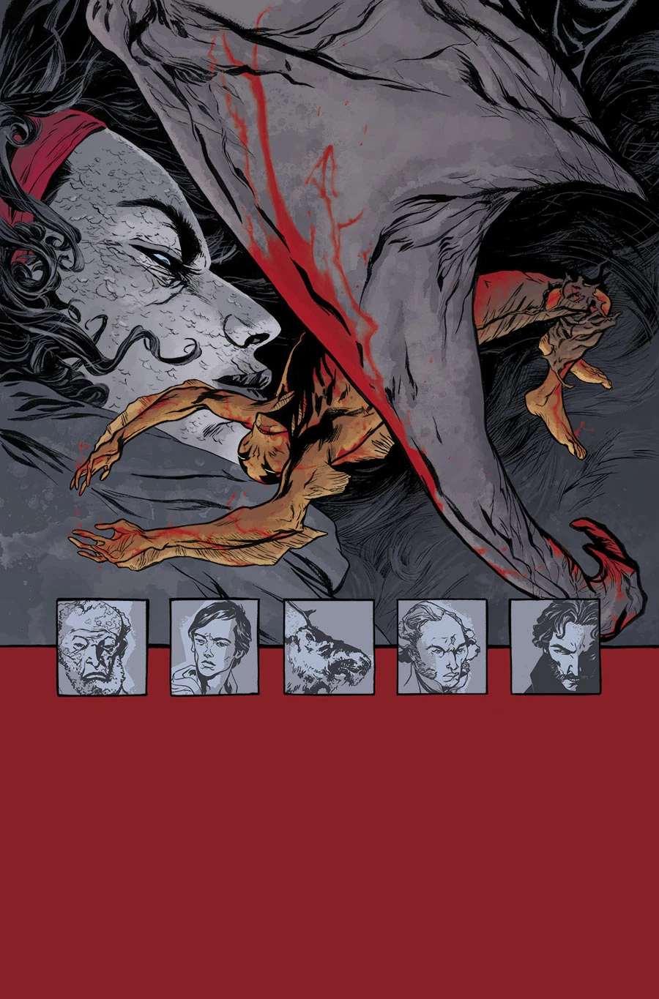
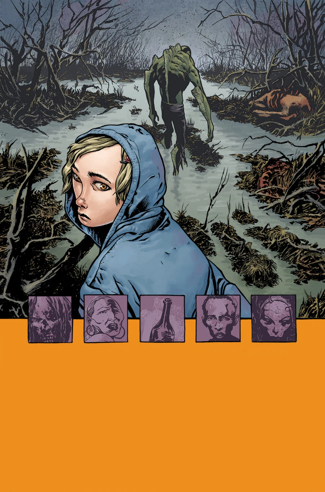
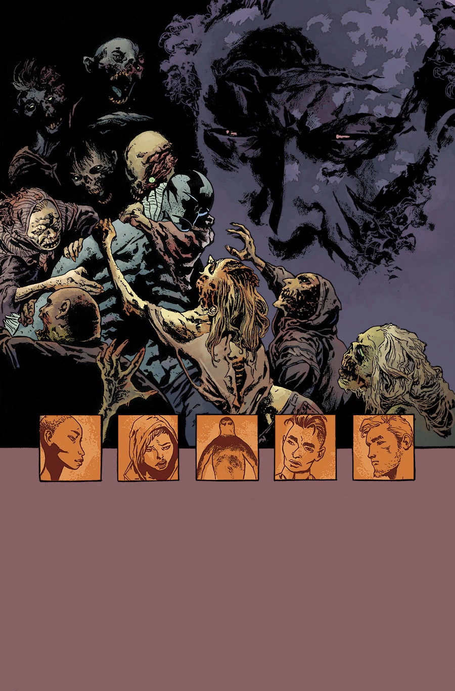
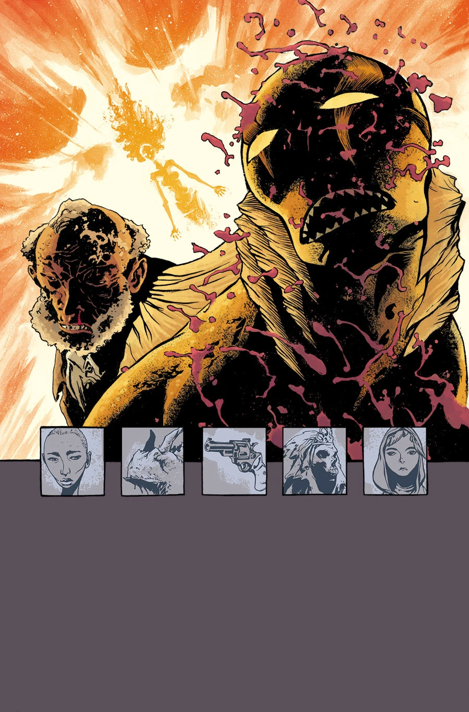

《**黑暗无边**》（A Darkness so Great）是一个五期故事弧，于 2014 年 12 月开篇。该系列每一期的作画将由不同绘者轮流担任。

## 剧情概要

### 第一部分：Grace

亚伯·塞皮恩前往得克萨斯，希望在经历变异、又遭到 BPRD 追捕之后，能寻得一些安宁。

### 第二部分：Dayana

在得克萨斯湾海岸一座奇异宁静的小镇里，亚伯找到了片刻安宁。可这份安宁受到了威胁——亚伯直觉地感到，这座小镇与他不久前遭遇的一场致命威胁之间存在着某种联系……

### 第三部分：Megan

一个小女孩在一个神秘的墨西哥死亡邪教处躲避世界末日，她转而向亚伯寻求保护。

### 第四部分：Arbogast

反派登上舞台中心，南得克萨斯的死灵法术问题随之揭开；而 Sebastián Fiumara 的画功足以与 Geof Darrow 一较高下。

### 第五部分：Abe

一座宁静的得克萨斯小镇——美国最后的安全之地——爆发了超自然暴乱，亚伯·塞皮恩真正尝到了人间地狱的滋味，而他离开调查防御署以来独行的那条孤独道路，也变得愈发孤寂。

## 画廊

