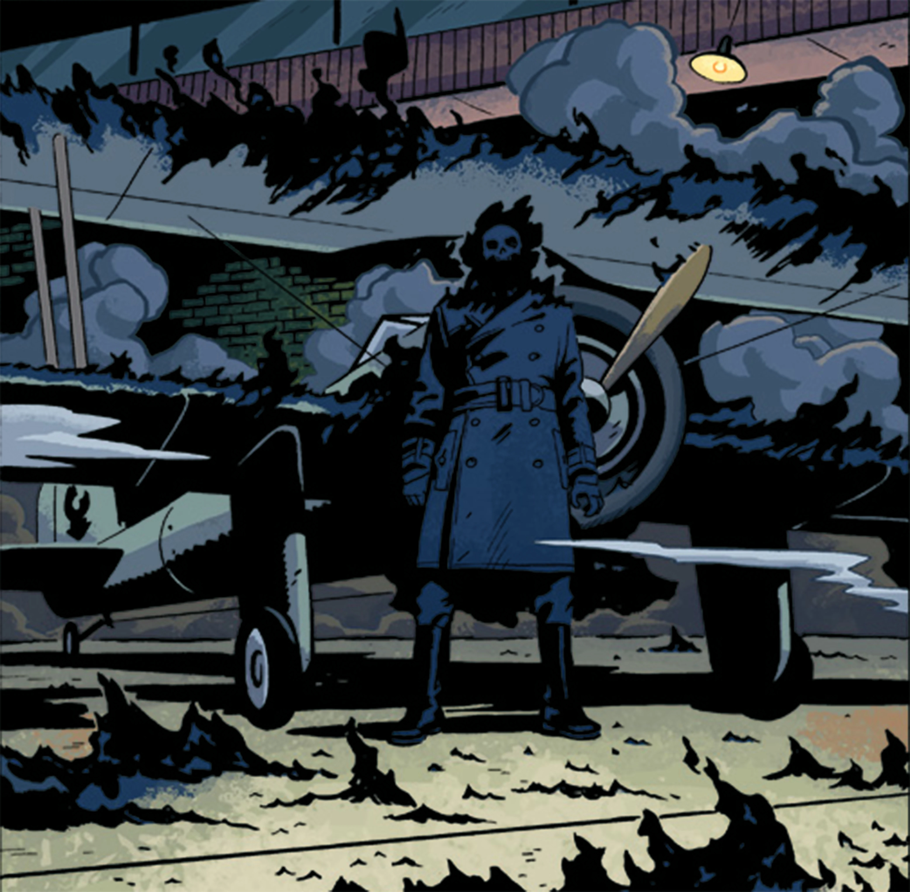
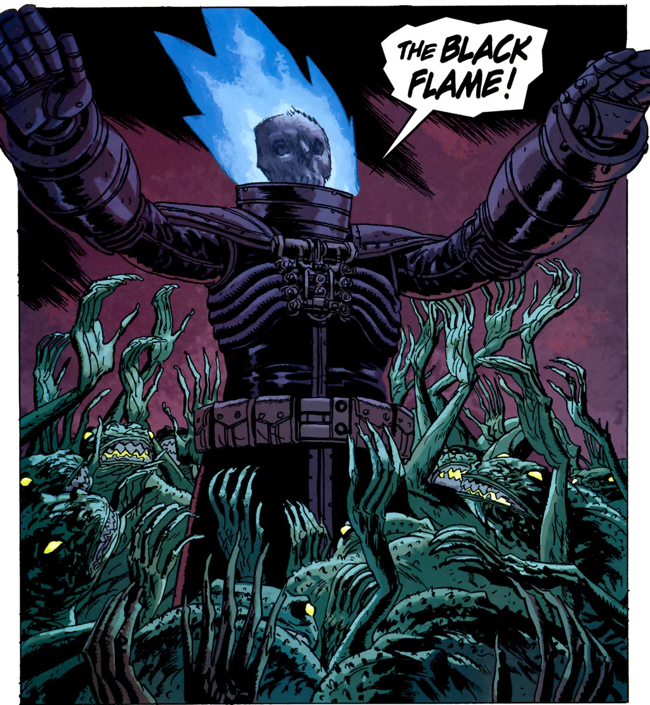
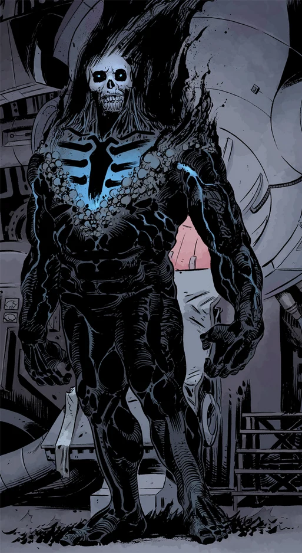

**黑焰（The Black Flame）**是地狱男爵宇宙中一个实体的名字，曾先后出现在数个宿主身上。其超自然力量与 [Ogdru Hem](/entry/Ogdru_Hem) 生物存在某种关联。

## 拉伊蒙德·迪斯特尔（1923—1944）

 已知的第一位黑焰使徒是 [拉伊蒙德·迪斯特尔](/entry/Raimund_Diestel)。

早在 1910 年 5 月，迪斯特尔就频繁看到关于黑女神与 [Ereshkigal](/entry/Ereshkigal) 的强烈幻象。1914 年 11 月从德意志帝国海军逃役后，他前往暹罗，在那里终日沉湎于酗酒与鸦片，消磨了数年光阴。[1]

到 1923 年，他在曼谷做当地向导。他受雇于 [莎拉·朱厄尔](/entry/Sarah_Jewell)，带领一行人进入丛林，寻找神秘的黑焰神庙。抵达神庙时，他阻止了一场看似是邪教徒献祭少女的仪式，结果却发现自己才是他们血祭仪式的对象，并就此被黑焰的力量充满。他救下的少女名叫 [卡玛拉](/entry/Kamala)，她受命——似乎是黑女神在梦中托付——以妻子兼导师的身份帮助他，助他完成宿命。[2]

1932 年初，黑焰使徒与卡玛拉受 [艾索格先生](/entry/Isog) 雇用，乘船前往美国，协助黑帮头目 [Arnie Wald](/entry/Arnie_Wald) 实施一个计划：恐吓一片街区，好让土地被低价收购*（参见：**[The Burning Hand](/entry/The_Burning_Hand)**）*。他们于 2 月抵达时，[大螯虾](/entry/The_Lobster)首次与他正面交锋，当时黑焰使徒正在为 Wald 纵火烧毁一些廉租公寓楼。在随后的打斗中，子弹对黑焰使徒毫无作用。大螯虾小队的成员之一 [马西莫](/entry/Massimo) 被黑焰使徒烧伤致死，尸体也被他掳走。

卡玛拉利用马西莫的尸体举行了一场神秘学仪式，吸收了他所掌握的关于大螯虾的情报。凭借这些情报，Wald、他的打手以及黑焰使徒对大螯虾的仓库总部发动了突袭。黑焰使徒看似势不可挡，直到大螯虾拖出一门大炮，用一发大口径炮弹将他轰飞。

有那么一刻黑焰使徒看似已被击败，但卡玛拉开始吟唱，火焰重新燃起。最终一辆汽车撞向卡玛拉、致其身亡，这场对峙才告结束。黑焰使徒立刻冲到她身边，低语道："*Kleine……？*"（小家伙……？），随后随着火焰熄灭倒在地上。

他最后一次在美国露面时正被警察带走。到 1933 年 6 月，他仍是阶下囚，不过此时被关押在德国豪夫蒂茨城堡的牢房中，由 Paul von Hindenberg 下令看管。在 *Sledgehammer 44*：[Lightning War](/entry/Lightning_War) 中，他被阿道夫·希特勒释放。

1944 年 9 月 20 日，黑焰使徒在战区附近的一次试飞中从美国人手中夺取了实验机型 X.F.W.-12，即"飞翼"（Flying Wing）。1944 年 10 月，重锤（Sledgehammer）被派去追回飞机和飞行员，黑焰使徒与他数次交手，最终在一场爆炸中被摧毁。他的遗骸很快被纳粹寻回。希特勒将迪斯特尔视为神话中的阿萨神（Aesir）之一，下令让他身着军官制服下葬。

他最早在 [*The Dead* 第 3 期](/entry/The_Dead)中以一张照片亮相，照片标注为："*黑焰使徒？摄于"飞翼"实验飞行期间。1944 年 9 月 20 日*"。B.P.R.D. 迁入科罗拉多州的新设施后，约翰·克劳斯翻阅的大量旧档案中就有这张照片。在 [*The Black Flame*](/entry/The_Black_Flame_%28story%29) 中，迪斯特尔的遗骸陈列在 [兰迪斯·波普](/entry/Landis_Pope) 秘密办公室的一个玻璃柜里。

### 能力与本领

黑焰使徒是一种不死生物，一具被黑色火焰包裹的骷髅。这些火焰受他操控，可以召唤到他周围相当大的范围内，或集中到某个特定目标上。火焰无法被水浇灭，能在数秒内把人烧成焦黑的骷髅。黑焰使徒还能以一团黑色火焰爆裂的方式瞬间移动，并可携带他人同行。他也能飞行。黑焰使徒会说德语、英语，还能说一口流利的泰语。

## [兰迪斯·波普](/entry/Landis_Pope)（2000 年代）

 在担任 [金科公司](/entry/Zinco_Corporation) 首席执行官期间，[兰迪斯·波普](/entry/Landis_Pope) 取得了前任黑焰使徒拉伊蒙德·迪斯特尔的遗骸，以及其他若干纳粹神器和神秘学典籍。在 [蛙怪](/entry/frog_monster) 的暗中指引下，他打造了一副铠甲，使自己得以成为新一代黑焰使徒和蛙怪的领袖。起初他的火焰是蓝色的，由战衣人工生成、并由战衣上的机械装置控制；就在解雇金科董事会之后不久，波普与蛙怪一同完成了一场仪式，从此他身上燃起了前任那种黑色的幽冥之火。

蛙怪开始向整个北美迁徙，向内布拉斯加进发——波普和他驯养的蛙怪召唤它们前来组建自己的军队。随着蛙怪战争（Frog War）拖延，波普在安大略省雷斯（Raith）遭遇了 Roger，将这个霍蒙库鲁斯及其小队尽数消灭。正是在此时，蛙怪向波普挑明了他的真实地位——他的角色不过是为疲倦的 [卡塔-赫姆](/entry/Katha-Hem) 照亮前路，蛙怪们正致力于复活它，他本人不会得到任何力量。波普既无法脱下铠甲，也无法熄灭火焰，惊恐万分的他突然发现自己成了自己军队中的囚徒，徒劳地朝天空嘶吼、乞求宽恕。等到卡塔-赫姆被摧毁时，他已从看守手中逃脱，但喘息十分短暂——他刚来得及就 Roger 之死向 [莉兹·谢尔曼](/entry/Liz_Sherman) 道歉，就被一群蛙怪哀嚎着、绝望地拖入了地底深处。

多月之后，人们在地下深处发现了他，此时他已与 [恐惧之王](/entry/King_of_Fear_%28character%29) 结盟。火焰无休止的灼烧使他的状态变得更接近最初的黑焰使徒——头上的皮肤和血肉已全部烧尽，火焰如今不再源自战衣的机械装置，而是从他自己的身体中燃烧。这个半不死的新波普似乎已经接受了自己在末日浩劫中的角色。他健谈而随和，对吃惊的 BPRD 俘虏们礼貌而殷勤。他宣称 [亚伯·塞皮恩](/entry/Abe_Sapien) 是蛙怪的进化形态，并不遗余力地想说服亚伯相信这一点——甚至随手杀死了恐惧之王，以此向亚伯证明他们是盟友——但徒劳无功。随后他被莉兹杀死，尸体也被她烧成灰烬。

### 能力与本领

波普拥有初代黑焰使徒的大部分能力。不过他似乎不具备瞬间移动的能力。除人类语言外，波普还精通多种神秘学语言，包括蛙怪使用的语言。起初他的火焰是泛蓝的黑色，因为那是金科研发部门人工制造的；后来随着蛙怪向他吟唱，他被真正的黑焰所吞没。

尽管起初他还能脱下铠甲，但他逐渐与铠甲融为一体，就此终结了自己作为人类的生命。铠甲既提供了极强的防护，也能防止火焰意外外泄。

## 黑焰使徒（2010 年代）

 黑焰使徒的最新化身在 [*The Return of the Master* 第 4 期](/entry/The_Return_of_the_Master)中首次登场。在 [第 5 期](/entry/The_Return_of_the_Master)中揭示：金科要复活的并不是 [Rasputin](/entry/Rasputin)——尽管 [利奥波德·库尔茨](/entry/Leopold_Kurtz) 和 [克勒南博士](/entry/Karl_Ruprect_Kroenen) 都这样以为——他们真正试图做的，是以黑焰使徒的身份复活兰迪斯·波普。他们成功了，而死亡与重生使波普的精神发生了巨大变化——在死亡中，他的灵魂与 Ogdru Jahad 的核心融为一体，比以往任何一位"巨龙"仆从都走得更近。他复活后的第一个行动，就是亲手灭绝了最后的蛙怪生物。随后他掌控了金科，在纽约市自封为神，与生活在城中的生物的生命相连。随着他的归来，许多被囚禁在地球内部的 [Ogdru Hem](/entry/Ogdru_Hem) 重新苏醒，开始侵扰人类。

此时的他已有能力与莉兹交手并将其击败——这连卡塔-赫姆都做不到。在与莉兹的第一次战斗中，他声称自己与这片土地联结得如此紧密，以至于必须先将这座岛上的生命彻底清除，他才有可能死去。

后来，黑焰使徒意识到自己力量的宇宙级影响范围，便进一步扩张势力。凭借这股力量，他做成了不可能之事：将七柱 Ogdru Jahad 之一的 [Nunn-Jahad](/entry/Nunn-Jahad) 从其位于深空的水晶囚笼中释放出来。巨龙坠落在地球的堪萨斯州，它的力量与黑焰使徒相连，并开始孕育新的 Ogdru Hem。黑焰使徒在与莉兹及 [约翰](/entry/Johann_Kraus)（身着重锤战衣）的战斗中声称，Ogdru Jahad 就是"属于我的七位"。

潘雅（Panya）试图通过昏迷中的菲尼克斯（Fenix）协助莉兹和约翰，但黑焰使徒向她揭示：他早就清楚她存在于自己的灵能网络中，并试图将她恐吓至屈服。在雄钦的帮助以及 Ted Howards 古老铭文的加持下，她与雄钦、菲尼克斯、厄里斯（Eris）合力诵出一道神秘咒语，切断了黑焰使徒与赋予其力量的生命网络之间的联系。这使莉兹和暴怒的约翰终于得以将他彻底消灭。不幸的是，他的死导致 Nunn-Jahad 彻底暴走，横行大地，孕育出比此前更多的 Ogdru Hem。

[pt-br:Chama Negra](/entry/pt-br%3AChama_Negra)

[1] *Rise of the Black Flame*

[2]
