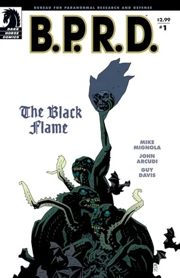
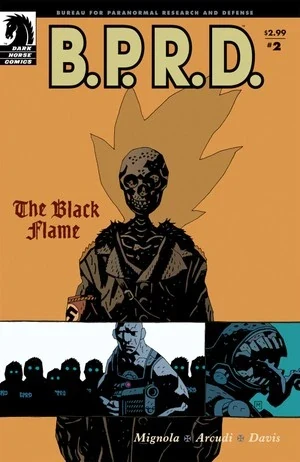
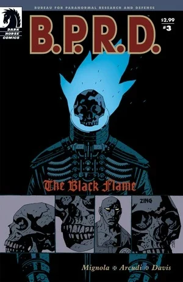
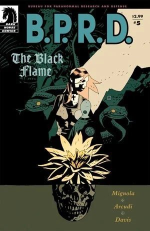

《**黑焰使徒**》（The Black Flame）中，[B.P.R.D.](/entry/Bureau_for_Paranormal_Research_and_Defense)重新把焦点放回到蛙族瘟疫上——瘟疫正在北美蔓延。防御署试图弄清[蛙怪](/entry/Frog_monster)的行为规律，而一个狂人则妄图控制这些生物。

## 出版历史

这部六期限定迷你系列于 2005 年 9 月至 2006 年 1 月出版。故事于 2006 年 7 月被收录进平装合订本《[B.P.R.D.: The Black Flame](/entry/Trade_Collections)》。

后来该系列又以全能精选集形式收录于《[B.P.R.D.: Plague of Frogs – Volume 2](/entry/Omnibus_Editions)》，与《[The Dead](/entry/The_Dead)》《[War on Frogs](/entry/War_on_Frogs)》合为一卷。正如 [Scott Allie](/entry/Scott_Allie) 在序言中所述，《War on Frogs》与《The Black Flame》被排成了另一种阅读顺序：

- *The Black Flame* \#1（改题为 *War on Frogs: Chapter 1*）
- *War on Frogs* \#1（改题为 *War on Frogs: Chapter 2*）
- 《Revival》（改题为 *War on Frogs: Chapter 3*）
- *War on Frogs* \#2（改题为 *War on Frogs: Chapter 4*）
- *War on Frogs* \#4（改题为 *War on Frogs: Chapter 5*）
- *The Black Flame* \#2-6（改题为 *The Black Flame: Chapters 1–5*）
- *War on Frogs* \#3（改题为 *The Black Flame: Epilogue*）

## 剧情简介

### 第一部

[本·达米奥](/entry/Ben_Daimio)、[丽兹·舍曼](/entry/Elizabeth_Sherman)、[罗杰](/entry/Roger)和[约翰·克劳斯](/entry/Johann_Kraus)带着一队探员潜入一条满是[蛙怪](/entry/frog_monster)的下水道。一路拼杀到更下层后，他们发现一个密室，里面全是巨大臃肿的青蛙。扎破一只后，众人才知这些青蛙肚里装满了蝌蚪。丽兹决定把整个蛙巢烧光。

一些蝌蚪顺着格栅漏到了更下层。一个身穿金科（Zinco）防护服的男人捡起蝌蚪，放进一只装满水的冷藏箱，转身离开。

### 第二部

金科公司负责人波普先生（Mr. Pope）面对忧心忡忡的董事会谈论研发开支。他告诉众人自己怀有一个愿景，随后回到办公室——屋里满是纳粹物品，其中似乎还有 1940 年代黑焰的遗体。他致电研发部的马斯滕（Marsten），询问进展。马斯滕站在一间实验室里，身旁有两只蛙怪，他告诉波普，它们会比预期更早准备就绪。

与此同时，在科罗拉多州的 [B.P.R.D.](/entry/B.P.R.D.) 总部，亚伯一直守着文职岗位，为自己无从知晓的前生而消沉。

波普和马斯滕持续训练一批蛙怪，教它们基础英语，让它们习惯与人相处。一只蛙怪对波普说「这里没有家」，波普回答它们很快就会去那里。

罗杰和一队探员在不列颠哥伦比亚省消灭了一群蛙怪，达米奥称赞他干得漂亮。

波普和马斯滕来到一处矿井口，放出三只「受训」的蛙怪。这三只与其他蛙怪交谈，似乎认出了装扮成[黑焰](/entry/The_Black_Flame_%28character%29)的波普就是它们的主人。

在蒙大拿州，丽兹和约翰谈论着蛙怪，也谈论着罗杰身上的变化。一位老妇人走上前送给丽兹一朵花以示感谢，丽兹却立刻昏倒在地。

### 第三部

丽兹坐在一个陌生的房间里，一个男人告诉她，他们对「蛙怪」的战斗并不像自以为的那么顺利。丽兹开始咳嗽。她在病床上醒来，咳出一张羊皮纸。

波普先生走进金科董事会会议室，宣布所有董事都被解雇。受训的蛙怪们走进来，以一场仪式把一团黑色火焰安放在波普防护服的头盔上。

[奥唐纳教授](/entry/Professor_James_Henry_O%27Donnell)查看羊皮纸，读出名字[卡塔-赫姆](/entry/Katha-Hem)（Katha-Hem）。他解释说，这是又一个[奥格德鲁·赫姆](/entry/Ogdru_Hem)，与[萨杜-赫姆](/entry/Sadu-Hem)同类。丽兹跑去找本·达米奥，告诉他罗杰将遭遇不测。

一支 B.P.R.D. 小队正在摧毁又一个蛙巢。化身为黑焰的波普出现在工厂里。一场巨大的爆炸炸死了所有仍在里面的人，罗杰也被炸得四分五裂。

### 第四部

罗杰残存的遗体被送回 B.P.R.D. 总部，丽兹搬出自己的房间，住进了罗杰那间摆满历次任务纪念品的旧房间。约翰发现罗杰的遗体没有像其他人一样装进尸袋，勃然大怒。

画面转到爱达荷州，黑焰统率着一支庞大的蛙怪大军，准备发动进攻。

本·达米奥给凯特·考瑞根写辞职信，把罗杰表现上的任何不足都归咎于自己。其间那个「中国佬」（"Chinaman"）现身，达米奥却把他打发走了。

丽兹仍在做与姆姆南·萨（Memnan Saa）互动的梦，梦中姆姆南·萨告诉她，她或许知道如何摧毁卡塔-赫姆，而无论什么都无法让罗杰复生。她醒来时，凯特正走进房间，两人聊起她的梦，随后丽兹问：「亚伯在哪？」

亚伯·塞皮恩开始把罗杰之死归咎于自己离开了外勤岗位，于是他决定回去当外勤探员，以此接替罗杰。他的第一个任务在内布拉斯加州，众人发现地下有大量目标。

黑焰开始召唤卡塔-赫姆，一根巨大的柱子从地底拔起。波普狂喜，以为自己即将把卡塔-赫姆的力量据为己有，不料一只蛙怪告诉他，黑焰的角色仅仅是为卡塔-赫姆降临世间「照亮道路」，波普对它、对蛙怪都毫无控制力。

凯特让亚伯中止任务，因为成千上万、不计其数的蛙怪正横扫北美西部。就在此时，亚伯和他的小队遭到数百只蛙怪伏击。

### 第五部

亚伯醒来，看见黑焰俯身对着他，承认自己召唤卡塔-赫姆或许铸成了大错。卡塔-赫姆是一头体型庞大的怪物，拥有轻易摧毁城市的力量。

奥唐纳教授确认那怪物就是卡塔-赫姆。丽兹告诉凯特和约翰，他们必须找到亚伯——她梦中的男人姆姆南·萨这样告诉她。约翰让她进入一种类似睡眠的状态，好与姆姆南·萨取得联系。

本·达米奥因罗杰之死辞职后试图离开 B.P.R.D. 总部，被[汤姆·曼宁](/entry/Thomas_Manning)拦下。亚伯回到 B.P.R.D. 时，达米奥向他坦言自己想道个歉。

美军开始用战斗机发射导弹攻击卡塔-赫姆，却似乎毫无效果。随着卡塔-赫姆开始变形、长出腿来，拉姆齐将军（General Ramsey）通知汤姆·曼宁，在总统和参谋长联席会议动用核武之前，他们只有 24 小时来阻止它。

丽兹找到姆姆南·萨并与他对峙，他向她展示一块刻纹石头，她在其中看到一个形似[尖刺圆筒](/entry/Spiked_Cylinder)的器物。丽兹恍然大悟地醒来，在罗杰的房间里翻找那根尖刺圆筒——那是罗杰在《[Born Again](/entry/Born_Again)》中捡到的。

### 第六部

前往卡塔-赫姆当前所在地的途中，约翰告诉众人，它会寻找一个强大的地脉中心，这意味着至少有一座大城市将被摧毁。随后他读起奥唐纳教授写的一段文字，文中预言：卡塔-赫姆的现身将开启百万年的剧变，蛙怪将继承整个地球。

到了现场，约翰瞥见黑焰，起初还以为是只「奇怪的生物」。达米奥告诉他，他们这次任务就是把丽兹送到离卡塔-赫姆足够近的地方，好弄清如何使用尖刺圆筒。达米奥提起罗杰之死时，约翰勃然大怒，声称罗杰没有死。

一场地震发生，地面裂开一道缝，丽兹·舍曼掉了下去，蛙怪开始从坑中涌出。其他人抵挡怪物时，亚伯冲向坑口想把丽兹拉出来。

在彻底的黑暗中，丽兹看到姆姆南·萨的幻象，他告诉她道路已经向她昭示，随后向她呈现一位「左手萨满」（Shaman of the Left Hand）手持尖刺圆筒的景象。她开始复述萨满所用的咒语。

与此同时，黑焰已被蛙怪擒获，他呼喊着乞求宽恕与怜悯，得到的唯一回应却是让他「在沉默中燃烧」。丽兹随即出现在高空，驾驭着那件神器的力量，将自己全部力量灌注其中，摧毁了卡塔-赫姆。

丽兹在地面上醒来时，波普走到她面前，说他的黑焰铠甲已经熔死封闭，求她帮忙把自己弄出来，同时为杀害罗杰道歉。当丽兹意识到是波普杀了罗杰，她退后一步，没有干涉——幸存的蛙怪抓住波普，把他尖叫着、哀求着拖进了大地的一道裂缝里。

回到 B.P.R.D. 总部，亚伯和凯特对发生的一切一头雾水，但他们知道整件事是丽兹造成的。约翰随后要求见罗杰，却发现他的遗骸正被切割以供医学研究，这激怒了约翰，他把所有人都赶出房间，默默地陪坐在罗杰身旁。

## 内容

注 1：此处包含 \#1 的内容——在所有合订本中，它被改头换面为 [War on Frogs](/entry/War_on_Frogs) 的第 1 章。
注 2：此处不含 [War on Frogs](/entry/War_on_Frogs) \#3 的内容——在所有合订本中，它充当本篇故事的尾声。

### 角色

#### [B.P.R.D.](/entry/Bureau_for_Paranormal_Research_and_Defense)

- [约翰·克劳斯](/entry/Johann_Kraus)
- [丽兹·舍曼](/entry/Elizabeth_Sherman)
- [本·达米奥](/entry/Benjamin_Daimio)
- [罗杰](/entry/Roger)
- [亚伯拉罕·塞皮恩](/entry/Abraham_Sapien)
- [凯特·考瑞根](/entry/%E5%87%AF%E7%89%B9%C2%B7%E8%80%83%E7%91%9E%E6%A0%B9))
- [J·H·奥唐纳教授](/entry/J%C2%B7H%C2%B7%E5%A5%A5%E5%94%90%E7%BA%B3%E6%95%99%E6%8E%88))
- [汤姆·曼宁](/entry/Thomas_Manning)
- 其他探员与工作人员

#### 其他

- [蛙怪](/entry/Frog_monster)
- [金科公司](/entry/Zinco_Corporation)
  - 科学家
  - [兰迪斯·波普](/entry/Landis_Pope)（成为[黑焰](/entry/The_Black_Flame_%28character%29)）
  - Isiah Marsten
- [赫尔曼·冯·卡朗普特](/entry/Herman_von_Klempt)（遗体）
- [地狱男爵](/entry/Hellboy_%28character%29)（仅被提及）
- Edith Howard（照片）
- 老妇人
- [姆姆南·萨](/entry/Memnan_Saa)
- [奥格德鲁·赫姆](/entry/Ogdru_Hem)
  - [卡塔-赫姆](/entry/Katha-Hem)
  - [萨杜-赫姆](/entry/Sadu-Hem)（仅被提及）
- 「Chinaman」
- [黑暗女神](/entry/Hecate)（Black Goddess，雕像）
- 史前人物
  - [雄钦](/entry/Shonchin)

### 地点

- 美国
  - [B.P.R.D.](/entry/Bureau_for_Paranormal_Research_and_Defense) 总部（科罗拉多州）
  - [金科公司](/entry/Zinco_Corporation)总部（纽约州曼哈顿）
  - [金科](/entry/Zinco_Corporation)研发部
  - 不列颠哥伦比亚省西部
  - Handelson, Montana
  - Onurb Caverns, Idaho
  - Lincoln, Nebraska
- [姆姆南·萨](/entry/Memnan_Saa)的神殿

### 重要器物

- [兰迪斯·波普](/entry/Landis_Pope)的办公室
  - [拉格纳洛克计划](/entry/Project_Ragna_Rok)徽章
  - [能剧猴子](/entry/Noh_monkey)（Noh Monkey）的遗体
  - [拉伊蒙德·迪斯特尔](/entry/Raimund_Diestel)（前任[黑焰](/entry/The_Black_Flame_%28character%29)）的遗体
  - [钢鹰](/entry/Rudolf_Bergen)（The Steel Hawk）的遗物
- [黑焰](/entry/The_Black_Flame_%28character%29)铠甲
- [姆姆南·萨](/entry/Memnan_Saa)的花
- [丽兹·舍曼](/entry/Elizabeth_Sherman)咳出的字条
- [罗杰](/entry/Roger)的房间
  - [克洛阿喀娜](/entry/Cloacina)的画像
  - 空军翼徽
  - 《[蛙族瘟疫](/entry/Plague_of_Frogs_%28story%29)》中那个女孩的球
  - [尖刺圆筒](/entry/Spiked_Cylinder)（[极北族人](/entry/Hyperboreans)神器）

## 画廊

封面由 [Mike Mignola](/entry/Mike_Mignola) 绘制。

 \#1

 \#2

 \#3

 \#4

 \#5

 \#6
