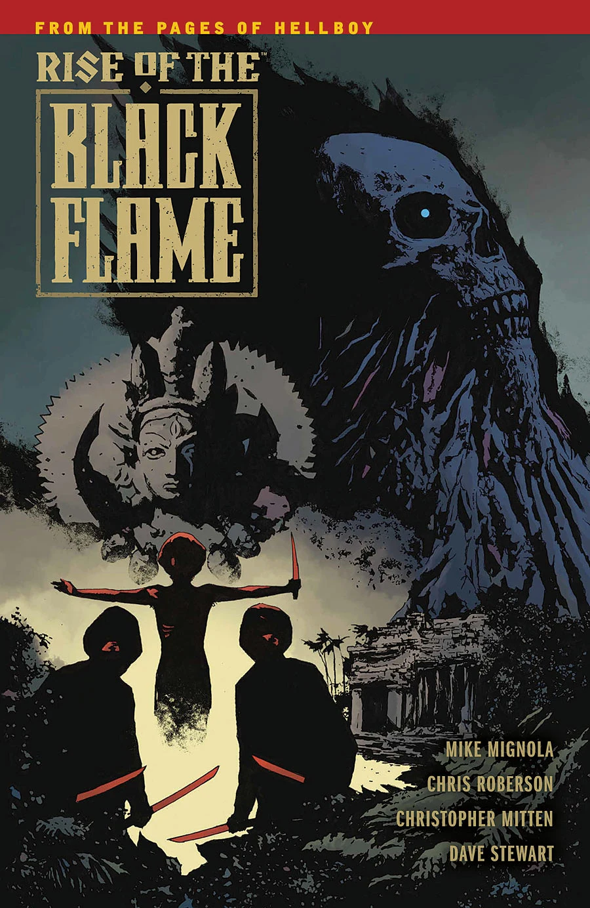
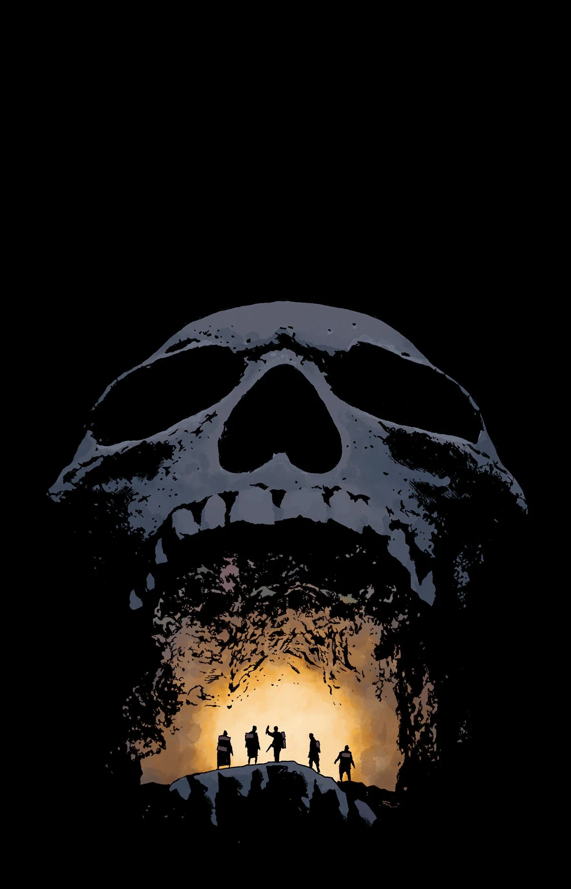
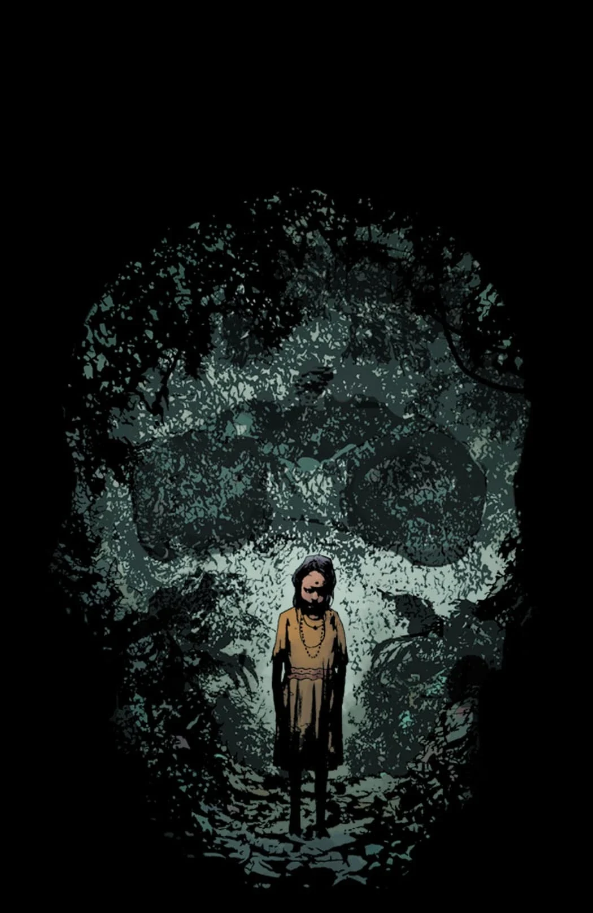
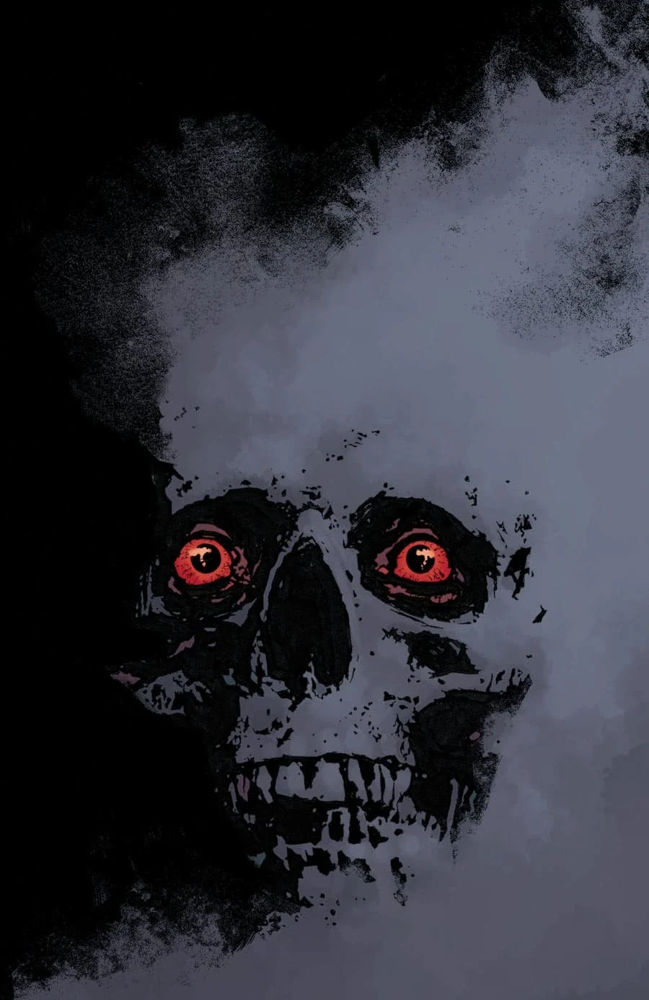

***《黑焰崛起》*（Rise of the Black Flame）**是一部五期限定迷你系列，于 2016 年 6 月宣布，2016 年 9 月发行。它探究了暹罗黑焰教团（Cult of the Black Flame）的起源。

## 剧情梗概

### 第一部分

1923 年，暹罗各城市不断有年轻女孩失踪，追查的线索通向丛林深处一个嗜血教团的藏身之处——他们掌握着一股古老的邪恶力量，即黑焰教团。

### 第二部分

有关黑焰教团实行人祭的传闻引领众人顺河而下、深入丛林，与此同时，队伍的向导被一位黑暗女神的梦境所困扰。

### 第三部分

在丛林深处一座失落的古老神庙里，英雄们找到了传闻中人祭的证据，也找到了关于黑焰教团的答案。

### 第四部分

从一群戴兜帽的袭击者手中侥幸逃脱，拖慢了小队阻止邪教人祭的任务；而他们那古怪向导的黑暗幻象变得愈发急迫，却丝毫没有减少神秘。

### 第五部分

英雄们的搜寻终于在黑焰教团的神庙告终，但他们没能及时赶到，无法阻止在那里发现的事情。

## 画廊

封面由 [劳伦斯·坎贝尔](/entry/Laurence_Campbell) 绘制

 \#1

 \#2

 \#3

 \#4

 \#5
