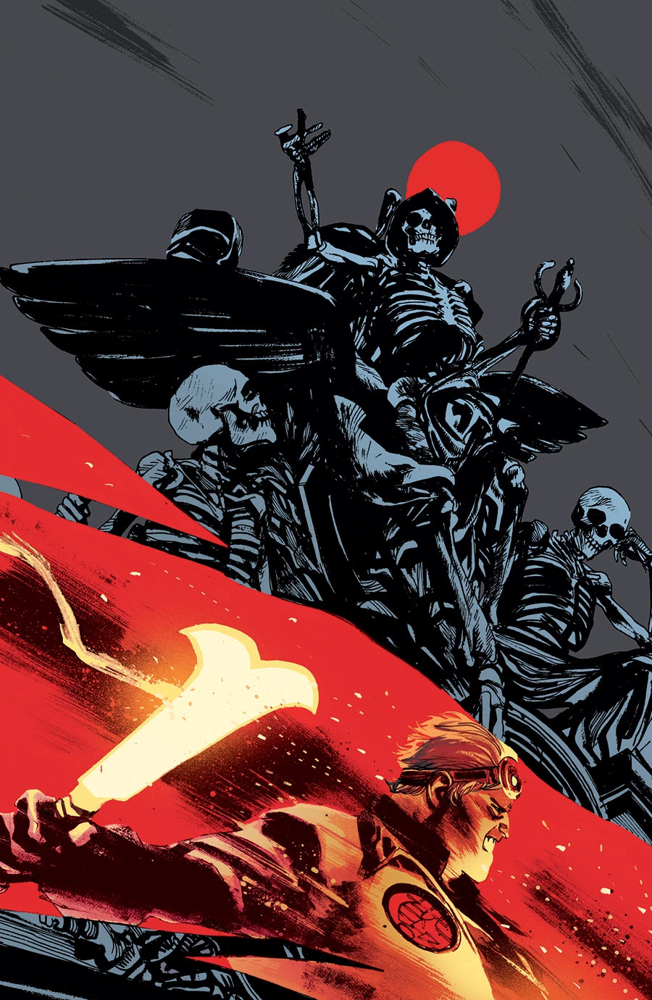
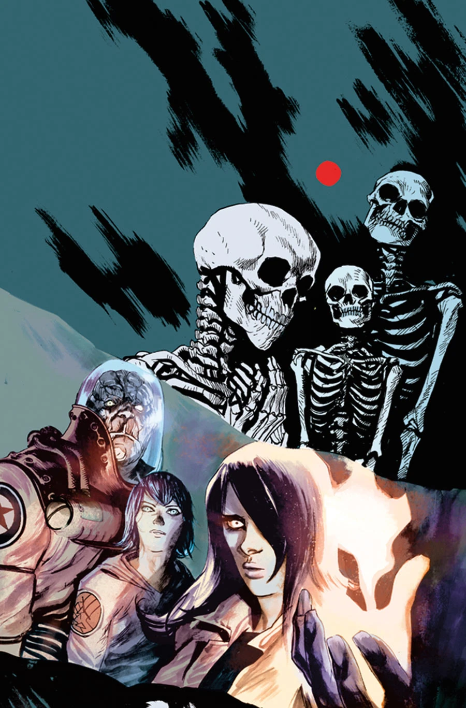
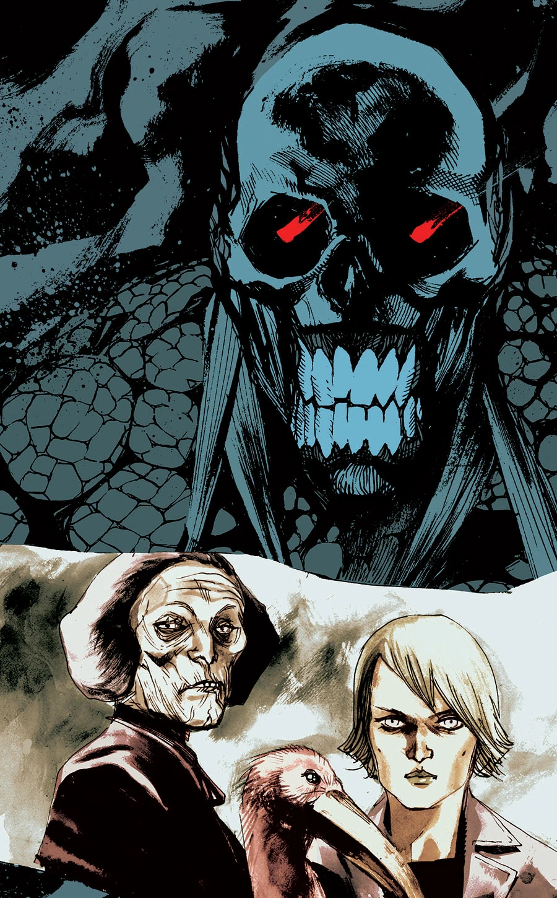
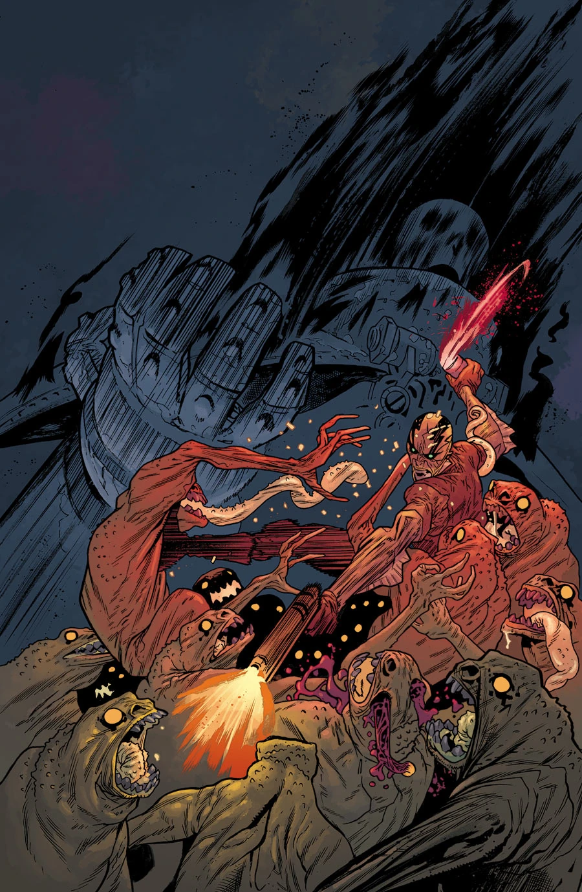
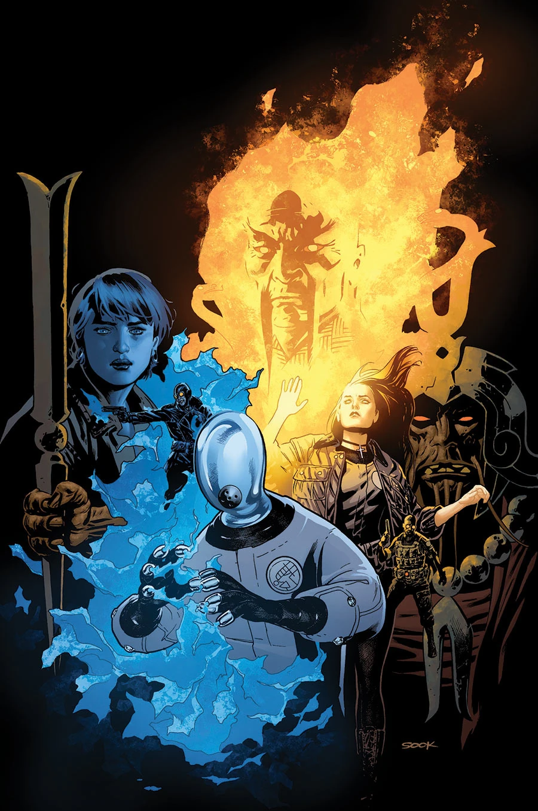

***《黑焰王朝》（The Reign of the Black Flame）**是一个五期故事弧，自 2014 年 1 月起出版，直接接续《烈焰之湖》（Lake of Fire）。

## 剧情梗概

### 第一部分

两支 [B.P.R.D.](/entry/Bureau_for_Paranormal_Research_and_Defense)小队穿行在曼哈顿废土上怪物横行的街道中，目标是抵达[黑焰](/entry/Black_Flame)的堡垒、击溃他的大军。

### 第二部分

B.P.R.D. 在曼哈顿废墟中与一支抵抗武装并肩作战，对抗黑焰及其由[金科](/entry/Zinco_Corporation)部队和怪物组成的邪恶政权！

### 第三部分

不屈的[约瑟夫](/entry/Iosif_Nichayko)向金科大厦发动全面进攻，自信他的部队能迅速解决楼内的怪物守卫。与此同时，[丽兹](/entry/Liz_Sherman)前去追击黑焰。对她来说不幸的是，黑焰清楚当初杀死他的人正是丽兹。而这一次，占据主动的是他。

### 第四部分

俄国调查局局长命悬一线之际，B.P.R.D. 设法顶住了金科部队的攻势；与此同时，丽兹·舍曼与黑焰在纽约上空以火攻火，宛如《阿基拉》（Akira）式的对决。

### 第五部分

随着曼哈顿涌出洛夫克拉夫特式的恶魔，一名年轻灵媒必须带领 B.P.R.D. 残余队员穿过纽约怪物密布的街道撤回总部避难，而丽兹·舍曼则如超新星般彻底爆发。

## 画廊

### 常规封面

### 20 周年变体封面

第 \#1 期变体封面

第 \#2 期变体封面

第 \#3 期变体封面

第 \#4 期变体封面

第 \#5 期变体封面
